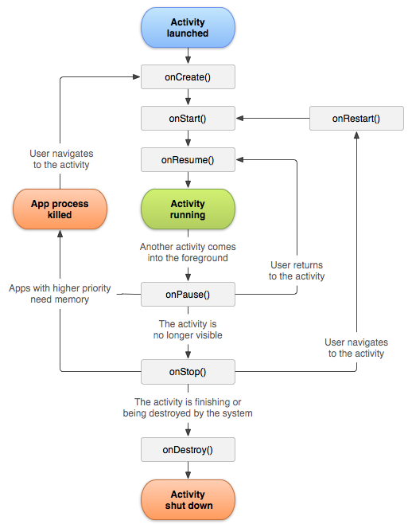
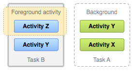

## Activity Lifecycle

Các Activities trong hệ thống được quản lý dưới dạng Activities stacks. Khi một hoạt động mới được bắt đầu, nó thường được đặt ở trên cùng của stack hiện tại và trở thành hoạt động đang chạy -- Activity trước đó luôn ở bên dưới nó trong ngăn xếp và sẽ không xuất hiện trở lại nền trước cho đến khi Activity mới thoát ra. Có thể có một hoặc nhiều stacks hoạt động hiển thị trên màn hình.

Một hoạt động về cơ bản có bốn trạng thái:

- If an activity is in the foreground of the screen (ở vị trí cao nhất của ngăn xếp trên cùng), NÓ ĐANG TRONG TRẠNG THÁI _active_ or _running_. thì Activity đó đang hoạt động hoặc đang chạy. Đây thường là Activity mà người dùng hiện đang tương tác

- Nếu một hoạt động bị mất focus nhưng nó vẫn hiển thị với người dùng.NÓ ĐANG TRONG TRẠNG THÁI VISIBLE. Có thể nó sẽ không hiển thị đầy đủ hoặc transparent activity đã focus trên activity,activity khác  có vị trí cao hơn trong chế độ multi-window, hoặc bản thân activity  không thể focus được trong chế độ windowing hiện tại. Such activity is completely alive (it maintains all state and member information and remains attached to the window manager).

- Nếu một Activity bị che khuất hoàn toàn bởi một Activity khác, Activity ĐANG TRONG TRẠNG THÁI STOP HOẶC HIDDEN. Nó vẫn giữ lại tất cả thông tin trạng thái và thành viên, tuy nhiên, nó không còn hiển thị cho người dùng nên cửa sổ của nó bị ẩn và nó thường bị hệ thống giết khi cần bộ nhớ ở nơi khác.

- Hệ thống có thể loại bỏ Activity khỏi bộ nhớ bằng cách yêu cầu nó kết thúc hoặc đơn giản là giết quá trình của nó, làm cho nó bị hủy (NÓ ĐÃ BỊ DESTROY). Khi nó được hiển thị lại cho người dùng, nó phải được khởi động lại hoàn toàn và khôi phục về trạng thái trước đó.



There are three key loops you may be interested in monitoring within your activity:

- The **entire lifetime** of an activity happens between the first call to `onCreate()` through to a single final call to `onDestroy()`

- The **visible lifetime** of an activity happens between a call to `onStart()` until a corresponding call to `onStop()`.Trong thời gian này, người dùng có thể nhìn thấy hoạt động trên màn hình, mặc dù hoạt động đó có thể không ở fo và tương tác với người dùng.

- The **foreground lifetime** of an activity happens between a call to `onResume()` until a corresponding call to `onPause()`
  
  | Method                                                                                                                                        | Description                                                                                                                                                                                                                                                                                                                                                                       | Killable ?             | Next    |
  | --------------------------------------------------------------------------------------------------------------------------------------------- | --------------------------------------------------------------------------------------------------------------------------------------------------------------------------------------------------------------------------------------------------------------------------------------------------------------------------------------------------------------------------------- | ---------------------- | ------- |
  | onCreate()                                                                                                                                    | Called when the activity is first created. This is where you should do all of your normal static set up: create views, bind data to lists, etc. This method also provides you with a Bundle containing the activity's previously frozen state, if there was one.                                                                                                                  |                        |         |
  | <br/>Always followed by onStart().                                                                                                            | No                                                                                                                                                                                                                                                                                                                                                                                | onStart()              |         |
  | onRestart()                                                                                                                                   | Called after your activity has been stopped, prior to it being started again.                                                                                                                                                                                                                                                                                                     |                        |         |
  | <br/>Always followed by onStart()                                                                                                             | No                                                                                                                                                                                                                                                                                                                                                                                | onStart()              |         |
  | onStart()                                                                                                                                     | Called when the activity is becoming visible to the user.                                                                                                                                                                                                                                                                                                                         |                        |         |
  | <br/>Followed by onResume() if the activity comes to the foreground, or onStop() if it becomes hidden.                                        | No                                                                                                                                                                                                                                                                                                                                                                                | onResume() or onStop() |         |
  | onResume()                                                                                                                                    | Called when the activity will start interacting with the user. At this point your activity is at the top of its activity stack, with user input going to it.                                                                                                                                                                                                                      |                        |         |
  | <br/>Always followed by onPause().                                                                                                            | No                                                                                                                                                                                                                                                                                                                                                                                | onPause()              |         |
  | onPause()                                                                                                                                     | Called when the activity loses foreground state, is no longer focusable or before transition to stopped/hidden or destroyed state. The activity is still visible to user, so it's recommended to keep it visually active and continue updating the UI. Implementations of this method must be very quick because the next activity will not be resumed until this method returns. |                        |         |
  | <br/>Followed by either onResume() if the activity returns back to the front, or onStop() if it becomes invisible to the user.                | Pre-Build.VERSION_CODES.HONEYCOMB                                                                                                                                                                                                                                                                                                                                                 | onResume() or          |         |
  | <br/>onStop()                                                                                                                                 |                                                                                                                                                                                                                                                                                                                                                                                   |                        |         |
  | onStop()                                                                                                                                      | Called when the activity is no longer visible to the user. This may happen either because a new activity is being started on top, an existing one is being brought in front of this one, or this one is being destroyed. This is typically used to stop animations and refreshing the UI, etc.                                                                                    |                        |         |
  | <br/>Followed by either onRestart() if this activity is coming back to interact with the user, or onDestroy() if this activity is going away. | Yes                                                                                                                                                                                                                                                                                                                                                                               | onRestart() or         |         |
  | <br/>onDestroy()                                                                                                                              |                                                                                                                                                                                                                                                                                                                                                                                   |                        |         |
  | onDestroy()                                                                                                                                   | The final call you receive before your activity is destroyed. This can happen either because the activity is finishing (someone called Activity#finish on it), or because the system is temporarily destroying this instance of the activity to save space. You can distinguish between these two scenarios with the isFinishing() method.                                        | Yes                    | nothing |

## Tasks and the back stack

Task là tập hợp các Activity mà người dùng tương tác khi cố gắng thực hiện điều gì đó trong ứng dụng của bạn. Các hoạt động này được sắp xếp trong một stack --the back stack—theo thứ tự mà mỗi hoạt động được mở. Ví dụ: ứng dụng email có thể có một hoạt động để hiển thị danh sách thư mới. Khi người dùng chọn một tin nhắn, một hoạt động mới sẽ mở ra để xem tin nhắn đó. Hoạt động mới này được thêm vào back stack. Sau đó, nếu người dùng nhấn hoặc cử chỉ Quay lại, hoạt động mới đó sẽ kết thúc và bật ra khỏi stack.
Lifecycle of a task and its back stack

## Lifecycle of a task and its back stack

Màn hình Home của thiết bị là nơi bắt đầu cho hầu hết các Task. Khi người dùng chạm vào biểu tượng cho một ứng dụng hoặc lối tắt trong trình khởi chạy ứng dụng (hoặc trên màn hình home), task của ứng dụng đó được đưa lên foregound. Nếu không có task nào tồn tại cho ứng dụng đó (ứng dụng không được sử dụng gần đây), thì một task mới sẽ được tạo ra và mainActivity chính cho ứng dụng đó sẽ mở ra như là hoạt động gốc trên ngăn xếp.


Khi Activity hiện tại bắt đầu Activity khác, Activity mới được đẩy lên trên cùng của stack và lấy focus. Activity trước đó vẫn còn trong stack, nhưng bị dừng.

 Khi một Activity stop, hệ thống sẽ giữ lại trạng thái hiện tại của giao diện người dùng.

 Khi người dùng thực hiện hành động quay lại, Activity hiện tại sẽ được bật lên từ top of stack (hoạt động bị hủy) và hoạt động trước đó tiếp tục lại (trạng thái trước đó của giao diện người dùng được khôi phục). Các hoạt động trong ngăn xếp không bao giờ được sắp xếp lại, chỉ được đẩy và bật ra khỏi ngăn xếp—được đẩy vào ngăn xếp khi bắt đầu bởi hoạt động hiện tại và bật ra khi người dùng rời khỏi ngăn xếp bằng cách sử dụng nút Quay lại hoặc cử chỉ. Như vậy, ngăn xếp phía sau hoạt động như một cấu trúc last in - first out. Hình 1 trực quan hóa hành vi này với một dòng thời gian hiển thị tiến trình giữa các hoạt động cùng với ngăn xếp hiện tại tại mỗi thời điểm.

Nếu người dùng tiếp tục nhấn hoặc cử chỉ Quay lại, thì mỗi Activity trong stack sẽ được bật ra để hiển thị Activity trước đó cho đến khi người dùng quay lại Màn hình Home (hoặc bất kỳ Activity nào đang chạy khi tác vụ bắt đầu). Khi tất cả các Activity được loại bỏ khỏi stack,Task không còn tồn tại.

### Back press behavior for root launcher activities

Root launcher activities là activities khai báo Intent filter với cả ACTION_MAIN và CATEGORY_LAUNCHER. Các Activities này là duy nhất vì chúng hoạt động như các điểm truy cập vào ứng dụng của bạn từ trình khởi chạy ứng dụng và được sử dụng để bắt đầu một Task    .


Khi người dùng nhấn hoặc cử chỉ Quay lại từ Root launcher activity, hệ thống sẽ xử lý sự kiện khác nhau tùy thuộc vào phiên bản Android mà thiết bị đang chạy.


System behavior on Android 11 and lower

    The system finishes the activity.


System behavior on Android 12 and higher

    Hệ thống di chuyển Activity và Task của nó sang nền thay vì kết thúc hoạt động. Hành vi này khớp với hành vi mặc định của hệ thống khi điều hướng ra khỏi ứng dụng bằng nút Home hoặc cử chỉ.


Trong hầu hết các trường hợp, hành vi này có nghĩa là người dùng có thể nhanh chóng tiếp tục ứng dụng của bạn từ trạng [warm state](https://developer.android.com/topic/performance/vitals/launch-time#warm) thay vì phải khởi động lại hoàn toàn ứng dụng từ trạng thái [cold state](https://developer.android.com/topic/performance/vitals/launch-time#cold).

If you need to [provide custom back navigation](https://developer.android.com/guide/navigation/navigation-custom-back), we recommend using the AndroidX Activity APIs, rather than overriding `onBackPressed()`. The AndroidX Activity APIs automatically defer to the appropriate system behavior if there are no components intercepting the system Back press.

Tuy nhiên, nếu ứng dụng của bạn ghi đè onBackPressed() để xử lý điều hướng Quay lại và kết thúc Activity, hãy cập nhật triển khai của bạn để gọi đến super.onBackPressed() thay vì Finish. Việc gọi super.onBackPressed() sẽ di chuyển Activity và Task của nó sang nền khi thích hợp và cung cấp trải nghiệm điều hướng nhất quán hơn cho người dùng trên các ứng dụng.

### Background and foreground tasks

Task là một đơn vị gắn kết có thể di chuyển xuống background khi người dùng bắt đầu một Task mới hoặc chuyển đến Màn hình Home. Trong khi ở chế độ background, tất cả các Activity trong Task đều bị dừng, nhưng back stack của Task vẫn còn nguyên—Task chỉ đơn giản là mất focus trong khi một Task khác diễn ra, như thể hiện trong hình. Sau đó, một Task có thể trở lại foreground để người dùng có thể tiếp tục từ nơi họ đã dừng lại.



### Multiple activity instances

Vì các activity trong ngăn xếp phía sau không bao giờ được sắp xếp lại, nên nếu ứng dụng của bạn cho phép người dùng bắt đầu một activity cụ thể từ nhiều activity, thì một phiên bản mới của activity đó sẽ được tạo và đẩy lên stack (thay vì đưa bất kỳ phiên bản activity nào trước đó vào về đầu trang).

 Như vậy, một activity trong ứng dụng của bạn có thể được khởi tạo nhiều lần (thậm chí từ các Task khác nhau), như thể hiện trong hình 3. Nếu người dùng điều hướng ngược lại bằng cách sử dụng nút hoặc cử chỉ Quay lại, thì mỗi phiên bản của activity sẽ được hiển thị theo thứ tự chúng xuất hiện. đã mở (mỗi cái có trạng thái giao diện người dùng riêng). Tuy nhiên, bạn có thể sửa đổi hành vi này nếu bạn không muốn một hoạt động được khởi tạo nhiều lần. Làm thế nào để làm như vậy được thảo luận trong phần sau về quản lý nhiệm vụ.

### Defining launch modes

Các chế độ khởi chạy cho phép bạn xác định cách một phiên bản mới của một Activity được liên kết với tác vụ hiện tại. Bạn có thể xác định các chế độ khởi chạy khác nhau theo hai cách:

* #### Define launch modes using the manifest file
  
  Khi khai báo một Activity trong tệp Manifest của mình, bạn có thể chỉ định cách Activity sẽ liên kết với một Task bằng cách sử dụng thuộc tính launchMode của phần tử <activity>.
  Thuộc tính `launchMode` chỉ định một hướng dẫn về cách Activity sẽ được khởi chạy trong một Task. Có năm chế độ khởi chạy khác nhau mà bạn có thể gán cho thuộc tính launchMode:
  `"standard"` (the default mode)
          Mặc định. Hệ thống tạo một Instances mới của Activity trong nhiệm vụ mà nó được bắt đầu và định tuyến ý định tới nó. Activity có thể được khởi tạo nhiều lần, mỗi phiên bản có thể thuộc về các Task khác nhau và một Task có thể có nhiều Instances.
  `"singleTop"`
          Nếu một instance của activity đã tồn tại ở top of task hiện tại, thì hệ thống sẽ định tuyến Intent đến phiên bản đó thông qua lệnh gọi phương thức onNewIntent() của nó, thay vì tạo một instance mới của activity. Activity có thể được khởi tạo nhiều lần, mỗi instance có thể thuộc về các Task khác nhau và một Task có thể có nhiều Instance (nhưng chỉ khi Instance ở đầu back stack không phải là instance hiện có của hoạt động).
  
  

      Ví dụ: giả sử back stack của một Task bao gồm root Activity A với các activity B, C và D ở trên cùng (stack là A-B-C-D; D ở trên cùng). Một Intent đến cho một Activity thuộc loại D. Nếu D có chế độ khởi chạy "standard" mặc định, một phiên bản mới của lớp sẽ được khởi chạy và ngăn xếp trở thành A-B-C-D-D. Tuy nhiên, nếu chế độ khởi chạy của D là "singleTop", Instance hiện tại của D sẽ nhận được Intent thông qua onNewIntent(), bởi vì nó ở trên cùng của ngăn xếp—ngăn xếp vẫn là A-B-C-D. Tuy nhiên, nếu một ý định đến cho một activity thuộc loại B, thì một Instance mới của B sẽ được thêm vào ngăn xếp, ngay cả khi chế độ khởi chạy của nó là "singleTop"


       `"singleTask"`


        Hệ thống tạo Activity ở root của một Task mới hoặc định vị Activity trên một Task  hiện có với cùng mối quan hệ. Nếu một phiên bản của hoạt động đã tồn tại, hệ thống sẽ định tuyến Intent đến Instance hiện có thông qua một cuộc gọi đến phương thức onNewIntent() của nó, thay vì tạo một phiên bản mới. Trong khi đó tất cả các activity khác on top đều bị phá hủy.

        **Note:** Although the activity starts in a new task, the Back button and gesture still return the user to the previous activity.

`"singleInstance"`.

    Tương tự như "singleTask", ngoại trừ việc hệ thống không khởi chạy bất kỳ activity nào khác vào Task đang nắm giữ Instance.Activity luôn là thành viên duy nhất và duy nhất trong Task của nó; bất kỳ activity nào được bắt đầu bởi activity này sẽ mở trong một Task riêng biệt.

`"singleInstancePerTask".`

         Activity chỉ có thể chạy như Activity gốc của task, tức là Activity đầu tiên tạo ra task, do đó chỉ có một Instance của Activity này trong một task. Khác với chế độ khởi chạy "singleTask", Activity này có thể được bắt đầu trong nhiều Instance khác nhau trong các task khác nhau nếu cờ FLAG_ACTIVITY_MULTIPLE_TASK hoặc FLAG_ACTIVITY_NEW_DOCUMENT được thiết lập.


**Note:** `"singleTask"` and `"singleInstancePerTask"` will remove all activities which are above the starting activity from the task. For example, suppose a task consists of root activity A with activities B, C (the task is A-B-C; C is on top). An intent arrives for an activity of type A. If A's launch mode is `"singleTask"` or `"singleInstancePerTask"`, the existing instance of A receives the intent through [`onNewIntent()`](https://developer.android.com/reference/android/app/Activity#onNewIntent(android.content.Intent)). B and C are finished, and the task is now A.

* #### Define launch modes using Intent flags

When starting an activity, you can modify the default association of an activity to its task by including flags in the intent that you deliver to [`startActivity()`](https://developer.android.com/reference/android/app/Activity#startActivity(android.content.Intent)). The flags you can use to modify the default behavior are:


[`FLAG_ACTIVITY_NEW_TASK`](https://developer.android.com/reference/android/content/Intent#FLAG_ACTIVITY_NEW_TASK)

        Start the activity in a new task. If a task is already running for the activity you are now starting, that task is brought to the foreground with its last state restored and the activity receives the new intent in [`onNewIntent()`](https://developer.android.com/reference/android/app/Activity#onNewIntent(android.content.Intent)).

This produces the same behavior as the `"singleTask"` [`launchMode`](https://developer.android.com/guide/topics/manifest/activity-element#lmode) value, discussed in the previous section.


[`FLAG_ACTIVITY_SINGLE_TOP`](https://developer.android.com/reference/android/content/Intent#FLAG_ACTIVITY_SINGLE_TOP)

        If the activity being started is the current activity (at the top of the back stack), then the existing instance receives a call to [`onNewIntent()`](https://developer.android.com/reference/android/app/Activity#onNewIntent(android.content.Intent)), instead of creating a new instance of the activity.

This produces the same behavior as the `"singleTop"` [`launchMode`](https://developer.android.com/guide/topics/manifest/activity-element#lmode) value, discussed in the previous section.

    

[`FLAG_ACTIVITY_CLEAR_TOP`](https://developer.android.com/reference/android/content/Intent#FLAG_ACTIVITY_CLEAR_TOP)

        If the activity being started is already running in the current task, then instead of launching a new instance of that activity, all of the other activities on top of it are destroyed and this intent is delivered to the resumed instance of the activity (now on top), through [`onNewIntent()`](https://developer.android.com/reference/android/app/Activity#onNewIntent(android.content.%0AIntent))).

There is no value for the [`launchMode`](https://developer.android.com/guide/topics/manifest/activity-element#lmode) attribute that produces this behavior.

### Clear the back stack

If the user leaves a task for a long time, the system clears the task of all activities except the root activity. When the user returns to the task again, only the root activity is restored. The system behaves this way, because, after an extended amount of time, users likely have abandoned what they were doing before and are returning to the task to begin something new.

There are some activity attributes that you can use to modify this behavior:

[`alwaysRetainTaskState`](https://developer.android.com/guide/topics/manifest/activity-element#always)

    If this attribute is set to `"true"` in the root activity of a task, the default behavior just described does not happen. The task retains all activities in its stack even after a long period.

[`clearTaskOnLaunch`](https://developer.android.com/guide/topics/manifest/activity-element#clear)

    If this attribute is set to `"true"` in the root activity of a task, the task is cleared down to the root activity whenever the user leaves the task and returns to it. In other words, it's the opposite of [`alwaysRetainTaskState`](https://developer.android.com/guide/topics/manifest/activity-element#always). The user always returns to the task in its initial state, even after leaving the task for only a moment.

**Note:** This attribute is ignored if [`FLAG_ACTIVITY_RESET_TASK_IF_NEEDED`](https://developer.android.com/reference/android/content/Intent#FLAG_ACTIVITY_RESET_TASK_IF_NEEDED) isn't set.

[`finishOnTaskLaunch`](https://developer.android.com/guide/topics/manifest/activity-element#finish)

    This attribute is like [`clearTaskOnLaunch`](https://developer.android.com/guide/topics/manifest/activity-element#clear), but it operates on a single activity, not an entire task. It can also cause any activity to finish, except for the root activity. When it's set to `"true"`, the activity remains part of the task only for the current session. If the user leaves and then returns to the task, it is no longer present.

**Note:** This attribute is ignored if [`FLAG_ACTIVITY_RESET_TASK_IF_NEEDED`](https://developer.android.com/reference/android/content/Intent#FLAG_ACTIVITY_RESET_TASK_IF_NEEDED) isn't set.


Trong Android, có ba cách để clear back stack:

1. Sử dụng Intent FlagBạn có thể sử dụng Intent Flag để xóa toàn bộ stack và khởi tạo lại Activity mới. Điều này có thể được thực hiện bằng cách thêm Intent Flag `FLAG_ACTIVITY_CLEAR_TASK` và `FLAG_ACTIVITY_NEW_TASK` vào Intent khi bắt đầu Activity mới. Điều này sẽ xóa tất cả các Activity trên đường dẫn của Activity mới và bắt đầu lại với Activity mới.

Ví dụ:

```kotlin
val intent = Intent(this, MainActivity::class.java) 
intent.flags = Intent.FLAG_ACTIVITY_CLEAR_TASK or Intent.FLAG_ACTIVITY_NEW_TASK
 startActivity(intent)
```


2. Sử dụng phương thức finishAffinity()Bạn có thể sử dụng phương thức `finishAffinity()` để kết thúc tất cả các Activity hiện tại và xóa stack. Điều này sẽ đưa người dùng trở lại màn hình Home hoặc màn hình khởi động của ứng dụng.

Ví dụ:

    `finishAffinity()`

3. Sử dụng phương thức finish()Bạn có thể sử dụng phương thức `finish()` để kết thúc Activity hiện tại và quay trở lại Activity trước đó trên stack. Bạn có thể sử dụng phương thức này để kết thúc các Activity được chọn hoặc tránh chúng khỏi bị lưu trữ trong stack.

Ví dụ:

    `finish()`
