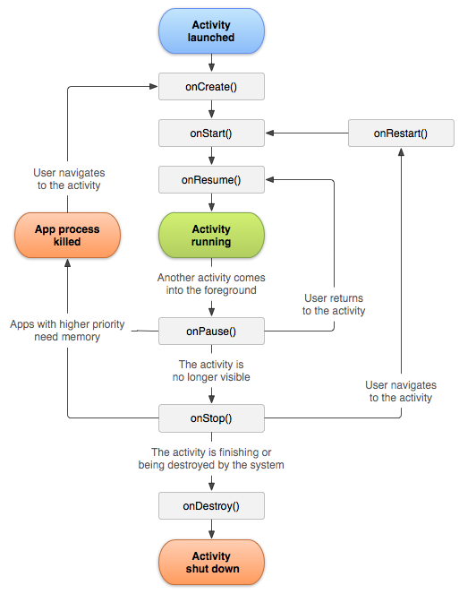
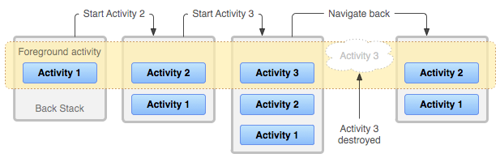
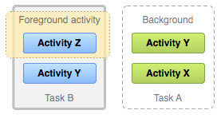

# Activity

An Activity is an independent and reusable component that interacts with the user by providing user interface-related resources. Every Android application must have at least one activity to enter the application and interact with the user.


## Activity Lifecycle

Activities in the system are managed as activity stacks. When a new activity is started, it is usually placed on the top of the current stack and becomes the running activity, the previous activity always remains below it in the stack, and will not come to the foreground again until the new activity exits. There can be one or multiple activity stacks visible on screen.

An activity has essentially four states:

- If an activity is in the foreground of the screen (at the highest position of the topmost stack), it is **ACTIVE (also called RUNNING)**. This is usually the activity that the user is currently interacting with.
- If an activity has lost focus but is still presented to the user, it is **VISIBLE**. It is possible if a new non-full-sized or transparent activity has focus on top of your activity, another activity has higher position in multi-window mode, or the activity itself is not focusable in current windowing mode. Such activity is completely alive (it maintains all state and member information and remains attached to the window manager).
- If an activity is completely obscured by another activity, it is **STOPPED (also called HIDDEN)**. It still retains all state and member information, however, it is no longer visible to the user so its window is hidden and it will often be killed by the system when memory is needed elsewhere.
- The system can drop the activity from memory by either asking it to finish, or simply killing its process, making it **DESTROYED**. When it is displayed again to the user, it must be completely restarted and restored to its previous state.



There are three key loops you may be interested in monitoring within your activity:

- The **entire lifetime** of an activity happens between the first call to `onCreate()` through to a single final call to `onDestroy()`

- The **visible lifetime** of an activity happens between a call to `onStart()` until a corresponding call to `onStop()`. During this time the user can see the activity on-screen, though it may not be in the foreground and interacting with the user.

- The **foreground lifetime** of an activity happens between a call to `onResume()` until a corresponding call to `onPause()`
  
  | Method                                                                                                                                        | Description                                                                                                                                                                                                                                                                                                                                                                       | Killable ?             | Next    |
  | --------------------------------------------------------------------------------------------------------------------------------------------- | --------------------------------------------------------------------------------------------------------------------------------------------------------------------------------------------------------------------------------------------------------------------------------------------------------------------------------------------------------------------------------- | ---------------------- | ------- |
  | onCreate()                                                                                                                                    |  the Activity becomes visible and ready to interact with the user. The application stays in this state until something interrupts it: a phone call, the screen turning off, user switching to another activity and so on. You can use this method to resume everything that should only work when the Activity is visible. If it's interrupted, the `onPause()` method is called.                                                                                               |                        |         |
  | <br/>Always followed by onStart().                                                                                                            | No                                                                                                                                                                                                                                                                                                                                                                                | onStart()              |         |
  | onRestart()                                                                                                                                   | Called after your activity has been stopped, prior to it being started again.                                                                                                                                                                                                                                                                                                     |                        |         |
  | <br/>Always followed by onStart()                                                                                                             | No                                                                                                                                                                                                                                                                                                                                                                                | onStart()              |         |
  | onStart()                                                                                                                                     | Called when the activity is becoming visible to the user.                                                                                                                                                                                                                                                                                                                         |                        |         |
  | <br/>Followed by onResume() if the activity comes to the foreground, or onStop() if it becomes hidden.                                        | No                                                                                                                                                                                                                                                                                                                                                                                | onResume() or onStop() |         |
  | onResume()                                                                                                                                    | Called when the activity will start interacting with the user. At this point your activity is at the top of its activity stack, with user input going to it.                                                                                                                                                                                                                      |                        |         |
  | <br/>Always followed by onPause().                                                                                                            | No                                                                                                                                                                                                                                                                                                                                                                                | onPause()              |         |
  | onPause()                                                                                                                                     | Called when the activity loses foreground state, is no longer focusable or before transition to stopped/hidden or destroyed state. The activity is still visible to user, so it's recommended to keep it visually active and continue updating the UI. Implementations of this method must be very quick because the next activity will not be resumed until this method returns. |                        |         |
  | <br/>Followed by either onResume() if the activity returns back to the front, or onStop() if it becomes invisible to the user.                | Pre-Build.VERSION_CODES.HONEYCOMB                                                                                                                                                                                                                                                                                                                                                 | onResume() or          |         |
  | <br/>onStop()                                                                                                                                 |                                                                                                                                                                                                                                                                                                                                                                                   |                        |         |
  | onStop()                                                                                                                                      | Called when the activity is no longer visible to the user. This may happen either because a new activity is being started on top, an existing one is being brought in front of this one, or this one is being destroyed. This is typically used to stop animations and refreshing the UI, etc.                                                                                    |                        |         |
  | <br/>Followed by either onRestart() if this activity is coming back to interact with the user, or onDestroy() if this activity is going away. | Yes                                                                                                                                                                                                                                                                                                                                                                               | onRestart() or         |         |
  | <br/>onDestroy()                                                                                                                              |                                                                                                                                                                                                                                                                                                                                                                                   |                        |         |
  | onDestroy()                                                                                                                                   | The final call you receive before your activity is destroyed. This can happen either because the activity is finishing (someone called Activity#finish on it), or because the system is temporarily destroying this instance of the activity to save space. You can distinguish between these two scenarios with the isFinishing() method.                                        | Yes                    | nothing |

## Tasks and the back stack

A Task is a collection of Activities that users interact with when trying to accomplish something in your application. These activities are arranged in a the back stack in the order that each activity is opened. For example, an email application might have an activity to display a list of new messages. When the user selects a message, a new activity opens to view that message. This new activity is added to the back stack. Then, if the user presses or gestures Back, the new activity is finished and popped off the stack.

## Lifecycle of a task and its back stack

The Home screen of the device is the starting point for most Tasks. When a user touches an icon for an application or shortcut in the app launcher (or on the home screen), that application's task is brought to the foreground. If no task exists for the application (the app hasn't been used recently), then a new task is created and the main activity of that application opens as the root activity on the stack.


When the current Activity starts another Activity, the new Activity is pushed to the top of the stack and takes focus. The previous Activity remains in the stack, but is stopped.
When an Activity stops, the system retains the current state of its user interface.
When the user performs a back action, the current Activity is popped from the top of the stack (the activity is destroyed) and the previous activity resumes (the previous state of its user interface is restored). 

Activities in the stack are never rearranged, only pushed and popped from the stack—pushed onto the stack when started by the current activity and popped off when the user leaves it by using the Back button or gesture. Thus, the back stack operates as a **last in, first out** object structure. Figure below visualizes this behavior with a timeline showing the progress between activities along with the current back stack at each point in time.



If the user continues to press or gesture Back, then each Activity in the stack is popped off to reveal the previous Activity until the user returns to the Home screen (or to whichever Activity was running when the task began). When all Activities are removed from the stack, the Task no longer exists.


### Back press behavior for root launcher activities

Root launcher activities are activities that declare an Intent filter with both `ACTION_MAIN` and `CATEGORY_LAUNCHER`. These activities are unique because they act as entry points into your application from the app launcher and are used to start a Task.

When the user presses or gestures Back from a root launcher activity, the system handles the event differently depending on which version of Android the device is running.

System behavior on Android 11 and lower:
- The system finishes the activity.
System behavior on Android 12 and higher:
- The system moves the activity and its task to the background instead of finishing the activity. This behavior matches the system's default behavior when navigating out of the app using the Home button or gesture.


In most cases, this behavior means that users can quickly resume your application from a [warm state](https://developer.android.com/topic/performance/vitals/launch-time#warm) instead of having to completely restart the application from a [cold state](https://developer.android.com/topic/performance/vitals/launch-time#cold).

If you need to [provide custom back navigation](https://developer.android.com/guide/navigation/navigation-custom-back), we recommend using the AndroidX Activity APIs, rather than overriding **onBackPressed()**. The AndroidX Activity APIs automatically defer to the appropriate system behavior if there are no components intercepting the system Back press.
However, if your application overrides onBackPressed() to handle Back navigation and finish the Activity, update your implementation to call super.onBackPressed() instead of finish(). Calling super.onBackPressed() will move the Activity and its Task to the background when appropriate and provide a more consistent navigation experience for users across applications.

### Background and foreground tasks

A Task is a cohesive unit that can move to the background when the user starts a new Task or goes to the Home Screen. While in the background, all the Activities in the Task are stopped, but the Task's back stack remains intact—the Task has simply lost focus while another Task takes place, as illustrated in the figure. Then, the Task can return to the foreground so users can pick up where they left off.



### Multiple activity instances

Since activities in the background stack are never reordered, if your application allows users to start a specific activity from multiple activities, a new instance of that activity will be created and pushed onto the stack (instead of bringing any previous instance of the activity to the foreground).

Thus, an activity in your application can be initialized multiple times (even from different tasks), as shown in Figure below. If the user navigates back using the back button or gesture, each instance of the activity will be displayed in the order they were opened (each with its own user interface state). However, you can modify this behavior if you do not want an activity to be initialized multiple times. How to do this is discussed in the following section on task management.


### Defining launch modes

Launch modes allow you to specify how a new instance of an Activity is associated with the current task. You can define different launch modes in two ways:

* #### Define launch modes using the manifest file
  
When declaring an Activity in your Manifest file, you can specify how the Activity will be associated with a Task using the `launchMode` attribute of the `<activity>` element.

The `launchMode` attribute specifies a guideline for how the Activity will be launched within a Task. There are five different launch modes that you can assign to the `launchMode` attribute:

`standard` (the default mode) Default. The system creates a new instance of the Activity in the task where it is started and routes the intent to it. The Activity can be initialized multiple times, with each instance potentially belonging to different Tasks, and a Task can have multiple instances.

`singleTop` If an instance of the Activity already exists at the top of the current task, the system will route the Intent to that instance by calling its `onNewIntent()` method, rather than creating a new instance of the Activity. The Activity can be initialized multiple times, with each instance potentially belonging to different Tasks, and a Task can have multiple instances (but only if the instance at the top of the back stack is not the existing instance of the Activity).
  
  
<details>
  <summary>
  For example
  </summary>
  suppose the back stack of a Task includes root Activity A with activities B, C, and D on top (the stack is A-B-C-D, with D on top). An Intent is sent to an Activity of type D. If D has the default standard launch mode, a new instance of D will be launched, and the stack will become A-B-C-D-D. However, if D's launch mode is singleTop, the current instance of D will receive the Intent through onNewIntent() because it is on top of the stack—the stack remains A-B-C-D. However, if an Intent is sent to an Activity of type B, a new instance of B will be added to the stack, even if its launch mode is singleTop.
</details>


`singleTask` The system creates the Activity as the root of a new Task or positions the Activity in an existing Task with the same affinity. If an instance of the Activity already exists, the system routes the Intent to the existing instance through a call to its `onNewIntent()` method, rather than creating a new instance. Meanwhile, all other activities on top are destroyed.

> [!NOTE]
> Although the activity starts in a new task, the Back button and gesture still return the user to the previous activity.

`singleInstance`. Similar to `singleTask`, except that the system does not launch any other activities into the Task holding the instance. The Activity is always the sole and exclusive member of its Task; any activity started by this Activity will open in a separate Task.

`singleInstancePerTask`. The Activity can only run as the root activity of a task, meaning it is the first Activity to create the task, so there can only be one instance of this Activity in a task. Unlike the `singleTask` launch mode, this Activity can be started in multiple instances across different tasks if the flags `FLAG_ACTIVITY_MULTIPLE_TASK` or `FLAG_ACTIVITY_NEW_DOCUMENT` are set.


> [!NOTE]
> singleTask and singleInstancePerTask will remove all activities which are above the starting activity from the task. For example, suppose a task consists of root activity A with activities B, C (the task is A-B-C; C is on top). An intent arrives for an activity of type A. If A's launch mode is singleTask or singleInstancePerTask, the existing instance of A receives the intent through onNewIntent(). B and C are finished, and the task is now A.

#### Define launch modes using Intent flags

When starting an activity, you can modify the default association of an activity to its task by including flags in the intent that you deliver to [startActivity()](https://developer.android.com/reference/android/app/Activity#startActivity(android.content.Intent)). The flags you can use to modify the default behavior are:


[FLAG_ACTIVITY_NEW_TASK](https://developer.android.com/reference/android/content/Intent#FLAG_ACTIVITY_NEW_TASK)

        Start the activity in a new task. If a task is already running for the activity you are now starting, that task is brought to the foreground with its last state restored and the activity receives the new intent in [onNewIntent()](https://developer.android.com/reference/android/app/Activity#onNewIntent(android.content.Intent)).

This produces the same behavior as the `singleTask` [launchMode](https://developer.android.com/guide/topics/manifest/activity-element#lmode) value, discussed in the previous section.


[FLAG_ACTIVITY_SINGLE_TOP](https://developer.android.com/reference/android/content/Intent#FLAG_ACTIVITY_SINGLE_TOP)

        If the activity being started is the current activity (at the top of the back stack), then the existing instance receives a call to [onNewIntent()](https://developer.android.com/reference/android/app/Activity#onNewIntent), instead of creating a new instance of the activity.

This produces the same behavior as the `singleTop` [launchMode](https://developer.android.com/guide/topics/manifest/activity-element#lmode) value, discussed in the previous section.

    

[FLAG_ACTIVITY_CLEAR_TOP](https://developer.android.com/reference/android/content/Intent#FLAG_ACTIVITY_CLEAR_TOP)

        If the activity being started is already running in the current task, then instead of launching a new instance of that activity, all of the other activities on top of it are destroyed and this intent is delivered to the resumed instance of the activity (now on top), through [onNewIntent()](https://developer.android.com/reference/android/app/Activity#onNewIntent(android.content.%0AIntent))).

There is no value for the [launchMode](https://developer.android.com/guide/topics/manifest/activity-element#lmode) attribute that produces this behavior.

### Clear the back stack

If the user leaves a task for a long time, the system clears the task of all activities except the root activity. When the user returns to the task again, only the root activity is restored. The system behaves this way, because, after an extended amount of time, users likely have abandoned what they were doing before and are returning to the task to begin something new.

There are some activity attributes that you can use to modify this behavior:

[alwaysRetainTaskState](https://developer.android.com/guide/topics/manifest/activity-element#always)

    If this attribute is set to `true` in the root activity of a task, the default behavior just described does not happen. The task retains all activities in its stack even after a long period.

[clearTaskOnLaunch](https://developer.android.com/guide/topics/manifest/activity-element#clear)

    If this attribute is set to `true` in the root activity of a task, the task is cleared down to the root activity whenever the user leaves the task and returns to it. In other words, it's the opposite of [alwaysRetainTaskState](https://developer.android.com/guide/topics/manifest/activity-element#always). The user always returns to the task in its initial state, even after leaving the task for only a moment.

> [!NOTE]
> This attribute is ignored if FLAG_ACTIVITY_RESET_TASK_IF_NEEDED isn't set.

[finishOnTaskLaunch](https://developer.android.com/guide/topics/manifest/activity-element#finish)

    This attribute is like [clearTaskOnLaunch](https://developer.android.com/guide/topics/manifest/activity-element#clear), but it operates on a single activity, not an entire task. It can also cause any activity to finish, except for the root activity. When it's set to `true`, the activity remains part of the task only for the current session. If the user leaves and then returns to the task, it is no longer present.

> [!NOTE]
> This attribute is ignored if FLAG_ACTIVITY_RESET_TASK_IF_NEEDED isn't set.


In Android, there are three ways to clear the back stack:

- **Using Intent Flags**. You can use Intent Flags to clear the entire stack and start a new Activity. This can be done by adding the Intent Flags `FLAG_ACTIVITY_CLEAR_TASK` and `FLAG_ACTIVITY_NEW_TASK` to the Intent when starting a new Activity. This will clear all Activities in the path of the new Activity and start fresh with the new Activity.

For example:

```kotlin
val intent = Intent(this, MainActivity::class.java) 
intent.flags = Intent.FLAG_ACTIVITY_CLEAR_TASK or Intent.FLAG_ACTIVITY_NEW_TASK
 startActivity(intent)
```


- **Using the finishAffinity() Method**. You can use the `finishAffinity()` method to terminate all current Activities and clear the stack. This will return the user to the Home screen or the application's launch screen.

For example

    `finishAffinity()`

- **Using the finish() Method**. You can use the finish() method to terminate the current Activity and return to the previous Activity on the stack. This method can be used to end selected Activities or prevent them from being stored in the stack.

For example:

    `finish()`
