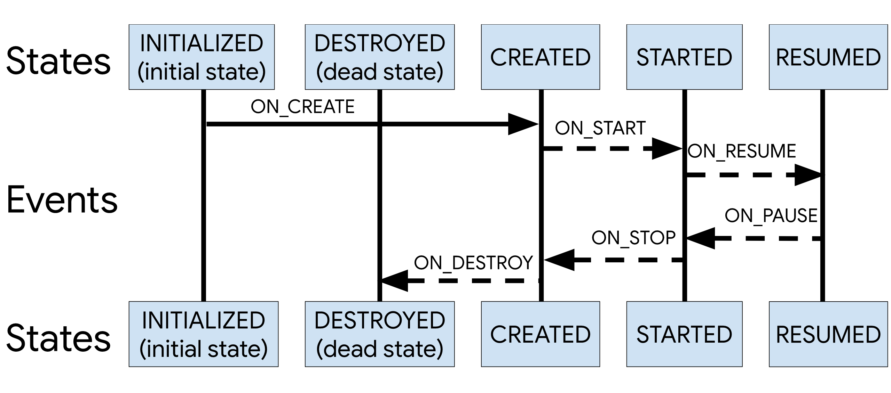

# Service

A `[Service]` is an application component that can perform long-running operations in the background. It does not provide a user interface. Once started, a service might continue running for some time, even after the user switches to another application. Additionally, a component can bind to a service to interact with it and even perform interprocess communication (IPC). For example, a service can handle network transactions, play music, perform file I/O, or interact with a content provider, all from the background.
Types of Services

-----------------


## Foreground Service

        A foreground service performs some operation that is noticeable to the user. For example, an audio app would use a foreground service to play an audio track. Foreground services must display a Notification. Foreground services continue running even when the user isn't interacting with the app.

       When you use a foreground service, you must display a notification so that users are actively aware that the service is running. This notification cannot be dismissed unless the service is either stopped or removed from the foreground.

        


        The WorkManager API cung cấp một cách linh hoạt để lập lịch công việc và có thể chạy các công việc như là các foreground services nếu cần. Trong nhiều trường hợp, sử dụng WorkManager là tốt hơn so với sử dụng foreground services trực tiếp. Tuy nhiên, cần lưu ý rằng việc sử dụng foreground service trong một số trường hợp vẫn cần thiết, như khi ứng dụng cần chạy các tác vụ đòi hỏi tính liên tục và độ trễ thấp.

## Background Service

   Dịch vụ nền thực hiện một thao tác mà người dùng không trực tiếp nhận thấy. Ví dụ: nếu một ứng dụng đã sử dụng một dịch vụ để thu gọn bộ nhớ, thì đó thường là một dịch vụ nền.

    Lưu ý: Nếu ứng dụng của bạn dành cho API level 26 hoặc cao hơn, hệ thống áp đặt các hạn chế về việc chạy các dịch vụ nền khi ứng dụng không ở trạng thái hiện tại trên màn hình. Trong hầu hết các trường hợp, bạn không nên truy cập thông tin vị trí từ phía nền. Thay vào đó, hãy lên lịch các tác vụ sử dụng WorkManager.

## Bound Service

    A service is _bound_ when an application component binds to it by calling `bindService()`. A bound service offers a client-server interface that allows components to interact with the service, send requests, receive results, and even do so across processes with interprocess communication (IPC). A bound service runs only as long as another application component is bound to it. Multiple components can bind to the service at once, but when all of them unbind, the service is destroyed.


Khi một Activity bind với một Bound Service, thì việc kết nối này chỉ được duy trì khi Activity đó còn tồn tại. Nếu Activity bị destroy, thì hệ thống sẽ gọi phương thức `onUnbind()` và sau đó sẽ destroy Service nếu không có component nào khác đang bind tới nó. Do đó, khi Activity bị destroy, kết nối giữa nó và Bound Service cũng sẽ bị đóng lại.

## Choosing between a service and a thread

    A service is simply a component that can run in the background, even when the user is not interacting with your application.

    If you must perform work outside of your main thread, but only while the user is interacting with your application, you should instead create a new thread in the context of another application component.

For example, if you want to play some music, but only while your activity is running, you might create a thread in `onCreate()`, start running it in `[onStart()]`, and stop it in `[onStop()]`. Also consider using thread pools and executors from the `java.util.concurrent` package  or Kotlin coroutines instead of the traditional `[Thread]` class. See the Threading on Android document for more information about moving execution to background threads.


    Service khác với Thread và coroutine ở chỗ Service là một component của android và có một vòng đời độc lập, còn Thread hay Coroutine đều phải phụ thuộc vào vòng đời của một component nào đó ví dụ Activity.

## The basics

To create a service, you must create a subclass of `[Service]` or use one of its existing subclasses.

In your implementation, you must override some callback methods that handle key aspects of the service lifecycle and provide a mechanism that allows the components to bind to the service, if appropriate. These are the most important callback methods that you should override:

`onStartCommand()`

        The system invokes this method by calling startService() when another component (such as an activity) requests that the service be started. When this method executes, the service is started and can run in the background indefinitely. If you implement this, it is your responsibility to stop the service when its work is complete by calling stopSelf() or stopService(). If you only want to provide binding, you DON'T NEED to implement this method.

Notice that the `[onStartCommand()]` method must return an integer. The integer is a value that describes how the system should continue the service in the event that the system kills it. The return value from `[onStartCommand()]` must be one of the following constants:

`START_NOT_STICKY`

        If the system kills the service after `onStartCommand()` returns, _do not_ recreate the service unless there are pending intents to deliver. This is the safest option to avoid running your service when not necessary and when your application can simply restart any unfinished jobs.

`START_STICKY`

        If the system kills the service after `[onStartCommand()]` returns, recreate the service and call `[onStartCommand()]`, but _do not_ redeliver the last intent. Instead, the system calls `[onStartCommand()]` with a null intent unless there are pending intents to start the service. In that case, those intents are delivered. This is suitable for media players (or similar services) that are not executing commands but are running indefinitely and waiting for a job.

`START_REDELIVER_INTENT`

        If the system kills the service after `[onStartCommand()]` returns, recreate the service and call `[onStartCommand()]` with the last intent that was delivered to the service. Any pending intents are delivered in turn. This is suitable for services that are actively performing a job that should be immediately resumed, such as downloading a file.


  `onBind()`

         The system invokes this method by calling `bindService()`.when another component wants to bind with the service (such as to perform RPC).In your implementation of this method, you must provide an interface that clients use to communicate with the service by returning an IBinder. You MUST ALWAYS implement this method; however, if you don't want to allow binding, you should return null.

`onCreate()`

            The system invokes this method to perform one-time setup procedures when the service is initially created (before it calls either     onStartCommand() or onBind() ) . If the service is already running, this method is not called.

`onDestroy()`

        The system invokes this method when the service is no longer used and is being destroyed. Your service should implement this to clean up any resources such as threads, registered listeners, or receivers. This is the last call that the service receives.


!!**Caution**: To ensure that your app is secure, always use an explicit intent when starting a `[Service]` and don't declare intent filters for your services. Using an implicit intent to start a service is a security hazard because you cannot be certain of the service that responds to the intent, and the user cannot see which service starts. Beginning with Android 5.0 (API level 21), the system throws an exception if you call `[bindService()]` with an implicit intent.


You can ensure that your service is available to only your app by including the [`android:exported`](https://developer.android.com/guide/topics/manifest/service-element#exported) attribute and setting it to `false`. This effectively stops other apps from starting your service, even when using an explicit intent.
Managing the lifecycle of a service
-----------------------------------

    The lifecycle of a service is much simpler than that of an activity. However, it's even more important that you pay close attention to how your service is created and destroyed because a service can run in the background without the user being aware.


The service lifecycle—from when it's created to when it's destroyed—can follow either of these two paths:

* A started service
  The service is created when another component calls `[startService()]`. The service then runs indefinitely and must stop itself by calling `[stopSelf()]`. Another component can also stop the service by calling `[stopService()]`. When the service is stopped, the system destroys it.

* A bound service
  The service is created when another component (a client) calls `[bindService()]`. The client then communicates with the service through an `[IBinder]` interface. The client can close the connection by calling `[unbindService()]`. Multiple clients can bind to the same service and when all of them unbind, the system destroys the service. The service does _not_ need to stop itself.
  
  
  
  

    These two paths aren't entirely separate. You can bind to a service that is already started with `[startService()]`. For example, you can start a background music service by calling `[startService()]` with an `[Intent]` that identifies the music to play. Later, possibly when the user wants to exercise some control over the player or get information about the current song, an activity can bind to the service by calling `[bindService()]`. In cases such as this, `[stopService()]` or `[stopSelf()]` doesn't actually stop the service until all of the clients unbind.

### Implementing the lifecycle callbacks

```kotlin
class ExampleService : Service() {
    private var startMode: Int = 0             // indicates how to behave if the service is killed
    private var binder: IBinder? = null        // interface for clients that bind
    private var allowRebind: Boolean = false   // indicates whether onRebind should be used

    override fun onCreate() {
        // The service is being created
    }

    override fun onStartCommand(intent: Intent?, flags: Int, startId: Int): Int {
        // The service is starting, due to a call to startService()
        return startMode
    }

    override fun onBind(intent: Intent): IBinder? {
        // A client is binding to the service with bindService()
        return binder
    }

    override fun onUnbind(intent: Intent): Boolean {
        // All clients have unbound with unbindService()
        return allowRebind
    }

    override fun onRebind(intent: Intent) {
        // A client is binding to the service with bindService(),
        // after onUnbind() has already been called
    }

    override fun onDestroy() {
        // The service is no longer used and is being destroyed
    }
}
```




