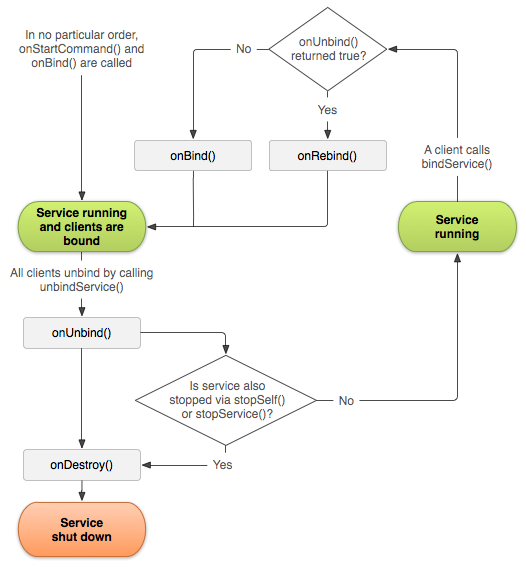

# Background Service

   A background service performs an operation that the user does not directly notice. For example, if an application uses a service to clear memory, it is typically a background service.

> [!NOTE]
> If your application targets API level 26 or higher, the system imposes restrictions on running background services when the application is not currently on the screen. In most cases, you should not access location information from the background. Instead, schedule tasks using WorkManager.

### Started Service and Bound Service

You can create a service that is both started and bound. That is, you can start a service by calling `startService()`, **which lets the service run indefinitely**. You can also let a client bind to the service by calling `bindService()`.

**If you let your service be started and bound**, then when the service starts, **the system doesn't destroy the service when all clients unbind**. Instead, you must explicitly stop the service by calling `stopSelf()` or `stopService()`.

Although you usually implement either `onBind()` or `onStartCommand()`, it's sometimes necessary to implement both. For example, a music player might find it useful to let its service run indefinitely and also provide binding. This way, an activity can start the service to play some music, and the music continues to play even if the user leaves the application. Then, when the user returns to the application, the activity can bind to the service to regain control of playback.

When the last client unbinds from the service, the system destroys the service, unless the service was started using `startService()`.


### Bound Service

    A service is **bound** when an application component binds to it by calling `bindService()`. A bound service offers a client-server interface that allows components to interact with the service, send requests, receive results, and even do so across processes with interprocess communication (IPC). A bound service runs only as long as another application component is bound to it. Multiple components can bind to the service at once, but when all of them unbind, the service is destroyed.

For example: When an `Activity` binds to a bound service, the connection is maintained only as long as the `Activity` exists. If the `Activity` is destroyed, the system will call the `onUnbind()` method and subsequently destroy the service if no other components are still bound to it. **Therefore, when the `Activity` is destroyed, the connection between it and the bound service is also terminated.**

### Create a bound service

The most important part of your bound service implementation is defining the interface that your `onBind()` callback method returns. The following section discusses several ways that you can define your service's `IBinder` interface.

When creating a service that provides binding, you must provide an IBinder that provides the programming interface that clients can use to interact with the service. There are three ways you can define the interface:
- Extend the Binder class
- Use a Messenger
- Use AIDL

#### Extend the Binder class

If your service is private to your own application and runs in the same process as the client, which is common, create your interface by extending the `Binder` class and returning an instance of it from `onBind()`. The client receives the `Binder` and can use it to directly access public methods available in either the `Binder` implementation or the `Service`.
This is the preferred technique when your service is merely a background worker for your own application. The only use case when this is not the preferred way to create your interface is if your service is used by other applications or across separate processes.


Here's how to set it up:

- In your service, create an instance of Binder that does one of the following:
  - Contains public methods that the client can call.
  - Returns the current Service instance, which has public methods the client can call.
  - Returns an instance of another class hosted by the service with public methods the client can call.
- Return this instance of Binder from the `onBind()` callback method.
- In the client, receive the Binder from the `onServiceConnected()` callback method and make calls to the bound service using the methods provided.

For example:

```kotlin
class LocalService : Service() {
    // Binder given to clients.
    private val binder = LocalBinder()

    // Random number generator.
    private val mGenerator = Random()

    /** Method for clients.  */
    val randomNumber: Int
        get() = mGenerator.nextInt(100)

    /**
     * Class used for the client Binder. Because we know this service always
     * runs in the same process as its clients, we don't need to deal with IPC.
     */
    inner class LocalBinder : Binder() {
        // Return this instance of LocalService so clients can call public methods.
        fun getService(): LocalService = this@LocalService
    }

    override fun onBind(intent: Intent): IBinder {
        return binder
    }
}
```

The `LocalBinder` provides the `getService()` method for clients to retrieve the current instance of `LocalService`. This lets clients call public methods in the service. For example, clients can call `getRandomNumber()` from the service.

Here's an activity that binds to `LocalService` and calls `getRandomNumber()` when a button is clicked:

```kotlin

class BindingActivity : Activity() {
    private lateinit var mService: LocalService
    private var mBound: Boolean = false

    /** Defines callbacks for service binding, passed to bindService().  */
    private val connection = object : ServiceConnection {

        override fun onServiceConnected(className: ComponentName, service: IBinder) {
            // We've bound to LocalService, cast the IBinder and get LocalService instance.
            val binder = service as LocalService.LocalBinder
            mService = binder.getService()
            mBound = true
        }

        override fun onServiceDisconnected(arg0: ComponentName) {
            mBound = false
        }
    }

    override fun onCreate(savedInstanceState: Bundle?) {
        super.onCreate(savedInstanceState)
        setContentView(R.layout.main)
    }

    override fun onStart() {
        super.onStart()
        // Bind to LocalService.
        Intent(this, LocalService::class.java).also { intent ->
            bindService(intent, connection, Context.BIND_AUTO_CREATE)
        }
    }

    override fun onStop() {
        super.onStop()
        unbindService(connection)
        mBound = false
    }

    /** Called when a button is clicked (the button in the layout file attaches to
     * this method with the android:onClick attribute).  */
    fun onButtonClick(v: View) {
        if (mBound) {
            // Call a method from the LocalService.
            // However, if this call is something that might hang, then put this request
            // in a separate thread to avoid slowing down the activity performance.
            val num: Int = mService.randomNumber
            Toast.makeText(this, "number: $num", Toast.LENGTH_SHORT).show()
        }
    }
}

```


#### Use a Messenger

If you need your interface to work across different processes, you can create an interface for the service with a `Messenger`. In this manner, the service defines a Handler that responds to different types of Message objects.
This Handler is the basis for a `Messenger` that can then share an `IBinder` with the client, letting the client send commands to the service using `Message` objects. Additionally, the client can define a `Messenger` of its own, so the service can send messages back.

This is the simplest way to perform interprocess communication (IPC) without the need to use AIDL, because the `Messenger` queues all requests into a single thread so that you don't have to design your service to be thread-safe.


Here's a summary of how to use a Messenger:

- The service implements a `Handler` that receives a callback for each call from a client.
- The service uses the Handler to create a `Messenger` object (which is a reference to the `Handler`).
- The `Messenger` creates an `IBinder` that the service returns to clients from `onBind()`.
- Clients use the `IBinder` to instantiate the `Messenger` (that references the service's `Handler`), which the client uses to send Message objects to the service.
- The service receives each Message in its Handler—specifically, in the `handleMessage()` method.

In this way, there are no methods for the client to call on the service. Instead, the client delivers messages (Message objects) that the service receives in its Handler.

For example:

```kotlin
/** Command to the service to display a message.  */
private const val MSG_SAY_HELLO = 1

class MessengerService : Service() {

    /**
     * Target we publish for clients to send messages to IncomingHandler.
     */
    private lateinit var mMessenger: Messenger

    /**
     * Handler of incoming messages from clients.
     */
    internal class IncomingHandler(
            context: Context,
            private val applicationContext: Context = context.applicationContext
    ) : Handler() {
        override fun handleMessage(msg: Message) {
            when (msg.what) {
                MSG_SAY_HELLO ->
                    Toast.makeText(applicationContext, "hello!", Toast.LENGTH_SHORT).show()
                else -> super.handleMessage(msg)
            }
        }
    }

    /**
     * When binding to the service, we return an interface to our messenger
     * for sending messages to the service.
     */
    override fun onBind(intent: Intent): IBinder? {
        Toast.makeText(applicationContext, "binding", Toast.LENGTH_SHORT).show()
        mMessenger = Messenger(IncomingHandler(this))
        return mMessenger.binder
    }
}
```

All that a client needs to do is create a `Messenger` based on the `IBinder` returned by the service and send a message using `send()`. For example, here's an activity that binds to the service and delivers the `MSG_SAY_HELLO` message to the service:


```kotlin
class ActivityMessenger : Activity() {
    /** Messenger for communicating with the service.  */
    private var mService: Messenger? = null

    /** Flag indicating whether we have called bind on the service.  */
    private var bound: Boolean = false

    /**
     * Class for interacting with the main interface of the service.
     */
    private val mConnection = object : ServiceConnection {

        override fun onServiceConnected(className: ComponentName, service: IBinder) {
            // This is called when the connection with the service has been
            // established, giving us the object we can use to
            // interact with the service.  We are communicating with the
            // service using a Messenger, so here we get a client-side
            // representation of that from the raw IBinder object.
            mService = Messenger(service)
            bound = true
        }

        override fun onServiceDisconnected(className: ComponentName) {
            // This is called when the connection with the service has been
            // unexpectedly disconnected&mdash;that is, its process crashed.
            mService = null
            bound = false
        }
    }

    fun sayHello(v: View) {
        if (!bound) return
        // Create and send a message to the service, using a supported 'what' value.
        val msg: Message = Message.obtain(null, MSG_SAY_HELLO, 0, 0)
        try {
            mService?.send(msg)
        } catch (e: RemoteException) {
            e.printStackTrace()
        }

    }

    override fun onCreate(savedInstanceState: Bundle?) {
        super.onCreate(savedInstanceState)
        setContentView(R.layout.main)
    }

    override fun onStart() {
        super.onStart()
        // Bind to the service.
        Intent(this, MessengerService::class.java).also { intent ->
            bindService(intent, mConnection, Context.BIND_AUTO_CREATE)
        }
    }

    override fun onStop() {
        super.onStop()
        // Unbind from the service.
        if (bound) {
            unbindService(mConnection)
            bound = false
        }
    }
}
```

#### Use AIDL

Android Interface Definition Language (AIDL) decomposes objects into primitives that the operating system can understand and marshalls them across processes to perform IPC. The previous technique, using a `Messenger`, is actually based on AIDL as its underlying structure.

As mentioned in the preceding section, the `Messenger` creates a queue of all the client requests in a single thread, so the service receives requests one at a time. If, however, you want your service to handle multiple requests simultaneously, then you can use AIDL directly. In this case, your service must be thread-safe and capable of multithreading.

To use AIDL directly, create an `.aidl` file that defines the programming interface. The Android SDK tools use this file to generate an abstract class that implements the interface and handles IPC, which you can then extend within your service.

> [!NOTE]
> For most applications, AIDL isn't the best choice to create a bound service, because it might require multithreading capabilities and can result in a more complicated implementation. Therefore, this document does not discuss how to use it for your service. 

If you're certain that you need to use AIDL directly, see the [AIDL](https://developer.android.com/guide/components/aidl) document.


### Bind to a service

Application components (clients) can bind to a service by calling `bindService()`. The Android system then calls the service's `onBind()` method, which returns an `IBinder` for interacting with the service.

The binding is asynchronous, and `bindService()` returns immediately without returning the `IBinder` to the client. To receive the `IBinder`, the client must create an instance of `ServiceConnection` and pass it to `bindService()`. The `ServiceConnection` includes a callback method that the system calls to deliver the `IBinder`.

> [!CAUTION]
> Only activities, services, and content providers can bind to a service—you can't bind to a service from a broadcast receiver.

To bind to a service from your client, follow these steps:

- Implement ServiceConnection.
Your implementation **must** override two callback methods:

    - `onServiceConnected()` :  The system calls this to deliver the IBinder returned by the service's onBind() method.
    - `onServiceDisconnected()` :  The Android system calls this when the connection to the service is unexpectedly lost, such as when the service crashes or is killed. This is not called when the client unbinds.
- Call `bindService()`, passing the `ServiceConnection` implementation.

> [!NOTE]
>  If the method returns false, your client does not have a valid connection to the service. However, do call unbindService() in your client. Otherwise, your client keeps the service from shutting down when it is idle. If the service does not support binding, it may return null from its onBind() method. If it does, then the ServiceConnection's onNullBinding() method will be invoked instead of onServiceConnected().

- When the system calls your `onServiceConnected()` callback method, you can begin making calls to the service, using the methods defined by the interface.

- To disconnect from the service, call `unbindService()`.
If your client is still bound to a service when your app destroys the client, destruction causes the client to unbind. It is a better practice to unbind the client as soon as it is done interacting with the service. Doing so lets the idle service shut down.

> [!CAUTION]
> If you use an intent to bind to a Service, make sure your app is secure by using an explicit intent. Using an implicit intent to start a service is a security hazard because you can't be certain what service responds to the intent, and the user can't see which service starts. Beginning with Android 5.0 (API level 21), the system throws an exception if you call bindService() with an implicit intent.

##  Important notes about binding to a service:

- Always trap `DeadObjectException` exceptions, which are thrown when the connection has broken. This is the only exception thrown by remote methods.
- Objects are reference counted across processes.
- You usually pair the binding and unbinding during the matching bring-up and tear-down moments of the client's lifecycle, as described in the following examples:
    - If you need to interact with the service only while your activity is visible, bind during `onStart()` and unbind during `onStop()`.
    - If you want your activity to receive responses even while it is stopped in the background, bind during `onCreate()` and unbind during `onDestroy()`. Beware that this implies that your activity needs to use the service the entire time it's running, even in the background, so when the service is in another process, then you increase the weight of the process and it is more likely to be killed by the system.

> [!NOTE]
> You don't usually bind and unbind during your activity's onResume() and onPause() callbacks, because these callbacks occur at every lifecycle transition. Keep the processing that occurs at these transitions to a minimum.
Also, if multiple activities in your application bind to the same service and there is a transition between two of those activities, the service might be destroyed and recreated as the current activity unbinds (during pause) before the next one binds (during resume).


#### Managing the lifecycle of a bound service

Additionally, if your service is started and accepts binding, then when the system calls your onUnbind() method, you can optionally return true if you want to receive a call to onRebind() the next time a client binds to the service. onRebind() returns void, but the client still receives the `IBinder` in its onServiceConnected() callback.

