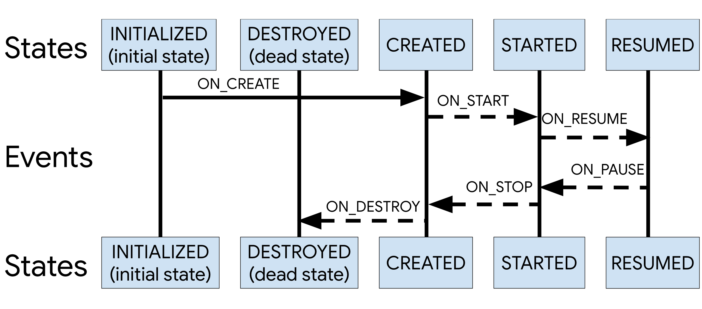

# Service Component

A `Service` is an application component that can perform long-running operations in the background. It does not provide a user interface. Once started, a service might continue running for some time, even after the user switches to another application. Additionally, a component can bind to a service to interact with it and even perform interprocess communication (IPC). For example, a service can handle network transactions, play music, perform file I/O, or interact with a content provider, all from the background.

> [!NOTE]
> The difference between the WorkManager API and a Service lies in their functionality and use cases. WorkManager provides a flexible way to schedule tasks and can run them as foreground services if needed, ensuring execution even when the app is not running. It supports scheduling based on system conditions such as network connectivity or battery status. In contrast, a Service handles long-running or frequent background tasks, like playing music or downloading data, but does not offer the same level of scheduling or system condition management. While WorkManager is often preferable for tasks that require guaranteed execution, a foreground service is still necessary for tasks that demand continuous operation and low latency.


Types of Services
These are the three different types of services:
- Foreground
- Background
- Bound

## The Basics guide to creating and managing Services in Android

To create a service, you must create a subclass of `Service` or use one of its existing subclasses.

In your implementation, you must override some callback methods that handle key aspects of the service lifecycle and provide a mechanism that allows the components to bind to the service, if appropriate. These are the most important callback methods that you should override:

### onStartCommand()

        The system invokes this method by calling `startService()` when another component (such as an activity) requests that the service be started. When this method executes, the service is started and can run in the background indefinitely. If you implement this, it is your responsibility to stop the service when its work is complete by calling `stopSelf()` or `stopService()`. If you only want to provide binding, you DON'T NEED to implement this method.

Notice that the `onStartCommand()` method must return an integer. The integer is a value that describes how the system should continue the service in the event that the system kills it. The return value from `onStartCommand()` must be one of the following constants:

`START_NOT_STICKY`

        If the system kills the service after `onStartCommand()` returns, **DO NOT** recreate the service unless there are pending intents to deliver. This is the safest option to avoid running your service when not necessary and when your application can simply restart any unfinished jobs.

`START_STICKY`

        If the system kills the service after `onStartCommand()` returns, recreate the service and call `onStartCommand()`, but **DO NOT** redeliver the last intent. Instead, the system calls `onStartCommand()` with a null intent unless there are pending intents to start the service. In that case, those intents are delivered. This is suitable for media players (or similar services) that are not executing commands but are running indefinitely and waiting for a job.

`START_REDELIVER_INTENT`

        If the system kills the service after `onStartCommand()` returns, recreate the service and call `onStartCommand()` with the last intent that was delivered to the service. Any pending intents are delivered in turn. This is suitable for services that are actively performing a job that should be immediately resumed, such as downloading a file.


### onBind()

         The system invokes this method by calling `bindService()`.when another component wants to bind with the service (such as to perform RPC).In your implementation of this method, you must provide an interface that clients use to communicate with the service by returning an IBinder. You MUST ALWAYS implement this method; however, if you don't want to allow binding, you should return null.

### onCreate()

            The system invokes this method to perform one-time setup procedures when the service is initially created (before it calls either `onStartCommand()` or `onBind()` ) . If the service is already running, this method is not called.

### onDestroy()

        The system invokes this method when the service is no longer used and is being destroyed. Your service should implement this to clean up any resources such as threads, registered listeners, or receivers. This is the last call that the service receives.


### Declaring a service in the manifest

You must declare all services in your application's manifest file, just as you do for activities and other components.

To declare your service, add a `service` element as a child of the `application` element. Here is an example:


```xml
<manifest ... >
  ...
  <application ... >
      <service android:name=".ExampleService" />
      ...
  </application>
</manifest>
```

> [!CAUTION]
> To ensure that your app is secure, always use an explicit intent when starting a `Service` and don't declare intent filters for your services. Using an implicit intent to start a service is a security hazard because you cannot be certain of the service that responds to the intent, and the user cannot see which service starts. Beginning with Android 5.0 (API level 21), the system throws an exception if you call `bindService()` with an implicit intent.

You can ensure that your service is available to only your app by including the [android:exported](https://developer.android.com/guide/topics/manifest/service-element#exported) attribute and setting it to `false`. This effectively stops other apps from starting your service, even when using an explicit intent.
Managing the lifecycle of a service

### Creating a started service


A started service is one that another component starts by calling `startService()`, which results in a call to the service's `onStartCommand()` method.

When a service is started, it has a lifecycle that's independent of the component that started it. The service can run in the background indefinitely, even if the component that started it is destroyed. As such, the service should stop itself when its job is complete by calling `stopSelf()`, or another component can stop it by calling `stopService()`.

An application component such as an activity can start the service by calling `startService()` and passing an Intent that specifies the service and includes any data for the service to use. The service receives this Intent in the `onStartCommand()` method.

For instance, suppose an activity needs to save some data to an online database. The activity can start a companion service and deliver it the data to save by passing an intent to `startService()`. The service receives the intent in `onStartCommand()`, connects to the Internet, and performs the database transaction. When the transaction is complete, the service stops itself and is destroyed.

> [!CAUTION]
> A service runs in the same process as the application in which it is declared and in the main thread of that application by default. If your service performs intensive or blocking operations while the user interacts with an activity from the same application, the service slows down activity performance. To avoid impacting application performance, start a new thread or using coroutine inside the service.


The Android framework also provides the `IntentService` subclass of `Service` that uses a worker thread to handle all of the start requests, one at a time. Using this class is not recommended for new apps as it will not work well starting with Android 8 Oreo, due to the introduction of [Background execution limits](https://developer.android.com/about/versions/oreo/background#services). Moreover, it's deprecated starting with Android 11. You can use `JobIntentService` as a replacement for IntentService that is compatible with newer versions of Android. But `JobIntentService` has been deprecated too. Because Android Jetpack provide `WorkManager` library, which makes it easy to schedule deferrable, asynchronous tasks that are expected to run even if the app exits or the device restarts.

**The following sections describe how you can implement your own custom service**, however you should strongly consider using `WorkManager` instead for most use cases. Consult the [guide to background processing on Android](https://developer.android.com/guide/background) to see if there is a solution that fits your needs.

#### Implement Custom Service by extend the Service class
You can extend the `Service` class to handle each incoming intent. Here's how a basic implementation might look:

```kotlin
class HelloService : Service() {

    private var serviceLooper: Looper? = null
    private var serviceHandler: ServiceHandler? = null

    // Handler that receives messages from the thread
    private inner class ServiceHandler(looper: Looper) : Handler(looper) {

        override fun handleMessage(msg: Message) {
            // Normally we would do some work here, like download a file.
            // For our sample, we just sleep for 5 seconds.
            try {
                Thread.sleep(5000)
            } catch (e: InterruptedException) {
                // Restore interrupt status.
                Thread.currentThread().interrupt()
            }

            // Stop the service using the startId, so that we don't stop
            // the service in the middle of handling another job
            stopSelf(msg.arg1)
        }
    }

    override fun onCreate() {
        // Start up the thread running the service.  Note that we create a
        // separate thread because the service normally runs in the process's
        // main thread, which we don't want to block.  We also make it
        // background priority so CPU-intensive work will not disrupt our UI.
        HandlerThread("ServiceStartArguments", Process.THREAD_PRIORITY_BACKGROUND).apply {
            start()

            // Get the HandlerThread's Looper and use it for our Handler
            serviceLooper = looper
            serviceHandler = ServiceHandler(looper)
        }
    }

    override fun onStartCommand(intent: Intent, flags: Int, startId: Int): Int {
        Toast.makeText(this, "service starting", Toast.LENGTH_SHORT).show()

        // For each start request, send a message to start a job and deliver the
        // start ID so we know which request we're stopping when we finish the job
        serviceHandler?.obtainMessage()?.also { msg ->
            msg.arg1 = startId
            serviceHandler?.sendMessage(msg)
        }

        // If we get killed, after returning from here, restart
        return START_STICKY
    }

    override fun onBind(intent: Intent): IBinder? {
        // We don't provide binding, so return null
        return null
    }

    override fun onDestroy() {
        Toast.makeText(this, "service done", Toast.LENGTH_SHORT).show()
    }
}
```

### Starting a service

You can start a service from an activity or other application component by passing an `Intent` to `startService()` or `startForegroundService()`. The Android system calls the service's `onStartCommand()` method and passes it the `Intent`, which specifies which service to start.

For example, an activity can start the example service in the previous section (HelloService) using an explicit intent with `startService()`, as shown here:

```kotlin
startService(Intent(this, HelloService::class.java))
```

> [!WARNING]
> Note: If your app targets API level 26 or higher, the system imposes restrictions on using or creating background services unless the app itself is in the foreground. If an app needs to create a foreground service, the app should call startForegroundService(). That method creates a background service, but the method signals to the system that the service will promote itself to the foreground. Once the service has been created, the service must call its startForeground() method within five seconds.

### Stopping a service

**A started service must manage its own lifecycle**. That is, the system doesn't stop or destroy the service unless it must recover system memory and the service continues to run after `onStartCommand()` returns. The service must stop itself by calling `stopSelf()`, or another component can stop it by calling `stopService()`.

Once requested to stop with `stopSelf()` or `stopService()`, the system destroys the service as soon as possible.

## Managing the lifecycle of a service

The service lifecycle—from when it's created to when it's destroyed—can follow either of these two paths:
 - A started service
The service is created when another component calls `startService()`. The service then runs indefinitely and must stop itself by calling `stopSelf()`. Another component can also stop the service by calling `stopService()`. When the service is stopped, the system destroys it.
 - A bound service
The service is created when another component (a client) calls `bindService()`. The client then communicates with the service through an `IBinder` interface. The client can close the connection by calling `unbindService()`. Multiple clients can bind to the same service and **when all of them unbind, the system destroys the service. The service does not need to stop itself.**

    These two paths aren't entirely separate. You can bind to a service that is already started with `startService()`. For example, you can start a background music service by calling `startService()` with an `Intent` that identifies the music to play. Later, possibly when the user wants to exercise some control over the player or get information about the current song, an activity can bind to the service by calling `bindService()`. In cases such as this, `stopService()` or `stopSelf()` doesn't actually stop the service until all of the clients unbind.

### Implementing the lifecycle callbacks

```kotlin
class ExampleService : Service() {
    private var startMode: Int = 0             // indicates how to behave if the service is killed
    private var binder: IBinder? = null        // interface for clients that bind
    private var allowRebind: Boolean = false   // indicates whether onRebind should be used

    override fun onCreate() {
        // The service is being created
    }

    override fun onStartCommand(intent: Intent?, flags: Int, startId: Int): Int {
        // The service is starting, due to a call to startService()
        return startMode
    }

    override fun onBind(intent: Intent): IBinder? {
        // A client is binding to the service with bindService()
        return binder
    }

    override fun onUnbind(intent: Intent): Boolean {
        // All clients have unbound with unbindService()
        return allowRebind
    }

    override fun onRebind(intent: Intent) {
        // A client is binding to the service with bindService(),
        // after onUnbind() has already been called
    }

    override fun onDestroy() {
        // The service is no longer used and is being destroyed
    }
}
```

