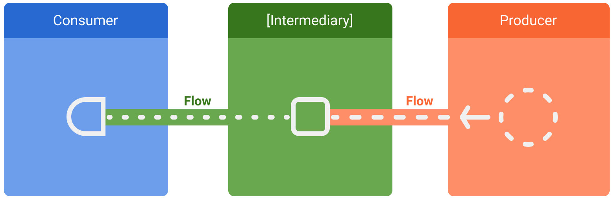

# Kotlin flows on Android

    In coroutines, a _flow_ is a type that can emit multiple values sequentially as opposed to _suspend functions_ that return only a single value. For example, you can use a flow to receive live updates from a database.

There are three entities involved in streams of data:

* A **producer** produces data that is added to the stream. Thanks to coroutines, flows can also produce data asynchronously.
* **(Optional) Intermediaries** can modify each value emitted into the stream or the stream itself.
* A **consumer** consumes the values from the stream.



In Android, a Repository is typically a producer of UI data that has the user interface (UI) as the consumer that ultimately displays the data.

Layers in between the producer and consumer usually act as intermediaries that modify the stream of data to adjust it to the requirements of the following layer.

## Creating a flow

        In the following example, a data source fetches the latest news automatically at a fixed interval. As a suspend function cannot return multiple consecutive values, the data source creates and returns a flow to fulfill this requirement. In this case, the data source acts as the producer.


```kotlin
class NewsRemoteDataSource(
    private val newsApi: NewsApi,
    private val refreshIntervalMs: Long = 5000
) {
    val latestNews: Flow<List<ArticleHeadline>> = flow {
        while(true) {
            val latestNews = newsApi.fetchLatestNews()
            emit(latestNews) // Emits the result of the request to the flow
            delay(refreshIntervalMs) // Suspends the coroutine for some time
        }
    }
}

// Interface that provides a way to make network requests with suspend functions
interface NewsApi {
    suspend fun fetchLatestNews(): List<ArticleHeadline>
}
```

Modifying the stream
--------------------

Người trung gian có thể sử dụng toán tử trung gian để sửa đổi luồng dữ liệu mà không tiêu thụ các giá trị.

```kotlin
class NewsRepository(
    private val newsRemoteDataSource: NewsRemoteDataSource,
    private val userData: UserData
) {
    /**
     * Returns the favorite latest news applying transformations on the flow.
     * These operations are lazy and don't trigger the flow. They just transform
     * the current value emitted by the flow at that point in time.
     */
    val favoriteLatestNews: Flow<List<ArticleHeadline>> =
        newsRemoteDataSource.latestNews
            // Intermediate operation to filter the list of favorite topics
            .map { news -> news.filter { userData.isFavoriteTopic(it) } }
            // Intermediate operation to save the latest news in the cache
            .onEach { news -> saveInCache(news) }
}
```

## Collecting from a flow

    Use a _terminal operator_ to trigger the flow to start listening for values. To get all the values in the stream as they're emitted, use [`collect`](https://kotlinlang.org/api/kotlinx.coroutines/kotlinx-coroutines-core/kotlinx.coroutines.flow/-flow/collect.html).

```kotlin
class LatestNewsViewModel(
    private val newsRepository: NewsRepository
) : ViewModel() {

    init {
        viewModelScope.launch {
            // Trigger the flow and consume its elements using collect
            newsRepository.favoriteLatestNews.collect { favoriteNews ->
                // Update View with the latest favorite news
            }
        }
    }
}
```

Collecting the flow triggers the producer that refreshes the latest news and emits the result of the network request on a fixed interval. As the producer remains always active with the `while(true)` loop, the stream of data will be closed when the ViewModel is cleared and `viewModelScope` is cancelled.

Flow collection can stop for the following reasons:

* The coroutine that collects is cancelled, as shown in the previous example. This also stops the underlying producer.
* The producer finishes emitting items. In this case, the stream of data is closed and the coroutine that called `collect` resumes execution.

## Catching unexpected exceptions

    The implementation of the producer can come from a third party library. This means that it can throw unexpected exceptions. To handle these exceptions, use the [`catch`](https://kotlinlang.org/api/kotlinx.coroutines/kotlinx-coroutines-core/kotlinx.coroutines.flow/catch.html) intermediate operator.

    `catch` can also `emit` items to the flow. The example repository layer could `emit` the cached values instead:

```kotlin
class LatestNewsViewModel(
    private val newsRepository: NewsRepository
) : ViewModel() {

    init {
        viewModelScope.launch {
            newsRepository.favoriteLatestNews
                // Intermediate catch operator. If an exception is thrown,
                // catch and update the UI
                .catch { exception -> notifyError(exception) }
                .collect { favoriteNews ->
                    // Update View with the latest favorite news
                }
        }
    }
}
```

```kotlin
class NewsRepository(...) {
    val favoriteLatestNews: Flow<List<ArticleHeadline>> =
        newsRemoteDataSource.latestNews
            .map { news -> news.filter { userData.isFavoriteTopic(it) } }
            .onEach { news -> saveInCache(news) }
            // If an error happens, emit the last cached values
            .catch { exception -> emit(lastCachedNews()) }
}
```


## Executing in a different CoroutineContext

    **By default, the producer of a `flow` builder executes in the `CoroutineContext` of the coroutine that collects from it it cannot `emit` values from a different `CoroutineContext`.**

    To change the `CoroutineContext` of a flow, use the intermediate operator [`flowOn`](https://kotlinlang.org/api/kotlinx.coroutines/kotlinx-coroutines-core/kotlinx.coroutines.flow/flow-on.html). `flowOn` changes the `CoroutineContext` of the _upstream flow_, meaning the producer and any intermediate operators applied _before (or above)_ `flowOn`.

```kotlin
class NewsRepository(
    private val newsRemoteDataSource: NewsRemoteDataSource,
    private val userData: UserData,
    private val defaultDispatcher: CoroutineDispatcher
) {
    val favoriteLatestNews: Flow<List<ArticleHeadline>> =
        newsRemoteDataSource.latestNews
            .map { news -> // Executes on the default dispatcher
                news.filter { userData.isFavoriteTopic(it) }
            }
            .onEach { news -> // Executes on the default dispatcher
                saveInCache(news)
            }
            // flowOn affects the upstream flow ↑
            .flowOn(defaultDispatcher)
            // the downstream flow ↓ is not affected
            .catch { exception -> // Executes in the consumer's context
                emit(lastCachedNews())
            }
}
```

    With this code, the `onEach` and `map` operators use the `defaultDispatcher`, whereas the `catch` operator and the consumer are executed on `Dispatchers.Main` used by `viewModelScope`.

As the data source layer is doing I/O work, you should use a dispatcher that is optimized for I/O operations:

```kotlin
class NewsRemoteDataSource(
    ...,
    private val ioDispatcher: CoroutineDispatcher
) {
    val latestNews: Flow<List<ArticleHeadline>> = flow {
        // Executes on the IO dispatcher
        ...
    }
        .flowOn(ioDispatcher)
}
```

## Flows in Jetpack libraries

    Flow is integrated into many Jetpack libraries, and it's popular among Android third party libraries. Flow is a great fit for live data updates and endless streams of data.

    You can use [Flow with Room](https://medium.com/androiddevelopers/room-flow-273acffe5b57) to be notified of changes in a database. When using [data access objects (DAO)](https://developer.android.com/training/data-storage/room/accessing-data), return a `Flow` type to get live updates.

```kotlin
@Dao
abstract class ExampleDao {
    @Query("SELECT * FROM Example")
    abstract fun getExamples(): Flow<List<Example>>
}
```

Every time there's a change in the `Example` table, a new list is emitted with the new items in the database.


# StateFlow and SharedFlow

    `StateFlow` and `SharedFlow` are [Flow APIs](https://developer.android.com/kotlin/flow) that enable flows to optimally emit state updates and emit values to multiple consumers.

## StateFlow

    [`StateFlow`](https://kotlin.github.io/kotlinx.coroutines/kotlinx-coroutines-core/kotlinx.coroutines.flow/-state-flow/) is a state-holder observable flow that emits the current and new state updates to its collectors. The current state value can also be read through its [`value`](https://kotlin.github.io/kotlinx.coroutines/kotlinx-coroutines-core/kotlinx.coroutines.flow/-state-flow/value.html) property. To update state and send it to the flow, assign a new value to the `value` property of the [`MutableStateFlow`](https://kotlin.github.io/kotlinx.coroutines/kotlinx-coroutines-core/kotlinx.coroutines.flow/-mutable-state-flow/index.html) class.

In Android, `StateFlow` is a great fit for classes that need to maintain an observable mutable state.

```kotlin
class LatestNewsActivity : AppCompatActivity() {
    private val latestNewsViewModel = // getViewModel()

    override fun onCreate(savedInstanceState: Bundle?) {
        ...
        // Start a coroutine in the lifecycle scope
        lifecycleScope.launch {
            // repeatOnLifecycle launches the block in a new coroutine every time the
            // lifecycle is in the STARTED state (or above) and cancels it when it's STOPPED.
            repeatOnLifecycle(Lifecycle.State.STARTED) {
                // Trigger the flow and start listening for values.
                // Note that this happens when lifecycle is STARTED and stops
                // collecting when the lifecycle is STOPPED
                latestNewsViewModel.uiState.collect { uiState ->
                    // New value received
                    when (uiState) {
                        is LatestNewsUiState.Success -> showFavoriteNews(uiState.news)
                        is LatestNewsUiState.Error -> showError(uiState.exception)
                    }
                }
            }
        }
    }
}
```


## Comparing StateFlow and SharedFlow

StateFlow và SharedFlow đều là các loại Flow trong Android.

    StateFlow là một loại Flow hot, chỉ trả về giá trị mới nhất cho mỗi Subscriber, khi có sự thay đổi giá trị trong StateFlow. Nó giúp quản lý trạng thái của ứng dụng hiệu quả hơn, đặc biệt trong trường hợp chỉ có một Subscriber hoặc khi bạn chỉ quan tâm đến giá trị mới nhất của StateFlow. **StateFlow không thể được chia sẻ với nhiều Subscriber, mà chỉ được sử dụng bởi một Subscriber duy nhất.**


    SharedFlow là một loại Flow hot, cũng giống như StateFlow, **nhưng nó có thể được chia sẻ với nhiều Subscriber. Khi một giá trị mới được phát ra, tất cả Subscriber đang nhận dữ liệu sẽ được thông báo**. Nó cung cấp nhiều tùy chọn cấu hình, giúp bạn kiểm soát cách dữ liệu được phát ra và đồng bộ hóa việc nhận dữ liệu giữa các Subscriber. **SharedFlow phù hợp trong các trường hợp mà nhiều Subscriber cần nhận dữ liệu và bạn muốn đồng bộ hóa dữ liệu giữa các Subscriber.**


Một trong những điểm khác biệt lớn nhất giữa StateFlow và SharedFlow là khi một Subscriber ngưng nhận dữ liệu. **Khi một Subscriber của StateFlow ngưng nhận dữ liệu, StateFlow sẽ không còn phát ra giá trị mới cho Subscriber đó. Trong khi đó, khi một Subscriber của SharedFlow ngưng nhận dữ liệu, SharedFlow vẫn tiếp tục phát ra giá trị mới cho các Subscriber còn lại.**
