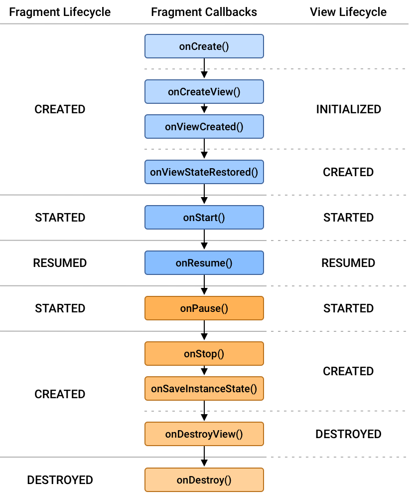
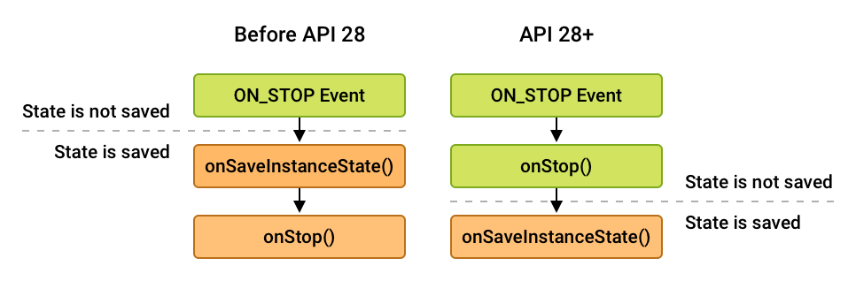
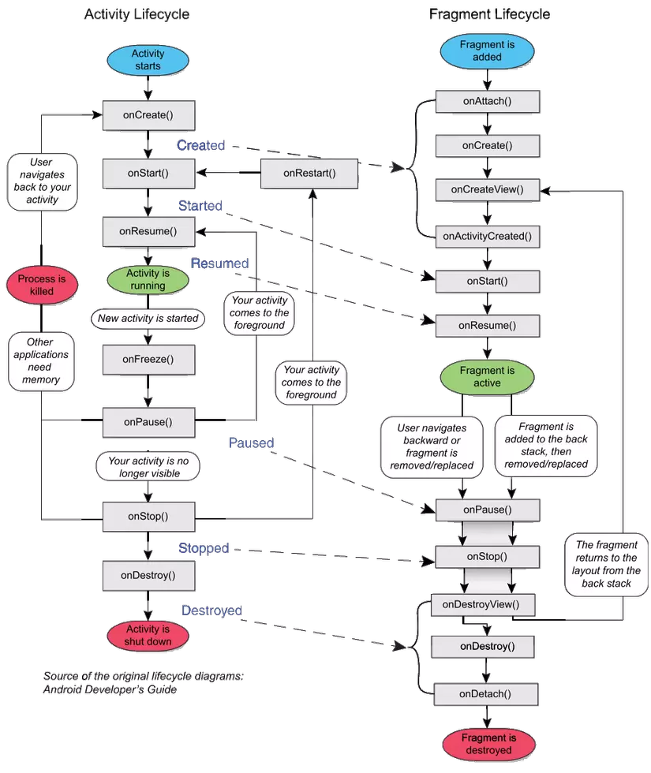

## Fragment

## Fragment manager

    You might never interact with `FragmentManager` directly if you're using the [Jetpack Navigation](https://developer.android.com/guide/navigation) library, as it works with the `FragmentManager` on your behalf. That said, any app using fragments is using `FragmentManager` at some level, so it's important to understand what it is and how it works.

## Access the FragmentManager

**Accessing in an activity**

        Every [`FragmentActivity`](https://developer.android.com/reference/androidx/fragment/app/FragmentActivity) and subclasses thereof, such as [`AppCompatActivity`](https://developer.android.com/reference/androidx/appcompat/app/AppCompatActivity), have access to the `FragmentManager` through the [`getSupportFragmentManager()`](https://developer.android.com/reference/androidx/fragment/app/FragmentActivity#getSupportFragmentManager()) method.

**Accessing in a Fragment**

Fragments are also capable of hosting one or more child fragments. Inside a fragment, you can get a reference to the `FragmentManager` that manages the fragment's children through [`getChildFragmentManager()`](https://developer.android.com/reference/androidx/fragment/app/Fragment#getChildFragmentManager()). If you need to access its host `FragmentManager`, you can use [`getParentFragmentManager()`](https://developer.android.com/reference/androidx/fragment/app/Fragment#getParentFragmentManager()).

## Support multiple back stacks

# Fragment lifecycle

    Each Fragment instance has its own lifecycle. When a user navigates and interacts with your app, your fragments transition through various states in their lifecycle as they are added, removed, and enter or exit the screen.

    To manage lifecycle, `Fragment` implements `LifecycleOwner`, exposing a `Lifecycle` object that you can access through the `getLifecycle()` method.

  Each possible `Lifecycle` state is represented in the [`Lifecycle.State`](https://developer.android.com/reference/androidx/lifecycle/Lifecycle.State) enum.

* [`INITIALIZED`](https://developer.android.com/reference/androidx/lifecycle/Lifecycle.State#INITIALIZED)
* [`CREATED`](https://developer.android.com/reference/androidx/lifecycle/Lifecycle.State#CREATED)
* [`STARTED`](https://developer.android.com/reference/androidx/lifecycle/Lifecycle.State#STARTED)
* [`RESUMED`](https://developer.android.com/reference/androidx/lifecycle/Lifecycle.State#RESUMED)
* [`DESTROYED`](https://developer.android.com/reference/androidx/lifecycle/Lifecycle.State#DESTROYED)

     A fragment's view has a separate `Lifecycle` that is managed independently from that of the fragment's `Lifecycle`.

     Fragments maintain a [`LifecycleOwner`](https://developer.android.com/reference/androidx/lifecycle/LifecycleOwner) for their view, which can be accessed using [`getViewLifecycleOwner()`](https://developer.android.com/reference/androidx/fragment/app/Fragment#getViewLifecycleOwner()) or [`getViewLifecycleOwnerLiveData()`](https://developer.android.com/reference/androidx/fragment/app/Fragment#getViewLifecycleOwnerLiveData()). Having access to the view's `Lifecycle` is useful for situations where a Lifecycle-aware component should only perform work while a fragment's view exists, such as observing [`LiveData`](https://developer.android.com/topic/libraries/architecture/livedata) that is only meant to be displayed on the screen.   

    This topic discusses the `Fragment` lifecycle in detail, explaining some of the rules that determine a fragment's lifecycle state and showing the relationship between the `Lifecycle` states and the fragment lifecycle callbacks.

## Fragments and the fragment manager

    When a fragment is instantiated, it begins in the `INITIALIZED` state. For a fragment to transition through the rest of its lifecycle, it must be added to a `FragmentManager` is responsible for determining what state its fragment should be in and then moving them into that state.

    Beyond the fragment lifecycle, `FragmentManager` is also responsible for attaching fragments to their host activity and detaching them when the fragment is no longer in use.

    The `Fragment` class has two callback methods, `onAttach()` and `onDetach()`, that you can override to perform work when either of these events occur.

    The `onAttach()` callback is invoked when the fragment has been added to a `FragmentManager` and is attached to its host activity. At this point, the fragment is active, and the `FragmentManager` is managing its lifecycle state.

    At this point, `FragmentManager` methods such as `findFragmentById()` return this fragment.

 `onAttach()` is always called before any **Lifecycle state changes**.

    The `onDetach()` callback is invoked when the fragment has been removed from a `FragmentManager` and is detached from its host activity. The fragment is no longer active and can no longer be retrieved using [`findFragmentById()`](https://developer.android.com/reference/androidx/fragment/app/FragmentManager#findFragmentById(int)).

`onDetach()` is always called before any **Lifecycle state changes**.

## Fragment lifecycle states and callbacks

                As a fragment progresses through its lifecycle, it moves upward and downward through its states. For example, a fragment that is added to the top of the back stack moves upward from `CREATED` to `STARTED` to `RESUMED`. Conversely, when a fragment is popped off of the back stack, it moves downward through those states, going from `RESUMED` to `STARTED` to `CREATED` and finally `DESTROYED`.

### Upward state transitions

    When moving upward through its lifecycle states, a fragment first calls the associated lifecycle callback for its new state. Once this callback is finished, the relevant [`Lifecycle.Event`](https://developer.android.com/reference/androidx/lifecycle/Lifecycle.Event) is emitted to observers by the fragment's `Lifecycle`

## Fragment CREATED

        When your fragment reaches the `CREATED` state, it has been added to a `FragmentManager` and the `onAttach()` method has already been called.

        Note that the fragment's view has _not_ been created at this time, and any state associated with the fragment's view should be restored only after the view has been created.

## Fragment CREATED and View INITIALIZED

    The fragment's view `Lifecycle` is created only when your `Fragment` provides a valid `View` instance. In most cases, you can use the fragment constructors that take a `@LayoutId`, which automatically inflates the view at the appropriate time. You can also override `onCreateView()` to programmatically inflate or create your fragment's view.

    If and only if your fragment's view is instantiated with a non-null `View`, that `View` is set on the fragment and can be retrieved using [`getView()`](https://developer.android.com/reference/androidx/fragment/app/Fragment#getView()). The [`getViewLifecycleOwnerLiveData()`](https://developer.android.com/reference/androidx/fragment/app/Fragment#getViewLifecycleOwnerLiveData()) is then updated with the newly `INITIALIZED` [`LifecycleOwner`](https://developer.android.com/reference/androidx/lifecycle/LifecycleOwner) corresponding with the fragment's view. The [`onViewCreated()`](https://developer.android.com/reference/androidx/fragment/app/Fragment#onViewCreated(android.view.View,%20android.os.Bundle)) lifecycle callback is also called at this time.

    This is the appropriate place to set up the initial state of your view, to start observing [`LiveData`](https://developer.android.com/topic/libraries/architecture/livedata) instances whose callbacks update the fragment's view, and to set up adapters on any [`RecyclerView`](https://developer.android.com/reference/androidx/recyclerview/widget/RecyclerView) or [`ViewPager2`](https://developer.android.com/reference/androidx/viewpager2/widget/ViewPager2) instances in your fragment's view.

VN : ý trên nghĩa là sau khi onCreate chạy xong thì Lifecycle của view mới được init nghĩa là lúc này LifecycleOwner mới được khởi tạo tương ứng với View

## Fragment and View CREATED

After the fragment's view has been created, the previous view state, if any, is restored, and the view's `Lifecycle` is then moved into the `CREATED` state.  state. The view lifecycle owner also emits the [`ON_CREATE`](https://developer.android.com/reference/androidx/lifecycle/Lifecycle.Event#ON_CREATE) event to its observers. Here you should restore any additional state associated with the fragment's view.

## Fragment and View STARTED

It is strongly recommended to tie [Lifecycle-aware components](https://developer.android.com/topic/libraries/architecture/lifecycle) to the `STARTED` state of a fragment, as this state guarantees that the fragment's view is available, if one was created, and that it is safe to perform a `FragmentTransaction` on the child `FragmentManager` of the fragment. If the fragment's view is non-null, the fragment's view `Lifecycle` is moved to `STARTED` immediately after the fragment's `Lifecycle` is moved to `STARTED`.

When the fragment becomes `STARTED`, the [`onStart()`](https://developer.android.com/reference/androidx/fragment/app/Fragment#onStart()) callback is invoked.

## Fragment and View RESUMED

    When the fragment is visible, all [`Animator`](https://developer.android.com/reference/android/animation/Animator) and [`Transition`](https://developer.android.com/reference/androidx/transition/Transition) effects have finished, and the fragment is ready for user interaction. The fragment's `Lifecycle` moves to the `RESUMED` state, and the [`onResume()`](https://developer.android.com/reference/androidx/fragment/app/Fragment#onResume()) callback is invoked.

    The transition to `RESUMED` is the appropriate signal to indicate that the user is now able to interact with your fragment.

    Fragments that are not `RESUMED` should not manually set focus on their views or attempt to handle input method visibility.

## Downward state transitions

        When a fragment moves downward to a lower lifecycle state, the relevant [`Lifecycle.Event`](https://developer.android.com/reference/androidx/lifecycle/Lifecycle.Event) is emitted to observers by the fragment's view `Lifecycle`, if instantiated, followed by the fragment's `Lifecycle`. After a fragment's lifecycle event is emitted, the fragment calls the associated lifecycle callback.

## Fragment and View STARTED

        As the user begins to leave the fragment, and while the fragment is still visible, the `Lifecycle`s for the fragment and for its view are moved back to the `STARTED` state and emit the [`ON_PAUSE`](https://developer.android.com/reference/androidx/lifecycle/Lifecycle.Event#ON_PAUSE) event to their observers. The fragment then invokes its [`onPause()`](https://developer.android.com/reference/androidx/fragment/app/Fragment#onPause()) callback.

## Fragment and View CREATED

        Once the fragment is no longer visible, the `Lifecycle`s for the fragment and for its view are moved into the `CREATED` state and emit the [`ON_STOP`](https://developer.android.com/reference/androidx/lifecycle/Lifecycle.Event#ON_STOP) event to their observers. This state transition is triggered not only by the parent activity or fragment being stopped, but also by the saving of state by the parent activity or fragment

    This behavior guarantees that the `ON_STOP` event is invoked before the fragment's state is saved. This makes the `ON_STOP` event the last point where it is safe to perform a `FragmentTransaction` on the child `FragmentManager`.

     the ordering of the [`onStop()`](https://developer.android.com/reference/androidx/fragment/app/Fragment#onStop()) callback and the saving of the state with `onSaveInstanceState()` differs based on API level. For all API levels prior to API 28, `onSaveInstanceState()` is invoked before [`onStop()`](https://developer.android.com/reference/androidx/fragment/app/Fragment#onStop()). For API levels 28 and higher, the calling order is reversed.

## Fragment CREATED and View DESTROYED

    After all of the exit [animations and transitions](https://developer.android.com/training/basics/fragments/animate) have completed, and the fragment's view has been detached from the window, the fragment's view `Lifecycle` is moved into the `DESTROYED` state and emits the [`ON_DESTROY`](https://developer.android.com/reference/androidx/lifecycle/Lifecycle.Event#ON_DESTROY) event to its observers. The fragment then invokes its [`onDestroyView()`](https://developer.android.com/reference/androidx/fragment/app/Fragment#onDestroyView()) callback. At this point, the fragment's view has reached the end of its lifecycle and [`getViewLifecycleOwnerLiveData()`](https://developer.android.com/reference/androidx/fragment/app/Fragment#getViewLifecycleOwnerLiveData()) returns a `null` value.

    At this point, all references to the fragment's view should be removed, allowing the fragment's view to be garbage collected

#### Fragment DESTROYED

    If the fragment is removed, or if the `FragmentManager` is destroyed, the fragment's `Lifecycle` is moved into the `DESTROYED` state and sends the [`ON_DESTROY`](https://developer.android.com/reference/androidx/lifecycle/Lifecycle.Event#ON_DESTROY) event to its observers. The fragment then invokes its [`onDestroy()`](https://developer.android.com/reference/androidx/fragment/app/Fragment#onDestroy()) callback. At this point, the fragment has reached the end of its lifecycle.

## So sánh vòng đời của fragment và activity

