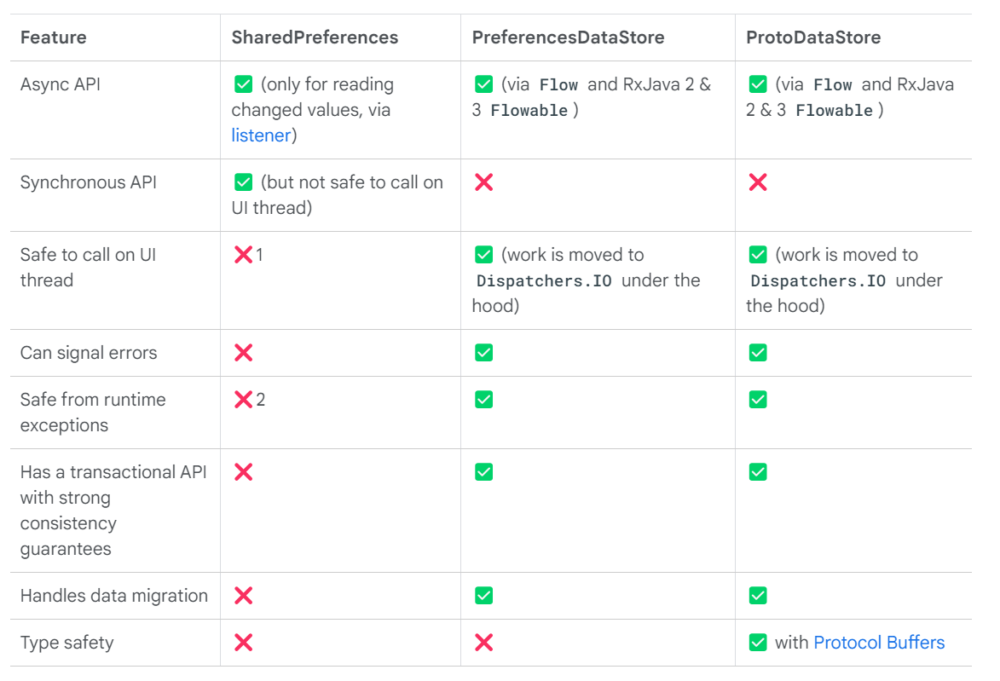

# DataStore

DataSource là thư viện lưu trữ cho phép bạn lưu trữ các cặp khóa-giá trị nhẹ trong bộ nhớ cục bộ. DataSource hoạt động với Coroutines và Flow để lưu trữ dữ liệu không đồng bộ và cũng hỗ trợ RxJava. Bạn có thể xem xét thay thế SharePreferences bằng DataSoure để lưu trữ các cặp khóa-giá trị.

Lưu ý: Nếu bạn cần hỗ trợ các tập dữ liệu lớn hoặc phức tạp, cập nhật một phần hoặc tính toàn vẹn tham chiếu, hãy cân nhắc sử dụng Room thay vì DataStore. DataStore lý tưởng cho các tập dữ liệu nhỏ, đơn giản và không hỗ trợ cập nhật một phần hoặc tính toàn vẹn tham chiếu.

## Preferences DataStore and Proto DataStore

1. Preferences DataStore:

- Là một API hiện đại, thân thiện với coroutine để lưu trữ cặp khóa-giá trị đơn giản một cách không đồng bộ.
- Thay thế cho SharedPreferences cũ, cung cấp sự an toàn về kiểu dữ liệu và hỗ trợ coroutine Kotlin.
- Phù hợp để lưu trữ ít dữ liệu đơn giản, như các tùy chọn người dùng, cài đặt, và cấu hình ứng dụng.
- Sử dụng Flow API của Kotlin để lấy và cập nhật dữ liệu không đồng bộ.
2. Proto DataStore:

- Là một phần mở rộng của Preferences DataStore thêm khả năng lưu trữ các loại dữ liệu phức tạp sử dụng Protocol Buffers (protobuf).
- Protocol Buffers là một cơ chế độc lập với nền tảng, ngôn ngữ để serialize dữ liệu cấu trúc.
- Cho phép định nghĩa cấu trúc dữ liệu tùy chỉnh bằng Protocol Buffers và lưu trữ chúng một cách an toàn theo kiểu.
- Phù hợp để lưu trữ các cấu trúc dữ liệu phức tạp, như hồ sơ người dùng, trạng thái ứng dụng, hoặc bất kỳ dữ liệu cấu trúc nào cần nhiều hơn chỉ là các cặp khóa-giá trị đơn giản.

## Sử dụng DataStore đúng cách

Để sử dụng DataStore đúng cách hãy luôn ghi nhớ những quy tắc sau:

1. Never create more than one instance of DataStore for a given file in the same process. Doing so can break all DataStore functionality. If there are multiple DataStores active for a given file in the same process, DataStore will throw IllegalStateException when reading or updating data.

2. The generic type of the DataStore must be immutable. Mutating a type used in DataStore invalidates any guarantees that DataStore provides and creates potentially serious, hard-to-catch bugs. It is strongly recommended that you use protocol buffers which provide immutability guarantees, a simple API and efficient serialization.

3. Never mix usages of SingleProcessDataStore and MultiProcessDataStore for the same file. If you intend to access the DataStore from more than one process always use MultiProcessDataStore.

## So sánh DataStore và SharePreference

