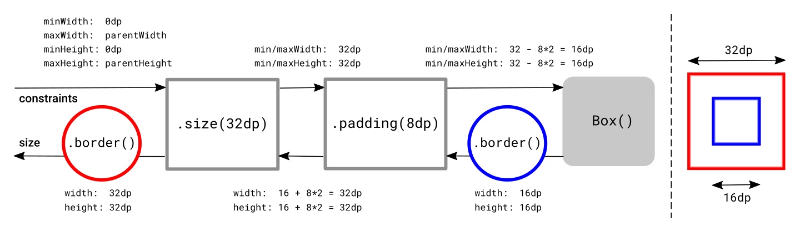
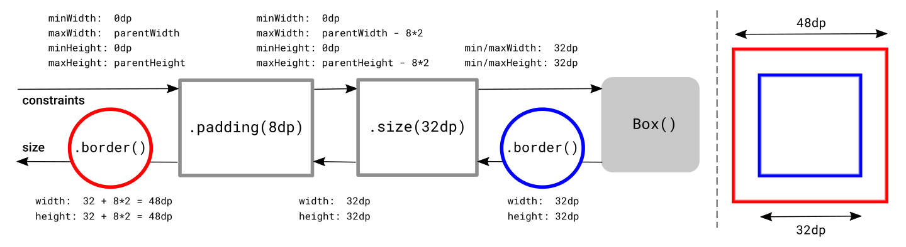

# Modifier
## Definition
Modifier can change the appearance and behavior of a composable. It can be used to apply a style, add padding ...

They allow you to decorate and augment composable molding them the way you need them to be and 
enabling them to do what you need them to do by chaining as many modifiers as you like you can change the composable size
layout behavior and appearance, additional information like accessibility label or interaction behavior.

## Modifier interact with the compose phases

## Modifier order & constraints

There’s [Layouts in Jetpack Compose](https://developer.android.com/codelabs/jetpack-compose-layouts#8) codelab
containing [Layout modifiers under the hood](https://developer.android.com/codelabs/jetpack-compose-layouts#8)
see "Order matters" section.


> [!TIP]
> order matters when chaining modifiers as they're applied to the composable they modify from earlier to later,
> meaning that the measurement and layout of the modifiers on the left will affect the modifier on the right.
> The final size of the composable depends on all modifiers passed as a parameter.
> First, modifiers will update the constraints from left to right, and then, they return back the size from right to
> left.


To understand it better I'd recommend to figure out how layouts work in Compose. In short, padding() is a LayoutModifer,
it takes in some constraints, measures its child size based on a projection of that constraints and places the child at
some coordinates.

Let’s see an example:

```kotlin
Box(
        modifier = Modifier
                .border(1.dp, Color.Red)
                .size(32.dp)
                .padding(8.dp)
                .border(1.dp, Color.Blue)
)
```

And the result:



But let's swap the .size() and the .padding()

```kotlin
Box(
        modifier = Modifier
                .border(1.dp, Color.Red)
                .padding(8.dp)
                .size(32.dp)
                .border(1.dp, Color.Blue)
)
```

Now we have a different result:



One can expect that the red border should be the closest to the box since it was added first, so the order might seem
reversed,
but such an order has pros too. Let’s take a look at this composable:

```kotlin
@Composable
fun MyFancyButton(modifier: Modifier = Modifier) {
    Text(
            text = "Ok",
            modifier = modifier
                    .clickable(onClick = { /*do something*/ })
                    .background(Color.Blue, RoundedCornerShape(4.dp))
                    .padding(8.dp)
    )
}
```

Just by moving the modifier to the arguments the composable allows its parents to add additional modifiers such as extra
margin.
Because the lastly added modifiers are the closest to the button, the border and the inner padding won’t be affected.