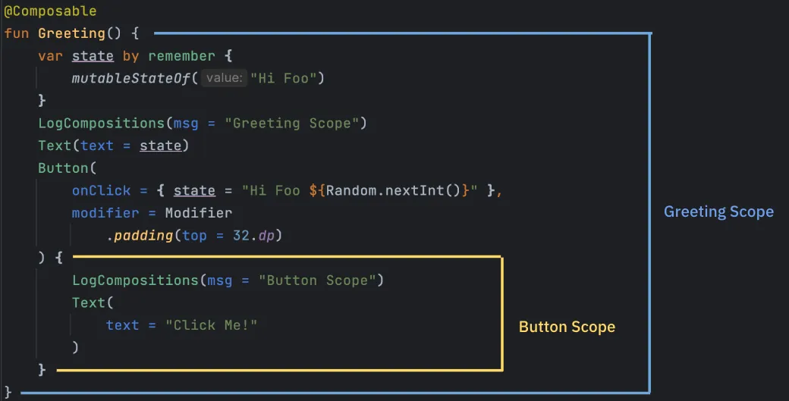

# Recomposition Scope in Jetpack Compose


> [!NOTE]
> Following the Offical Document We have :
> Recomposition is the process of calling your composable functions again when inputs change
> This happens when the function’s inputs change. When Compose recomposes based on new inputs, it only calls the functions or lambdas that might have changed, and skips the rest. By skipping all functions or lambdas that don’t have changed parameters, Compose can recompose efficiently.

Recomposition is inevitable when we build UI with Compose because recomposition is Compose mechanism to update current data state to UI, **but things that we can eliminate is unnecessary recomposition to optimize our Compose code**. By understanding how recomposition work we can ensure that code we write don’t lead to make compose doing unnecessary recomposition repeatedly.

## Recomposition Scope

Recomposition scope is smallest block of code that can be recomposed independently.


It means compose able to find where the state or input read and recompose only the smallest scope of the component without recompose all of them.


Let’s take a look recomposition scope sample below :



**Recomposition scope usually marked by opening and closing function bracket**, In term of hierarchy we see that `Button Scope` is inside `Greeting Scope` as well, but in term of recomposition `Greeting Scope` and `Button Scope `is able to recompose independently, Compose may recompose `Greeting Scope `without recompose `Button Scope` or recompose `Button Scope` without recompose `Greeting Scope` or recompose both of them in one recomposition process.

## To understand how recomposition scope works, let’s doing some experiment.

### 1. Understanding Recomposition Scope
For the following function :

```kotlin
class Ref(var value: Int)

@Composable
inline fun LogCompositions(msg: String) {
    val ref = remember { Ref(0) }
    SideEffect { ref.value++ }
    Log.d("RecompositionLog", "Compositions: $msg ${ref.value}")
}
```


this function will invoke every time recomposition happen and count how many recomposition already invoked.
We need this function inline to ensure this composable function doesn’t have its own recomposition scope. 

Let’s take a look example below, we modify default Greeting screen when we create compose activity on Android Studio to show how recomposition scope works

```kotlin
@Composable
fun Greeting() {
    var state by remember {
        mutableStateOf("Hi Foo")
    }
    LogCompositions(msg = "Greeting Scope")
    Text(text = state)
    Button(
        onClick = { state = "Hi Foo ${Random.nextInt()}" },
        modifier = Modifier
            .padding(top = 32.dp)
    ) {
        LogCompositions(msg = "Button Scope")
        Text(
            text = "Click Me!"
        )
    }
}
```

In this sample, we create one text and one button, whenever button tapped it will update state read by the text. We have two composition scope here, `Greeting Scope` and `Button Scope` . And the result is :

`Greeting Scope` is invoked, but `Button Scope` is not invoked. Why? because state is read on line 7 where this `LogCompositions` is part of `Greeting Scope` . Why `Button Scope` is not invoked? because there is no observable state read by any compose component on `Button Scope`.

Next step we try to moving component that reads state to another scope:

```kotlin
@Composable
fun Greeting() {
    var state by remember {
        mutableStateOf("Hi Foo")
    }
    LogCompositions(msg = "Greeting Scope")
    Text(text = "Hi Foo")
    Button(
        onClick = { state = "Hi Foo ${Random.nextInt()}" },
        modifier = Modifier
            .padding(top = 32.dp)
    ) {
        LogCompositions(msg = "Button Scope")
        Text(
            text = state
        )
    }
}
```

`Button Scope` is invoked because we move component that read state into `Button Scope` . Even though based on hierarchy `Button Scope` is also part of `Greeting Scope` but Compose able to invoke it without invoking its parent scope component. To be more understand about this skipping process you can read more on this article about “Donute Hole Skipping”

### 2. Pay attention to Inline Composable Function

Based on Part 1 example this code will invoke onlyColumn Scope , right? because component that read state on line number 9 is at Column Scope . Let’s find out.

```kotlin
@Composable
fun Greeting() {
    var state by remember {
        mutableStateOf("Hi Foo")
    }
    LogCompositions(msg = "Greeting Scope")
    Column { // We add new component here
        LogCompositions(msg = "Column Scope")
        Text(text = state)
        Button(
            onClick = { state = "Hi Foo ${Random.nextInt()}" },
        ) {
            LogCompositions(msg = "Button Scope")
            Text(
                text = "Click Me"
            )
        }
    }
}
```

Result :

the logCat look like :

```
Composition: Greenting Scope 1
Composition: Column Scope 1
```

Ok, this is not supposed to be happen. `Column Scope` is invoked, but why `Greeting Scope` is also invoked? To answer this question let’s open Column definition


`Column` (and most of container in Compose like `Box`, `Row`, `Constraint Layout`) **is inline function**. We know that when we compile inline function into java code, the function doesn’t really exist, it instructs compiler to bring complete body function to its caller without create new function. It makes inline composable function like `Column` doesn’t have its recomposition scope, it follows its parent scope. That’s why on our sample above `Column Scope` is invoked together with `Greeting Scope` because `Column Scope` doesn’t really exist.

You can read more about inline function on Kotlin official documentation or from this article : [Inline function in kotlin](https://amitshekhar.me/blog/inline-function-in-kotlin)

TL;DR from the article: 

```kotlin
fun simpleFun(){
    print("abc")
    reader()
}


inline fun reader(){
    print("reader")
}
```

when compiled into java:

```java
public void simpleFun(){
    System.out.print("abc")
    System.out.print("reader")
}
```

### 3. Recomposition Scope and Skippable Component

Let’s take a look code below :

```kotlin
@Composable
fun Greeting() {
    var state by remember {
        mutableStateOf("Hi Foo")
    }
    var staticState by remember {
        mutableStateOf("This state never changes")
    }
    LogCompositions(msg = "Greeting Scope")
    Column {
        LogCompositions(msg = "Column Scope")
        Text(text = state)
        Text(text = staticState)
        Button(
            onClick = { state = "Hi Foo ${Random.nextInt()}" },
        ) {
            LogCompositions(msg = "Button Scope")
            Text(
                text = "Click Me"
            )
        }
    }
}
```

The result:

We see that first text and second text is in the same scope, that is `Greeting Scope` . **This Greeting Scope is invoked every time we tap the button, but it only update state variable and there is no update forstatisState**. even though the whole code on `Greeting Scope` is invoked, Compose know that state read by second text is not updated, so Compose simply skip to recompose this component. By skipping unnecessary recompose component make Compose work efficiently.


⮕ Now we know that is no necessary for us to chunk recomposition scope or wrap every component into smaller recomposition scope,  **it is more important for us to ensure every component on our recomposition scope is skippable**, so even if there is a lot of component on single composition scope it doesn’t affect performance because Compose only recompose necessary component and left the rest un-recompose.


## Conclusions

- Compose doing smart recomposition by invoke smallest recomposition scope where the state read
- Instead of worrying about line of code in one scope, it will be better if we make sure the component inside recomposition scope is skippable, it will make compose work efficiently
- In general, it is hard to determine what scope that will be recomposed without knowing if the function is inline, use supporting tools like Layout Inspector to track recomposition
- The recomposition rules may change in the future development due to optimization purpose

To get full report of skippable and non skippable compose component, we can use [Composable metrics](https://chrisbanes.me/posts/composable-metrics/) or third party library like [Mendable](https://github.com/jayasuryat/mendable)

### References

- https://medium.com/@riz_maulana/how-does-compose-determine-which-block-of-code-to-recompose-3bf6bd4dad1e