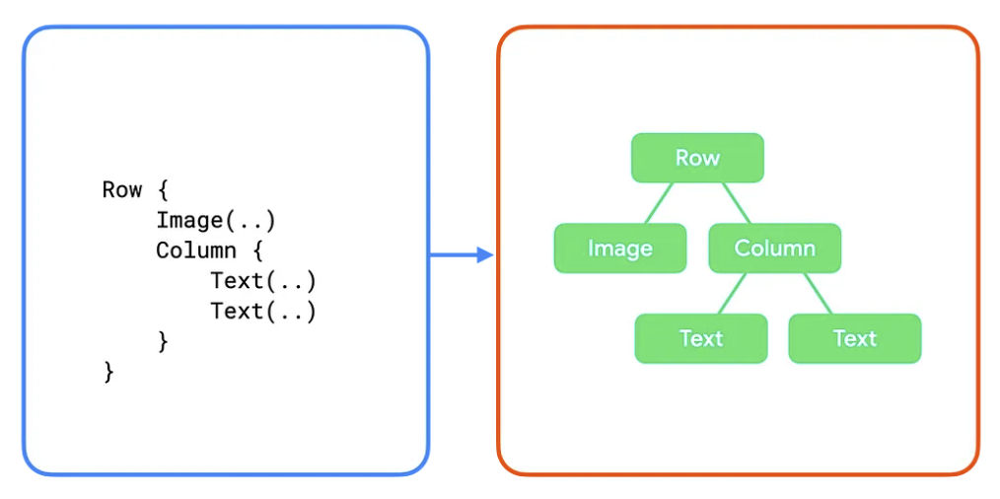
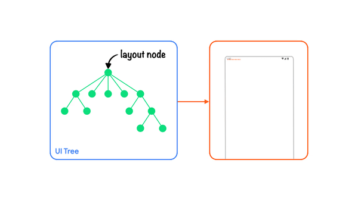
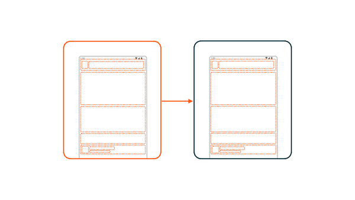
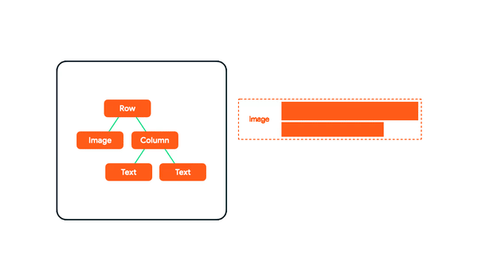
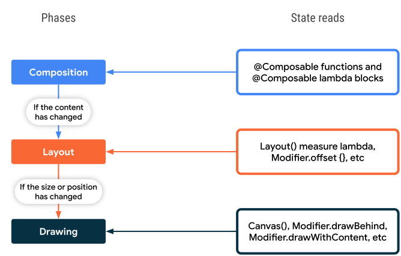

# Jetpack Compose phases 

Giống như hầu hết các UI tool kit khác, Compose render frame qua nhiều giai đoạn riêng biệt

If we look at the Android View system, it has three main phases: measure, layout, and drawing. Compose is very similar but has an important additional phase called composition at the start.

Composition is described across our Compose docs, including [Thinking in Compose](../Introduction/ThikingInCompose.md) and [State and Jetpack Compose.](./ManagingState.md)

## The three phases of a frame

Compose has three main phases:

1. **Composition**: What UI to show. Compose runs composable functions and creates a description of your UI.
2. **Layout**: Where to place UI. This phase consists of two steps: measurement and placement. Layout elements measure and place themselves and any child elements in 2D coordinates, for each node in the layout tree.
3. **Drawing**: How it renders. UI elements draw into a Canvas, usually a device screen.


Thứ tự các giai đoạn này thường giống nhau, cho phép dữ liệu chảy theo một hướng từ bố cục, composition đến layout để vẽ tạo ra một khung hình(also known as [unidirectional data flow](../../../../../General/DesignPattern/UnidirectionalDataFlow.md)). `BoxWithConstraints` and `LazyColumn` and `LazyRow` là những ngoại lệ đáng chú ý, trong đó thành phần của các con của nó phụ thuộc vào layout phase của parent.

Bạn có thể giả định một cách an toàn rằng ba giai đoạn này hầu như diễn ra cho mọi khung hình, nhưng vì mục đích hiệu suất:
- Compose tránh lặp lại công việc sẽ tính toán cùng một kết quả từ cùng một dữ liệu đầu vào trong tất cả các giai đoạn này. 
- Compose bỏ qua việc chạy một hàm composable nếu hàm đó có thể sử dụng lại kết quả cũ và giao diện người dùng Compose không bố cục lại hoặc vẽ lại toàn bộ tree nếu không cần thiết.
- Compose chỉ thực hiện khối lượng công việc tối thiểu cần thiết để cập nhật giao diện người dùng.
- Việc tối ưu hóa này có thể thực hiện được vì Compose theo dõi state reads trong các giai đoạn khác nhau.

## Understand the phases

Phần này mô tả cách thực thi ba giai đoạn Compose cho các composables một cách chi tiết hơn.

### Composition

In the composition phase.the Compose runtime executes composable functions and **outputs a tree structure** that represents your UI. 


The tree representing your UI that is created in the composition phase.

A subsection of the code and UI tree looks like the following:


Trong các ví dụ này, mỗi hàm có khả năng kết hợp trong mã sẽ ánh xạ tới một nút bố cục duy nhất trong cây giao diện người dùng. Trong các ví dụ phức tạp hơn, các thành phần kết hợp có thể chứa logic và luồng điều khiển, đồng thời tạo ra một cây khác với các State khác nhau.

### Layout

Trong Layout phase, Compose sử dụng UI tree được tạo trong giai đoạn composition làm đầu vào. Tập hợp các nút bố trí chứa tất cả thông tin cần thiết để quyết định kích thước và vị trí của từng nút trong không gian 2D.



During the layout phase, the tree is traversed using the following **three step algorithm**:

1. **Measure children**: Một nút đo lường các nút con của nó nếu có.
2. **Decide own size**: Dựa trên các phép đo này, một nút sẽ quyết định kích thước của chính nó.
3. **Place children**: Mỗi nút con được đặt tương ứng với vị trí của nút đó.

**At the end of this phase, each layout node has:**
- Chiều rộng và chiều cao được chỉ định
- Tọa độ x, y nơi cần vẽ


Nhớ lại cây giao diện người dùng từ phần trước:


Đối với cây này, thuật toán hoạt động như sau:

1. The `Row` measures its children, `Image` and `Column`.
2. The `Image` is measured. It doesn't have any children, so it decides its own size and reports the size back to the `Row`.
3. The `Column` is measured next. It measures its own children (two Text composables) first.
4. The first Text is measured. It doesn't have any children so it decides its own size and reports its size back to the `Column`.
    - The second Text is measured. It doesn't have any children so it decides its own size and reports it back to the `Column`.
5. The `Column` uses the **child measurements** to decide its own size. It uses the maximum child width and the sum of the height of its children.
6. The `Column` places its children relative to itself, putting them beneath each other vertically.
7. The `Row` uses the child measurements to decide its own size. It uses the maximum child height and the sum of the widths of its children. It then places its children.


> [!NOTE]
>Lưu ý rằng mỗi nút chỉ được truy cập một lần. Compose runntime chỉ yêu cầu một lần duyệt qua cây giao diện người dùng để đo lường và đặt tất cả các nút, giúp cải thiện hiệu suất. Khi số lượng nút trong cây tăng lên, thời gian duyệt qua nó sẽ tăng theo kiểu tuyến tính. Ngược lại, nếu mỗi nút được truy cập nhiều lần thì thời gian duyệt qua các node sẽ tăng theo cấp số nhân.

### Drawing

Trong giai Drawing, cây lại được duyệt từ trên xuống dưới và lần lượt từng nút sẽ tự vẽ trên màn hình.



**Figure 1**. The drawing phase draws the pixels on the screen.

Sử dụng ví dụ trước, nội dung cây được vẽ theo cách sau:

- The `Row` draws any content it might have, such as a background color.

- The `Image` draws itself.

- The `Column` draws itself.

- The first and second `Text` draw themselves, respectively.



**Figure 1**. A UI tree and its drawn representation.

## State reads

When you read the value of a snapshot state during one of the phases listed above, Compose automatically tracks what it was doing when the value was read. This tracking allows Compose to re-execute the reader when the state value changes, and is the basis of state observability in Compose.

State thường được tạo bằng cách sử dụng mutableStateOf() rồi truy cập thông qua một trong hai cách: bằng cách truy cập trực tiếp vào thuộc tính value hoặc bằng cách sử dụng ủy quyền thuộc tính Kotlin. Bạn có thể đọc thêm về chúng trong State trong các thành phần kết hợp. Vì mục đích của hướng dẫn này, "state reads" đề cập đến một trong các phương thức truy cập tương đương đó.

```kotlin
// State read without property delegate.
val paddingState: MutableState<Dp> = remember { mutableStateOf(8.dp) }
Text(
    text = "Hello",
    modifier = Modifier.padding(paddingState.value)
)
```

```kotlin
// State read with property delegate.
var padding: Dp by remember { mutableStateOf(8.dp) }
Text(
    text = "Hello",
    modifier = Modifier.padding(padding)
)
```

Bên dưới vỏ bọc của property delegate, các hàm "getter" và "setter" được sử dụng để truy cập và cập nhật giá trị của State. Các hàm getter và setter này chỉ được gọi khi bạn tham chiếu thuộc tính dưới dạng giá trị chứ không phải khi nó được tạo, đó là lý do tại sao hai cách trên là tương đương nhau.

> [!NOTE]
> Each block of code that can be re-executed when a read state changes is a restart scope. Compose keeps track of state value changes and restart scopes in different phases.

## Phased state reads

As mentioned above, there are three main phases in Compose, and Compose tracks what state is read within each of them. **This allows Compose to notify only the specific phases that need to perform work for each affected element of your UI.**

> [!NOTE]
> Việc tạo và lưu trữ một thể hiện state (state instance) ít ảnh hưởng đến các giai đoạn (phases), điều quan trọng chỉ là khi và nơi mà một giá trị state được đọc.

### Phase 1: Composition

State reads within a @Composable function or lambda block affect composition and potentially the subsequent phases. When the state value changes, the recomposer schedules reruns of all the composable functions which read that state value. Note that the runtime may decide to skip some or all of the composable functions if the inputs haven't changed. See [Skipping if the inputs haven't changed](../UIArchitecture/LifecycleOfComposables.md) for more information.


```kotlin
var padding by remember { mutableStateOf(8.dp) }
Text(
    text = "Hello",
    // The `padding` state is read in the composition phase
    // when the modifier is constructed.
    // Changes in `padding` will invoke recomposition.
    modifier = Modifier.padding(padding)
)

```


### Phase 2: Layout

The layout phase consists of two steps: **measurement** and **placement**. The measurement step runs the measure lambda passed to the `Layout` composable, the `MeasureScope.measure` method of the `LayoutModifier` interface, and so on. The placement step runs the placement block of the layout function, the lambda block of `Modifier.offset { … }`, and so on.

State reads during each of these steps affect the layout and potentially the drawing phase. When the state value changes, Compose UI schedules the layout phase. It also runs the drawing phase if size or position has changed.

To be more precise, **the measurement step and the placement step have separate restart scopes, meaning that state reads in the placement step don't re-invoke the measurement step before that**. However, these two steps are often intertwined, so a state read in the placement step can affect other restart scopes that belong to the measurement step.

```kotlin
var offsetX by remember { mutableStateOf(8.dp) }
Text(
    text = "Hello",
    modifier = Modifier.offset {
        // The `offsetX` state is read in the placement step
        // of the layout phase when the offset is calculated.
        // Changes in `offsetX` restart the layout.
        IntOffset(offsetX.roundToPx(), 0)
    }
)
```

### Phase 3: Drawing

State reads during drawing code affect the drawing phase. Common examples include `Canvas()`, Modifier.drawBehind, and `Modifier.drawWithContent`. When the state value changes, Compose UI runs only the draw phase.

```kotlin
var color by remember { mutableStateOf(Color.Red) }
Canvas(modifier = modifier) {
    // The `color` state is read in the drawing phase
    // when the canvas is rendered.
    // Changes in `color` restart the drawing.
    drawRect(color)
}
```



## Optimizing state reads

As Compose performs localized state read tracking, **we can minimize the amount of work performed by reading each state in an appropriate phase.**

Let’s take a look at an example. Here we have an Image() which uses the offset modifier to offset its final layout position, resulting in a parallax effect as the user scrolls.


For Example:

```kotlin
Box {
    val listState = rememberLazyListState()

    Image(
        // ...
        // Non-optimal implementation!
        Modifier.offset(
            with(LocalDensity.current) {
                // State read of firstVisibleItemScrollOffset in composition
                (listState.firstVisibleItemScrollOffset / 2).toDp()
            }
        )
    )

    LazyColumn(state = listState) {
        // ...
    }
}
```

This code works, but results in nonoptimal performance.
 As written, the code reads the value of the `firstVisibleItemScrollOffset` state and passes it to the `Modifier.offset(offset: Dp)` function. As the user scrolls the `firstVisibleItemScrollOffset` value will change. As we know, Compose tracks any state reads so that it can restart (re-invoke) the reading code, which in our example is the content of the `Box`.

This is an example of state being read within the composition phase. This is not necessarily a bad thing at all, and in fact is the basis of recomposition, allowing data changes to emit new UI.

In this example though it is nonoptimal, because every scroll event will result in the entire composable content being reevaluated, and then also measured, laid out and finally drawn. 

**We’re triggering the Compose phase on every scroll even though what we are showing hasn’t changed, only where it is shown. We can optimize our state read to only re-trigger the layout phase.**

```kotlin
Box {
    val listState = rememberLazyListState()

    Image(
        // ...
        Modifier.offset {
            // State read of firstVisibleItemScrollOffset in Layout
            IntOffset(x = 0, y = listState.firstVisibleItemScrollOffset / 2)
        }
    )

    LazyColumn(state = listState) {
        // ...
    }
}
```

So why is this more performant? The lambda block we provide to the modifier is invoked during the layout phase (specifically, during the layout phase's placement step), **meaning that our `firstVisibleItemScrollOffset` state is no longer read during composition.** Because Compose tracks when state is read, this change means that if the firstVisibleItemScrollOffset value changes, **Compose only has to restart the layout and drawing phases.**

> [!NOTE]
> You might wonder if taking a lambda parameter might add extra cost compared to taking a simple value. It does. **However, the benefit of limiting the state read to the layout phase overweighs the cost in this case.** The value of firstVisibleItemScrollOffset changes every frame during scroll, and by deferring the state read to the layout phase, we can avoid recompositions all along.

> [!IMPORTANT]
> Try to localize state reads to the lowest possible phase, enabling Compose to perform the minimum amount of work.

## Recomposition loop


Trước đó, chúng ta đã đề cập rằng các giai đoạn của Compose luôn được gọi theo cùng một thứ tự và không có cách nào để quay lại trong cùng một khung hình. Tuy nhiên, điều đó không ngăn cản ứng dụng rơi vào composition loops qua các khung hình khác nhau. Hãy xem xét ví dụ sau:

```kotlin
Box {
    var imageHeightPx by remember { mutableStateOf(0) }

    Image(
        painter = painterResource(R.drawable.rectangle),
        contentDescription = "I'm above the text",
        modifier = Modifier
            .fillMaxWidth()
            .onSizeChanged { size ->
                // Don't do this
                imageHeightPx = size.height
            }
    )

    Text(
        text = "I'm below the image",
        modifier = Modifier.padding(
            top = with(LocalDensity.current) { imageHeightPx.toDp() }
        )
    )
}
```
> **Note**
>Here we have (badly) implemented a vertical column, with the image at the top, and then the text below it. We’re using Modifier.onSizeChanged() to know the resolved size of the image, and then using Modifier.padding() on the text to shift it down. The unnatural conversion from Px back to Dp already indicates that the code has some issue.

> **Note**
>**The issue with this example is that we don’t arrive at the "final" layout within a single frame**. The code relies on multiple frames happening, which performs unnecessary work, and results in UI jumping around on screen for the user.

Readmore the reason at [here](https://developer.android.com/develop/ui/compose/phases#phase1-comp)

> **The fix for the sample above is to use the proper layout primitives**. The example above can be implemented with a simple Column(), but you may have a more complex example which requires something custom, which will require writing a custom layout. See the Custom layouts guide for more information.

**The general principle here is to have a single source of truth for multiple UI elements that should be measured and placed with regards to one another**. Using a proper layout primitive or creating a custom layout means that the minimal shared parent serves as the source of truth that can coordinate the relation between multiple elements. Introducing a dynamic state breaks this principle.