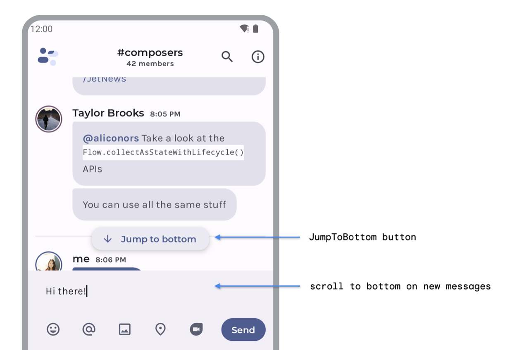
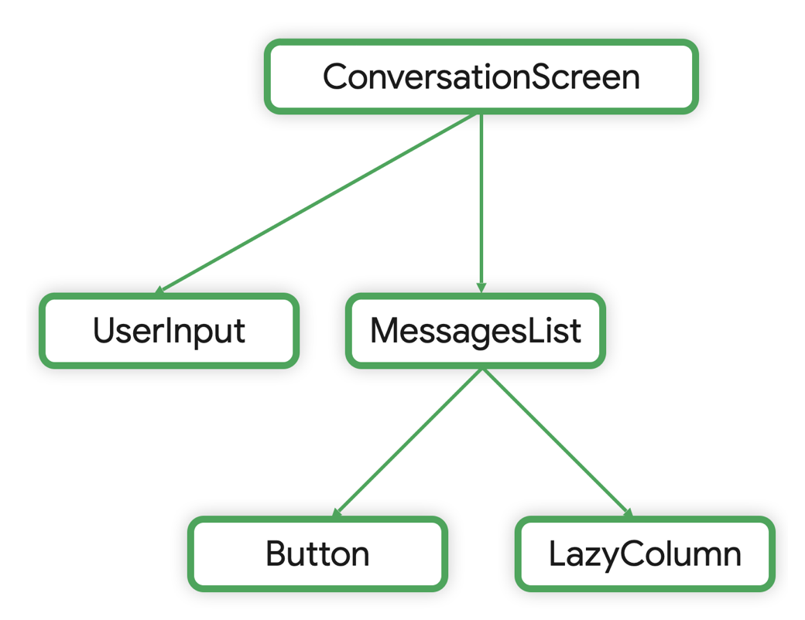
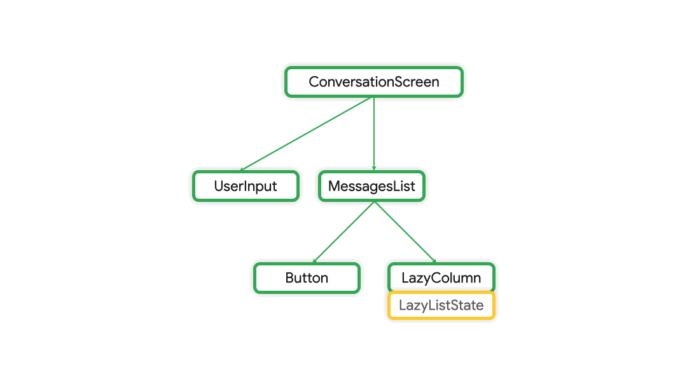
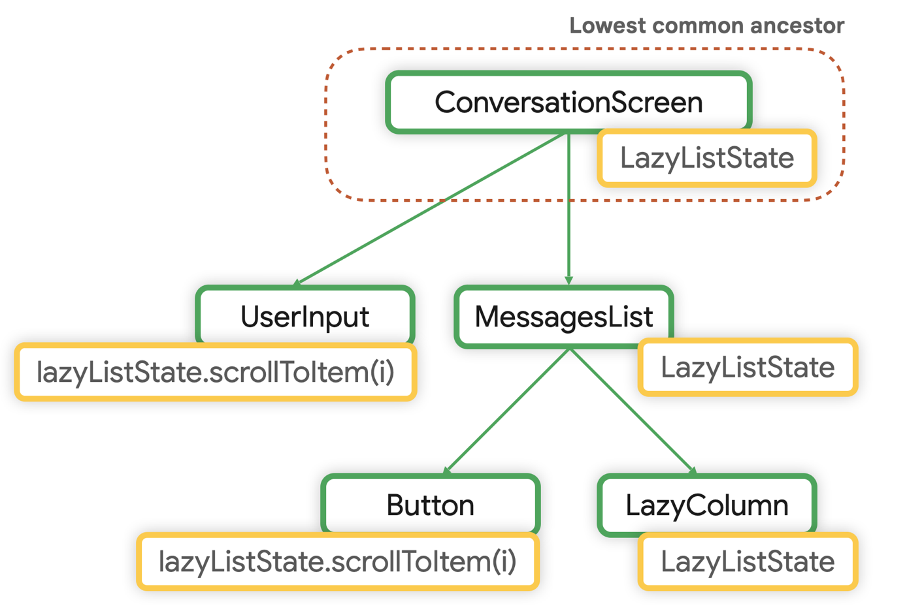

# State Hosting

Where to hoist state ?

## UI State
UI state is the property that describes the UI. There are two types of UI state:
 - **Screen UI state**: is what you need to display on the screen. (For example, a NewsUiState class...)
 - **UI element state**: refers to properties intrinsic to UI elements that influence how they are rendered. A UI element may be shown or hidden and may have a certain font, font size, or font color. ( An example of this are the get and set methods of the TextView class for its text.)

 ## Logic

 Logic in an application can be either business logic or UI logic:
 - **Business logic** is the implementation of product requirements for app data.
 - **UI logic** is related to how to display UI state on the screen

 ### UI logic

 When UI logic needs to read or write state, **you should scope the state to the UI**, following its lifecycle. To achieve this, **you should hoist the state at the correct level in a composable function**. Alternatively, you can do so in a plain state holder class, also scoped to the UI lifecycle.

Below is a description of both solutions and explanation of when to use which.

#### Composables as state owner
Having UI logic and UI element state in composables **is a good approach if the state and logic is simple**. You can leave your state internal to a composable or hoist as required.

#### No state hoisting needed

**Hoisting state isn't always required**. State can be kept internal in a composable when no other composable need to control it. In this snippet, there is a composable that expands and collapses on tap:

```kotlin
@Composable
fun ChatBubble(
    message: Message
) {
    var showDetails by rememberSaveable { mutableStateOf(false) } // Define the UI element expanded state

    ClickableText(
        text = AnnotatedString(message.content),
        onClick = { showDetails = !showDetails } // Apply simple UI logic
    )

    if (showDetails) {
        Text(message.timestamp)
    }
}
```

#### Hoisting within composables

**If you need to share your UI element state with other composables and apply UI logic to it in different places**, you can hoist it higher in the UI hierarchy. This also makes your composables more reusable and easier to test.


<details>
  <summary style="color: orange;">
  <b>
  Example to Understand how to hoisting within composables
  </b>
  </summary>
  
  <p>
  
The following example is a chat app that implements two pieces of functionality:

- The `JumpToBottom` button scrolls the messages list to the bottom. The button performs UI logic on the list state.
- The `MessagesList` list scrolls to the bottom after the user sends new messages. UserInput performs UI logic on the list state.



**Figure 1**. Chat app with a `JumpToBottom` button and scroll to bottom on new messages

The composable hierarchy is as follows:


**Figure 2**. Chat composable tree

The `LazyColumn` state is hoisted to the conversation screen so the app can perform UI logic and read the state from all composables that require it:


**Figure 3**. Hoisting `LazyColumn` state from the `LazyColumn` to the `ConversationScreen`

The code is as follows:

```kotlin
@Composable
private fun ConversationScreen(/*...*/) {
    val scope = rememberCoroutineScope()

    val lazyListState = rememberLazyListState() // State hoisted to the ConversationScreen

    MessagesList(messages, lazyListState) // Reuse same state in MessageList

    UserInput(
        onMessageSent = { // Apply UI logic to lazyListState
            scope.launch {
                lazyListState.scrollToItem(0)
            }
        },
    )
}

@Composable
private fun MessagesList(
    messages: List<Message>,
    lazyListState: LazyListState = rememberLazyListState() // LazyListState has a default value
) {

    LazyColumn(
        state = lazyListState // Pass hoisted state to LazyColumn
    ) {
        items(messages, key = { message -> message.id }) { item ->
            Message(/*...*/)
        }
    }

    val scope = rememberCoroutineScope()

    JumpToBottom(onClicked = {
        scope.launch {
            lazyListState.scrollToItem(0) // UI logic being applied to lazyListState
        }
    })
}
```

`LazyListState` is hoisted as high as required for the UI logic that has to be applied. Since it is initialized in a composable function, it is stored in the Composition, following its lifecycle.

Note that `lazyListState` is defined in the `MessagesList` method, with the default value of `rememberLazyListState()`. This is a common pattern in Compose. It makes composables more reusable and flexible. You can then use the composable in different parts of the app which might not need to control the state. This is usually the case while testing or previewing a composable. This is exactly how `LazyColumn` defines its state.

> [!NOTE]
> Key point: Hoist state to the lowest common ancestor and avoid passing it to composables that don't need it.




**Figure 5**. Lowest common ancestor for LazyListState is ConversationScreen


  </p>
</details>


#### Plain state holder class as state owner

When a composable contains complex UI logic that involves one or multiple state fields of a UI element, it should delegate that responsibility to `state holders`, like a plain state holder class. This makes the composable's logic more testable in isolation, and reduces its complexity. This approach favors [the separation of concerns principle](../../../../../General/DesignPrinciple/SeparationOfConcernsPrinciple.md): **the composable is in charge of emitting UI elements, and the state holder contains the UI logic and UI element state.**

Plain state holder classes provide convenient functions to callers of your composable function, so they don't have to write this logic themselves.

These plain classes are created and remembered in the Composition. Because they follow the [composable's lifecycle](../UIArchitecture/LifecycleOfComposables.md), they can take types provided by the Compose library such as `rememberNavController()` or `rememberLazyListState()`.

<details>
  <summary style="color: orange;">
  <b>
  An example of this
  </b>
  </summary>
  
  <p>
   the LazyListState plain state holder class, implemented in Compose to control the UI complexity of LazyColumn or LazyRow.

```kotlin
// LazyListState.kt

@Stable
class LazyListState constructor(
    firstVisibleItemIndex: Int = 0,
    firstVisibleItemScrollOffset: Int = 0
) : ScrollableState {
    /**
     *   The holder class for the current scroll position.
     */
    private val scrollPosition = LazyListScrollPosition(
        firstVisibleItemIndex, firstVisibleItemScrollOffset
    )

    suspend fun scrollToItem(/*...*/) { /*...*/ }

    override suspend fun scroll() { /*...*/ }

    suspend fun animateScrollToItem() { /*...*/ }
}
```


>Trong Compose, @Stable là một Annotation được sử dụng để đánh dấu rằng một lớp hoặc một hàm là không thay đổi về nội dung sau khi được khởi tạo. Khi một đối tượng được đánh dấu là @Stable, nó sẽ không bị thay đổi giá trị trong suốt vòng đời của ứng dụng.

>Trong trường hợp của lớp LazyListState, việc đánh dấu là @Stable là quan trọng để đảm bảo rằng trạng thái của LazyListState không thay đổi sau khi được tạo ra. Điều này cần thiết vì LazyListState thường được sử dụng để theo dõi vị trí cuộn của danh sách hoặc RecyclerView trong giao diện người dùng. Nếu trạng thái của LazyListState thay đổi trong khi ứng dụng đang chạy, có thể gây ra sự không nhất quán hoặc lỗi trong việc hiển thị danh sách. Điều này đặc biệt quan trọng trong việc xây dựng các giao diện người dùng có hiệu suất cao, nơi mà việc giữ cho trạng thái không thay đổi là rất quan trọng.

LazyListState encapsulates the state of the LazyColumn storing the scrollPosition for this UI element. It also exposes methods to modify the scroll position by for instance scrolling to a given item.

  </p>
</details>

As you can see, **incrementing a composable's responsibilities increases the need for a state holder**. The responsibilities could be in UI logic, or just in the amount of state to keep track of.

> [!NOTE]
> If plain state holder classes contain state you want to preserve after an Activity or process is recreated, use `rememberSaveable` and create a custom `Saver` for it.


### Business logic

If your UI element state is hoisted to the `ViewModel` because it is required by business logic, you can use `ViewModel`'s APIs.

<details>
  <summary style="color: orange;">
  <b>
    The main benefits of using a ViewModel
  </b>
  </summary>
  
  <p>

One of the main benefits of using a ViewModel in your Android application is that it handles configuration changes for free. When there is a configuration change, and the activity is destroyed and recreated, the UI state hoisted to the ViewModel is kept in memory. After the recreation, the old ViewModel instance is attached to the new activity instance.

  </p>
</details>


> [!NOTE]
> The `ViewModel`, as the implementation of a screen level state holder, handles the business logic used to produce screen UI state. **You should hoist the UI state to the `ViewModel`, not because it will handle configuration changes for free, but because it makes sense for your architecture**.

However, a `ViewModel` instance does not survive system-initiated process death. To have the UI state survive this, use the Saved State module for `ViewModel`, which contains the `SavedStateHandle` API.