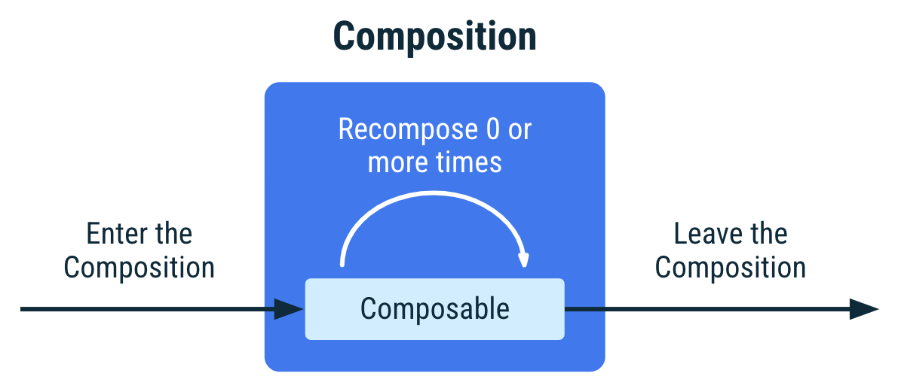
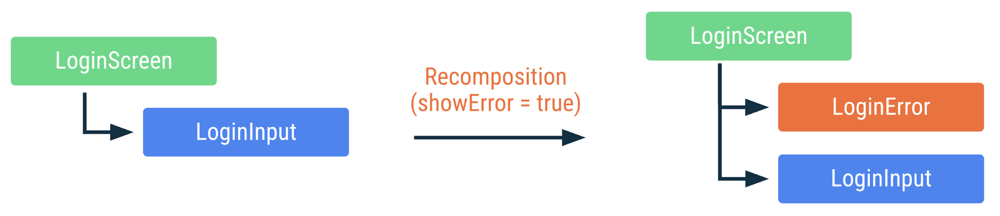
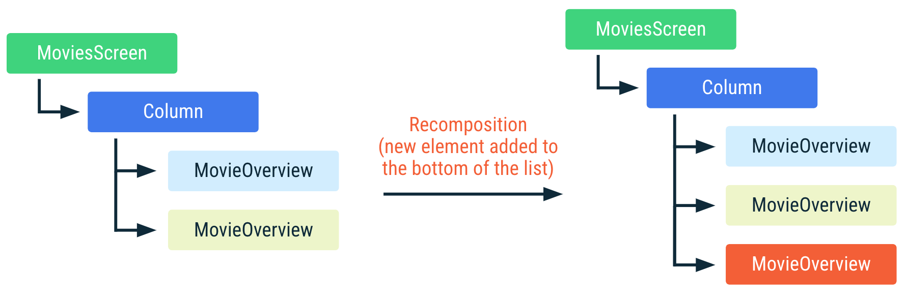
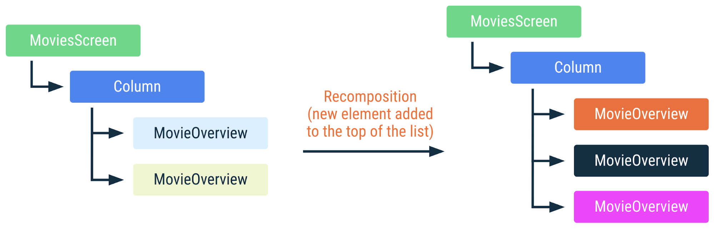
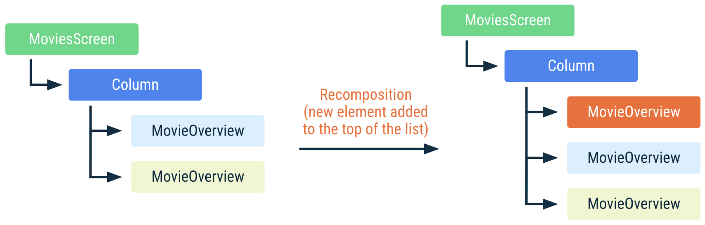

# Lifecycle of composables

As mentioned in the Managing state documentation, a Composition describes the UI of your app and is produced by running composables. A Composition is a tree-structure of the composables that describe your UI.

During the initial run of your composables, Jetpack Compose keeps track of them in a Composition to describe your UI. When your app's state changes, Jetpack Compose schedules a recomposition. This involves re-executing the composables that may have changed due to state changes, and updating the Composition accordingly.

A Composition can only be produced by an initial composition and updated by recomposition. The only way to modify a Composition is through recomposition.



**Figure 1.** Lifecycle of a composable in the Composition. It enters the Composition, gets recomposed 0 or more times, and leaves the Composition.


Recomposition is typically triggered by a change to a State<T> object. Compose tracks these and runs all composables in the Composition that read that particular State<T>, and any composables that they call that cannot be skipped.


> [!NOTE]
> A composable's lifecycle is simpler than the lifecycle of views, activities, and fragments. When a composable needs to manage or interact with external resources that do have a more complex lifecycle, you should use effects.


## Anatomy of a composable in Composition

If during a recomposition a composable calls different composables than it did during the previous composition, **Compose will identify which composables were called** or not called and for the composables that were called in both compositions, Compose will **avoid recomposing them if their inputs haven't changed.**

Example:

```kotlin
@Composable
fun LoginScreen(showError: Boolean) {
    if (showError) {
        LoginError()
    }
    LoginInput() // This call site affects where LoginInput is placed in Composition
}

@Composable
fun LoginInput() { /* ... */ }

@Composable
fun LoginError() { /* ... */ }
```

In the code snippet above, `LoginScreen` will conditionally call the `LoginError` composable and will always call the LoginInput composable. Each call has a unique call site and source position, which the compiler will use to uniquely identify it.



**Figure 1.** Representation of LoginScreen in the Composition when the state changes and a recomposition occurs. Same color means it hasn't been recomposed.

Even though LoginInput went from being called first to being called second, the LoginInput instance will be preserved across recompositions. Additionally, because LoginInput doesn’t have any parameters that have changed across recomposition, the call to LoginInput will be skipped by Compose.

## Add extra information to help smart recompositions

Example:

```kotlin
@Composable
fun MoviesScreen(movies: List<Movie>) {
    Column {
        for (movie in movies) {
            // MovieOverview composables are placed in Composition given its
            // index position in the for loop
            MovieOverview(movie)
        }
    }
}
```

In the example above, Compose uses the execution order in addition to the call site to keep the instance distinct in the Composition. If a new movie is added to the bottom of the list, Compose can reuse the instances already in the Composition since their location in the list haven't changed and therefore, the `movie` input is the same for those instances.



**Figure 2.** Representation of MoviesScreen in the Composition when a new element is added to the bottom of the list. MovieOverview composables in the Composition can be reused. Same color in MovieOverview means the composable hasn't been recomposed.


However, if the `movies` list changes by either adding to the top or the middle of the list, removing or reordering items, it'll cause a recomposition in all `MovieOverview` calls whose input parameter has changed position in the list.That's extremely important if, for example, `MovieOverview` fetches a movie image using a side effect. If recomposition happens while the effect is in progress, it will be cancelled and will start again.


```kotlin
@Composable
fun MovieOverview(movie: Movie) {
    Column {
        // Side effect explained later in the docs. If MovieOverview
        // recomposes, while fetching the image is in progress,
        // it is cancelled and restarted.
        val image = loadNetworkImage(movie.url)
        MovieHeader(image)

        /* ... */
    }
}
```



**Figure 3.** Representation of MoviesScreen in the Composition when a new element is added to the list. MovieOverview composables cannot be reused and all side effects will restart. A different color in MovieOverview means the composable has been recomposed.

By wrapping a block of code with a call to the `key` composable with one or more values passed in, those values will be combined to be used to identify that instance in the composition. The value for a `key` does not need to be globally unique, it needs to only be unique amongst the invocations of composables at the call site. So in this example, each `movie` needs to have a `key` that's unique among the `movies`; it's fine if it shares that key with some other composable elsewhere in the app.
```kotlin
@Composable
fun MoviesScreenWithKey(movies: List<Movie>) {
    Column {
        for (movie in movies) {
            key(movie.id) { // Unique ID for this movie
                MovieOverview(movie)
            }
        }
    }
}
```

**With the above, even if the elements on the list change, Compose recognizes individual calls to MovieOverview and can reuse them.**



Some composables have built-in support for the `key` composable. For example, `LazyColumn` accepts specifying a custom `key` in the `items`.

```kotlin
@Composable
fun MoviesScreenLazy(movies: List<Movie>) {
    LazyColumn {
        items(movies, key = { movie -> movie.id }) { movie ->
            MovieOverview(movie)
        }
    }
}
```