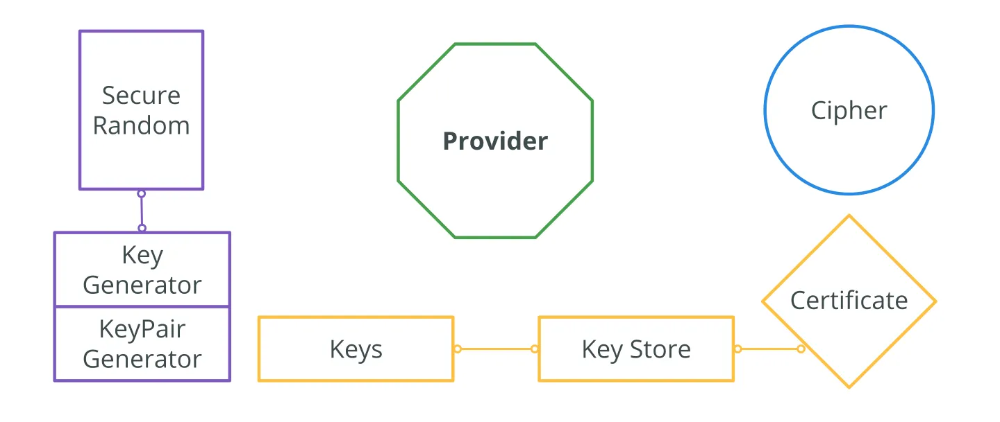

# Android encryption

## Java Cryptography Architecture

Android builds on the Java Cryptography Architecture (JCA), 
that provides API for digital signatures, certificates, encryption, 
keys generation and management.



### KeyGenerator 
provides the public API for generating symmetric cryptographic keys.

### KeyPairGenerator 
an engine class which is capable of generating a private key and its 
related public key utilizing the algorithm it was initialized with.

### SecretKey 
a secret (symmetric) key. The purpose of this interface is to group (and provide type safety for)
all secret key interfaces (e.g., SecretKeySpec).

### PrivateKey 
a private (asymmetric) key. The purpose of this interface is to group
(and provide type safety for) all private key interfaces(e.g., RSAPrivateKey).

### PublicKey 
a public key. This interface contains no methods or constants.
It merely serves to group (and provide type safety for) all public key interfaces(e.g., RSAPublicKey).

### KeyPair
this class is a simple holder for a key pair (a public key and a private key).
It does not enforce any security, and, when initialized, should be treated like a PrivateKey.

### SecureRandom
generates cryptographically secure pseudo-random numbers.
We will not use it directly in this series, but it is widely used inside of KeyGenerator,
KeyPairGenerator components and Keys implementations.

### KeyStore
database with a well secured mechanism of data protection,
that is used to save, get and remove keys. Requires entrance password and passwords for each of the keys.
In other words it is protected file that you need to create, read and update (with provided API).

### Certificate
certificate used to validate and save asymmetric keys.

### Cipher
provides access to implementations of cryptographic ciphers for encryption, 
decryption, wrapping, unwrapping and signing.

### Provider 
defines a set of extensible implementations, independent API’s. 
Providers are the groups of different Algorithms or their customizations. 
There are 3d party providers, such as Bouncy Castle and Spongy Castle (android version of Bouncy Castle),
as well as providers available out of box, such as cut-down version of Bouncy Castle 


## KeyStore

And in 18 version of Android, AndroidKeyStore was introduced:

> The Android Key Store system lets you store cryptographic
keys in a container to make it more difficult to extract from the device.

> Once keys are in the key store, 
they can be used for cryptographic operations with the key material remaining non-exportable.

> Moreover, it offers facilities to restrict when and how keys can be used,
such as requiring user authentication for key use or restricting keys to be used only in certain cryptographic modes.


AndroidKeyStore is a JCA Provider implementation, where:

> Without it, before Android 18, you would need to create a file somewhere in your local 
or external device storage, where all of your keys would be kept (as you can understand, 
it is easy to extract that file). But with AndroidKeyStore you do not need to create anything, 
system will manage everything for you:

- If device manufacture supports Trusted Execution Environment(TEE), your keys will be saved there (the most secure option);
- If device manufacture doesn’t support TEE, keys will be stored in emulated software environment, provided by the system.

## Lock Screen

If you want to secure your data — protect your device.

> To be more secure, before providing an access to any of application features, we can request user to setup his device Lock Screen (if it has been not setup yet).
Also some other features that we will review later in this series, such as Fingerprint, requires lock screen to be setup.

**And there is a special system service — KeyguardManager, that can help us with this task.**

for example:

```kotlin
private val keyguardManager: KeyguardManager

init {
    keyguardManager = context.getSystemService(Context.KEYGUARD_SERVICE) as KeyguardManager
}

fun isDeviceSecure(): Boolean = if (hasMarshmallow()) keyguardManager.isDeviceSecure else keyguardManager.isKeyguardSecure

// Used to block application if no lock screen is setup.
fun showDeviceSecurityAlert(): AlertDialog {
    return AlertDialog.Builder(context)
            .setTitle(R.string.lock_title)
            .setMessage(R.string.lock_body)
            .setPositiveButton(R.string.lock_settings, { _, _ -> context.openLockScreenSettings() })
            .setNegativeButton(R.string.lock_exit, { _, _ -> System.exit(0) })
            .setCancelable(BuildConfig.DEBUG)
            .show()
}

fun hasMarshmallow() = Build.VERSION.SDK_INT >= Build.VERSION_CODES.M
```

- **isDeviceSecure** method— checks if device is secured with a PIN, pattern or password. Available from API 23.
- **isKeyguardSecure** method— checks if keyguard is secured by a PIN, pattern or password or a SIM card is currently locked. 
Available from API 16. It’s not the best option to use, as it is also checking if a SIM card is locked, but it is totally better then nothing.

Usage: 

```kotlion
  if (!systemServices.isDeviceSecure()) {
        deviceSecurityAlert = systemServices.showDeviceSecurityAlert()
    }
```


## Choose a Key

Now, when device is secured with Lock Screen, we can focus on application sensitive data protection, like user Master password and Secrets (see [Encryption](../Security/Encryption.md)). We already know that encryption will be used for this. And first what we need to do is to choose what Key (symmetric, asymmetric) and Algorithm to use.

Also we know that **Symmetric Keys are available from Android 23+ API**, and **Asymmetric from 18+ API**. Our choice is predictable, **we will use Asymmetric Keys**, but still, what algorithm to chose?
Lets search for help in [Document](https://developer.android.com/reference/javax/crypto/Cipher)

**RSA — the only one available algorithm we can use, in Cipher, for Android Key Store Asymmetric Keys, on API 18+ devices.**

## Key Storage

On Android, cryptographic keys are stored in theKeyStore:


```kotlin

private val keyStore: KeyStore = createAndroidKeyStore()

private fun createAndroidKeyStore(): KeyStore {
    val keyStore = KeyStore.getInstance("AndroidKeyStore")
    keyStore.load(null)
    return keyStore
}

```

And there is a fabric getInstance("type") method, that creates KeyStore instance with given type by traversing the list of registered security Providers, starting with the most preferred one. We are going to search for “AndroidKeyStore” type.

There’s also another KeyStore fabric method: getInstance("type", "provider") —that returns a KeyStore object of the specified type from the specified Provider.

But note, if there are more then one registered types in different Providers, with the same name, getInstance(“type”) method will return you the first matching result among of them. And this has two different sides:

- You (or device vendors for example) can create your own Provider , and make it as the most preferred, by simply setting its position. Theoretically this may lead to some confusions, where you will get wrong, not expected key store type;
- On other side, this approach can be used to fix some compatibility issues, where system will add new AndroidKeyStore type implementation, keeping the same name convention, into another Provider (there is one more system Provider, called “AndroidKeyStoreBCWorkaround”, we will review it in “Encryption & Decryption” paragraph). This allows us to keep the same, working, code on different API’s, what is pretty cool.

The getInstance(“type”) method have been working well for me so far. [Documentation](https://developer.android.com/privacy-and-security/keystore#WorkingWithKeyStoreEntries) samples also referees to this method, so I would recommend you to use it to get KeyStore instance, rather then alternative getInstance(“type”, “provider”) method.

After getting the instance, you must to call the load(loadStoreParameter) method, that will load key store data basing on the providedProtectionParameter.

Protection parameters may be used to check the integrity of key store data, or to protect the confidentiality of sensitive key store data (such as a PrivateKey).

In case of AndroidKeyStore provider, we just need to pass null as a parameter, and system will load data under the cover, basing on our application identifier.

## Key Generation

On Android, asymmetric cryptographic keys are created with **KeyPairGenerator**:

```kotlin
fun createAndroidKeyStoreAsymmetricKey(alias: String): KeyPair {
    val generator = KeyPairGenerator.getInstance("RSA", "AndroidKeyStore")

    if (SystemServices.hasMarshmallow()) {
        initGeneratorWithKeyGenParameterSpec(generator, alias)
    } else {
        initGeneratorWithKeyPairGeneratorSpec(generator, alias)
    }
    
    // Generates Key with given spec and saves it to the KeyStore
    return generator.generateKeyPair()
}
```

Similarly to the key store, there is a fabric getInstance(“algorithm”, “provider”) method, that should be used to create a key.

There’s also another, simplified, version of that method — getInstance(“algorithm”) . **Don’t use it**. This method is searching for algorithm among all of existed Providers and unlike the key store, where we was using pretty unique “AndroidKeyStore” type, algorithm names are common in different Providers (“RSA” exists almost everywhere ). Here we need to explicitly define the provider we want to use.

KeyPairGenerator instance must be initialized with specification. **Before M, KeyPairGeneratorSpec class should be used to provide it**:

```kotlin

private fun initGeneratorWithKeyPairGeneratorSpec(generator: KeyPairGenerator, alias: String) {
    val startDate = Calendar.getInstance()
    val endDate = Calendar.getInstance()
    endDate.add(Calendar.YEAR, 20)

    val builder = KeyPairGeneratorSpec.Builder(context)
          .setAlias(alias)
          .setSerialNumber(BigInteger.ONE)
          .setSubject(X500Principal("CN=${alias} CA Certificate"))
          .setStartDate(startDate.time)
          .setEndDate(endDate.time)

    generator.initialize(builder.build())
}

```

In Android Key Store, each key must have an identifier — alias. If you are trying to save key into the key store, with alias that exists already, it will be overwritten with new key. Use setAlias() builders method to provide alias.


Asymmetric keys **must** be signed with a certificate. It is mostly used in client-server communications, where client (or server) is verifying certificate, to be certain that the server really is who he claims to be (and not a man in the middle). You will be not able to save asymmetric key without certificate.


**If both public and private keys are desired for usage in one application, then you can just create a fake, self signed, certificate.**

Certificate requires a start and end date (validity duration), that could be set with setStartDate and setEndDate builder methods. Also you need to provide serial number and a subject of certificate, that can be used with setSerialNumber and setSubject builder methods.

After providing the key details, initialize theKeyPairGenerator instance with specification using the initialize(specification) method.

**In Marshmallow version**, KeyGenParameterSpec was introduced. **It is used to initialize asymmetric and symmetric keys. KeyPairGeneratorSpec was deprecated.**

```kotlin
@TargetApi(Build.VERSION_CODES.M)
private fun initGeneratorWithKeyGenParameterSpec(generator: KeyPairGenerator, alias: String) {
    val builder = KeyGenParameterSpec.Builder(alias, KeyProperties.PURPOSE_ENCRYPT or KeyProperties.PURPOSE_DECRYPT)
            .setBlockModes(KeyProperties.BLOCK_MODE_ECB)
            .setEncryptionPaddings(KeyProperties.ENCRYPTION_PADDING_RSA_PKCS1)
    generator.initialize(builder.build())
}
```

KeyGenParameterSpec requires to specify the purposes of key usage. For instance, keys created with KeyProperties.PURPOSE_ENCRYPT cannot be used for decryption.

Also, you **must** to specify the block mode and encryption padding (see Encryption, Modes & Paddings) you want to use with this key. Use setBlockModes and setEncryptionPaddings builder methods for that.

**There’s no more need to define a fake certificate manually, KeyGenParameterSpec will do this automatically**. You still can customize default values with:

```kotlin
.setCertificateNotBefore(startDate) // By default, this date is Jan 1 1970.
.setCertificateNotAfter(endDate) // By default, this date is Jan 1 2048.
.setCertificateSerialNumber(number) // By default, the serial number is 1.
.setCertificateSubject(x500Principal) // By default, the subject is CN=fake.
```

Finally, whenKeyPairGenerator instance is initialized with specification, use generateKeyPair() method, to create private-public key pair. In Android Key Store provider, this method will automatically save key in KeyStore.

## Key Management

KeyStore provides methods, that helps us to manage saved keys:

```kotlin
fun getAndroidKeyStoreAsymmetricKeyPair(alias: String): KeyPair? {
       val privateKey = keyStore.getKey(alias, null) as PrivateKey?
       val publicKey = keyStore.getCertificate(alias)?.publicKey

   return if (privateKey != null && publicKey != null) {
       KeyPair(publicKey, privateKey)
   } else {
       null
   }
}

fun removeAndroidKeyStoreKey(alias: String) = keyStore.deleteEntry(alias)
```

**getKey(“alias”, “password”)** — returns a key with given alias or null if the given alias does not exist or does not identify a key-related entry. In Android Key Store, no password is required.

**getCertificate(“alias”)** — returns the certificate, or null if the given alias does not exist or does not contain a certificate.

**deleteEntry(“alias”)** — delete a key with given alias. KeyStoreException
will be thrown, if the entry cannot be removed.

## Encryption & Decryption

**On Android, encryption and decryption are made with Cipher:**

```kotlin
companion object {
    var TRANSFORMATION_ASYMMETRIC = "RSA/ECB/PKCS1Padding"
}

val cipher: Cipher = Cipher.getInstance(transformation)
```

There is a fabric getInstance(“transformation”) method, that is searching for given transformation among existed Providers (like in other cryptographic components we reviewed above) and should be used to create a Cipher instance.

**The transformation represents the algorithm, that will be used for encryption or decryption, in format of**: ”Algorithm/Mode/Padding”.

Method getInstance(“transformation”, "provider"), where you can explicitly specify the Provider, also exists here. **But note, you should not use it with Cipher.**

```kotlin
val transformation = "RSA/ECB/PKCS1Padding"
val provider = "AndroidKeyStore"
// API 19
val cipher: Cipher = Cipher.getInstance(transformation)
cipher.provider.name // AndroidOpenSSL
// API 23, 24
val cipher: Cipher = Cipher.getInstance(transformation)
cipher.provider.name // AndroidKeyStoreBCWorkaround
val cipher: Cipher = Cipher.getInstance(transformation, provider)
// throws java.security.NoSuchAlgorithmException: 
// Provider AndroidKeyStore does not provide RSA/ECB/PKCS1Padding
```
> [!TIP]
> As you can see, technically AndroidKeyStore provider doesn’t provide RSA algorithm to the Cipher. Instead, there are AndroidOpenSSL and AndroidKeyStoreBCWorkaround providers, that knows how to use AndroidKeyStore provider keys for this algorithm.


To start working with Cipher instance we need to initialize it for specific operation with a Key. Use init(mode, key) method with Cipher.ENCRYPT_MODE to initialize it for encryption:

```kotlin
fun encrypt(data: String, key: Key?): String {
    cipher.init(Cipher.ENCRYPT_MODE, key)
    val bytes = cipher.doFinal(data.toByteArray())
    return Base64.encodeToString(bytes, Base64.DEFAULT)
}
```

Or use init(mode, key) method with Cipher.DECRYPT_MODE to initialize Cipher for decryption:

```kotlin
fun decrypt(data: String, key: Key?): String {
    cipher.init(Cipher.DECRYPT_MODE, key)
    val encryptedData = Base64.decode(data, Base64.DEFAULT)
    val decodedData = cipher.doFinal(encryptedData)
    return String(decodedData)
}
```

After initialization, use doFinal(data) method, to process encrypted or decrypted data with this Cipher.

You can reinitialize created cipher instance as many times as you need to.

## Usage Example

To summarize everything we was talking about, lets try to encrypt and decrypt simple “Hello World” message:

```kotlin

var message = "Hello Word"

// Creates Android Key Store and provides manage functions
private val keyStoreWrapper = KeyStoreWrapper(context)

// Create and Save asymmetric key
keyStoreWrapper.createAndroidKeyStoreAsymmetricKey("MASTER_KEY")

// Get key from keyStore
var masterKey = keyStoreWrapper.getAndroidKeyStoreAsymmetricKeyPair("MASTER_KEY")

// Creates Cipher with given transformation and provides encrypt and decrypt functions
var cipherWrapper = CipherWrapper("RSA/ECB/PKCS1Padding")

// Encrypt message with the key, using public key
var encryptedData = cipherWrapper.encrypt(data, masterKey?.public)

// Output is:
// aB9Ce9d5oM0/yloLQikOz8RovWHLmoQf3ovlCiz+D9+0/y7ZDfx6SpPYsKFIK3df079DNVIGVXIW
// 63CIUrrc7zLPMCCHCnzoeNJMqj2z0mFclluXzr5mCDJYfU/63yPeUpCPuo3y1SfXPPPNYJKhz2pq
// TugVE+rWoql9019BwTKtBy80nOE4RDQnMe6M9FWcSv/k6NyFtml9iwwtGVuRGXpSgh9humMWT0Cu
// MxzHusdIaRaviY4mQLFS+iIyRC3Riu0OxbkgTWpDs937Vfv3LSslJSo2CvwqFEnMGhkGvMdjtNhJ
// vGnpzMYN/rYWt/cer8nreURscXN7o3IR8ZtPkA==

// Decrypt message with the key, using private key
var decryptedData = cipherWrapper.decrypt(data, masterKey?.private)

// Output is:
// Hello Word

```
