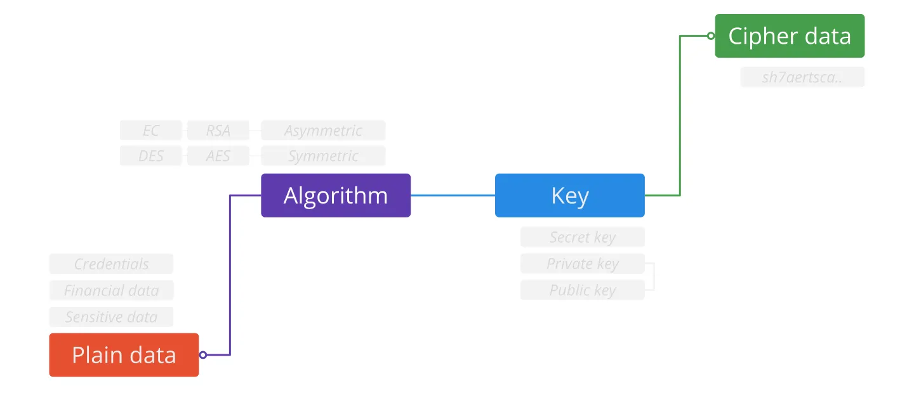

# Encryption

## Basics of Cryptography Definition

The most effective way to achieve data security.

To read an encrypted data, you must have access to a secret key or password that allows you to decrypt it.
Unencrypted data is called plain data (plain text), encrypted data is referred to as cipher data (cipher text).





In overall encryption works as following:

You have plain data, that could be some sensitive information (such as personal life information,
physical or mental health details, criminal or civil offenses, 
private photos, private user documents, etc.),
financial information (such as accounts, transactions, reports, credit card information, etc.)
and of course credentials (usernames, passwords, touch pin-codes, fingerprint data,
and all other stuff that can provide access to data above).

Then, **basing on some algorithm**, you will create a special key and will use it to create **cipher data** (cipher text).


For example, a simple algorithm — change every symbol in word with something. And a key — something is equal to next symbol from alphabet:

Algorithm: change every symbol in word with something
Key: something is equal to next symbol from alphabet
Plain Data (Input): "Hello World"
Cipher Data (Output): "ifmmp xpsme"
Symbol Mask:
```
    h -> i
    e -> f
    l -> m
    o -> p
    w -> x
    r -> s
    d -> e
```

Of course everything works vice versa, if you have a cipher data, 
you know the algorithm and have a key, you will get original plain data with ease.

## Algorithm Types

Above, we saw a very basic example of encryption. 
Nowadays algorithms are more complex and are separated on Symmetric and Asymmetric 
(there’s also a Hash Functions, that do not require a key and will be not reviewed in this article).

**Symmetric** — the oldest and best-known technique. The encryption key and the decryption key are the same. 
Also it is generally categorized as being either Stream Cipher or Block cipher.

The most common Symmetric AES — the Advanced Encryption Standard (AES)
is the algorithm trusted as the standard by the U.S. Government and numerous organizations.

Asymmetric — a modern branch of cryptography. Also known as public-key cryptography in which the algorithms 
employ a pair of keys (a public key and a private key) and use a different component of the pair 
for different steps of the algorithm.

The most common Asymmetric algorithm is RSA — a public-key encryption algorithm and 
the standard for encrypting data sent over the internet.


Stream Cipher:

Stream cipher là một thuật toán mã hóa đối xứng mà xử lý dữ liệu từng bit hoặc từng byte một cách tuần tự,
sử dụng một khóa để tạo ra dữ liệu mã hóa ngẫu nhiên hoặc dữ liệu văn bản thông thường.
Nói một cách đơn giản, stream cipher mã hóa dữ liệu theo từng phần nhỏ (bit hoặc byte) một cách tuần tự.
Mỗi phần nhỏ này được xử lý bằng cách kết hợp với thông tin từ khóa để tạo ra dữ liệu mã hóa ngẫu nhiên hoặc dữ liệu văn bản thông thường.

Block Cipher:

Block cipher là một thuật toán xác định hoạt động trên các nhóm độ dài cố định của các bit, được gọi là các block.
Block cipher là thành phần cơ bản quan trọng trong thiết kế của nhiều giao thức mật mã học, và được sử dụng rộng rãi để triển khai mã hóa dữ liệu lớn.
Đơn giản là, block cipher là một thuật toán mã hóa hoạt động trên các nhóm cố định của bit, được gọi là các block.
Mỗi block này được xử lý bằng cách sử dụng một phần của khóa để tạo ra dữ liệu mã hóa.
Tóm lại, cả hai loại cipher đều là các phương pháp mã hóa thông tin, nhưng chúng có cách thức hoạt động và áp dụng khác nhau,
phù hợp với các ứng dụng và mục đích sử dụng khác nhau trong lĩnh vực mật mã học.


## Modes & Paddings

Block cipher has different Modes and Paddings that increases it protection level.

### Modes:

Trong lĩnh vực mật mã học, "mode" (chế độ) thường ám chỉ cách thức mà một thuật toán 
mã hóa được áp dụng vào dữ liệu đầu vào để tạo ra dữ liệu mã hóa đầu ra

Dưới đây là một số chế độ phổ biến:

- ECB (Electronic Codebook)
- CBC (Cipher Block Chaining)
- CFB (Cipher Feedback)
- OFB (Output Feedback)
- CTR (Counter)

Các chế độ này thường được kết hợp với các thuật toán mã hóa block như AES hoặc DES để tạo ra các hệ thống mã hóa hiệu quả và an toàn.

### Paddings:
là cách thức mà dữ liệu được bổ sung (padding) hoặc điều chỉnh trước khi mã hóa để đảm bảo rằng
độ dài của dữ liệu đầu vào phù hợp với kích thước block của thuật toán mã hóa. 

block cipher works on units of a fixed size (known as a block size), but messages come in a variety of lengths.
So some modes (namely ECB and CBC) require that the final block be padded before encryption.

## Key Types:

There are three key types: Secret key, Private key and Public key.

Secret key — a single secret key which is used in conventional symmetric encryption to encrypt and decrypt a message.

Private key — the secret component of a pair of cryptographic keys used for decryption in asymmetric cryptography.

Public key — The public component of a pair of cryptographic keys used for encryption in asymmetric cryptography.
