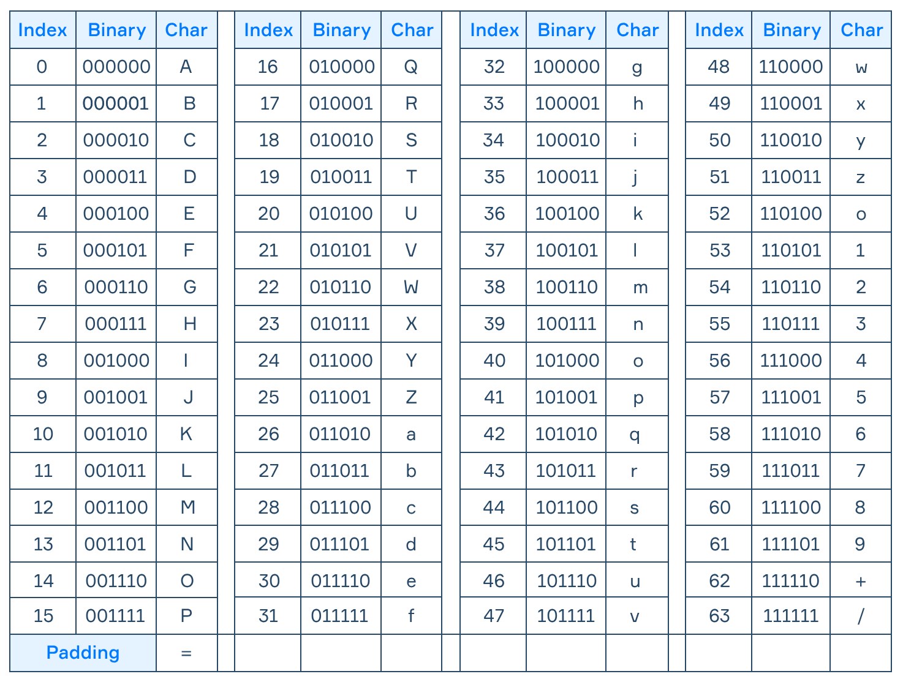
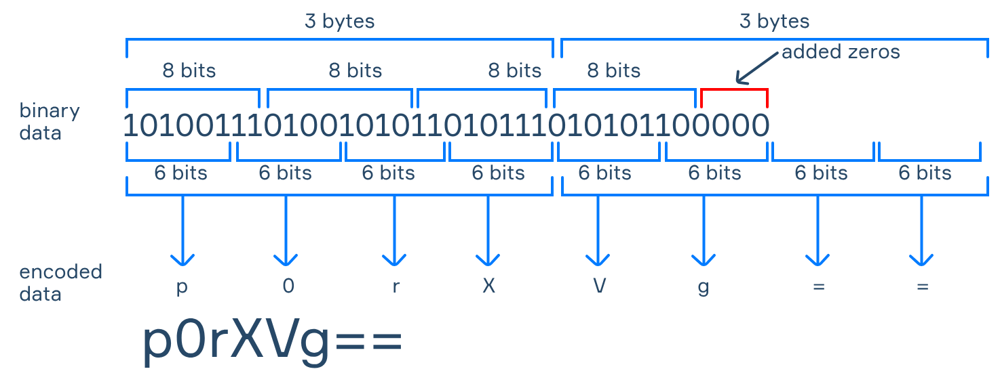

# Base64 and other bases

Some systems transfer data as text instead of binary for compatibility or security reasons. To address this, encoding schemes convert binary data into text

## Base64

In simple terms, Base64 is an encoding scheme for translating binary data to text using 64 ASCII symbols.

In Base64, we use 64 ASCII symbols to represent all possible combinations of 0s and 1s in 6 bits of binary data. Here is an index table with the 64 ASCII symbols.

When do you need this encoding scheme? 
Primarily when you want to transmit 8-bit binary data by protocols designed to carry text data.
The main applications are:

- transferring binary data, like attachments in email;
- inserting binary data such as images into text files like HTML, CSS, XML, or scripts;
- part of encryption programs following OpenPGP protocol;
- converting binary data to include it in URLs.

## How does it work?

Let's look at the process of encoding binary using base64.

1. First, divide 8-bit binary data into groups, each containing 6 bits.
2. However, you can see that every 3 bytes (24 bits) are encoded with 4 groups of 6 bits. If the end of the sequence is less than 3 bytes (like in the picture), fill all empty places for the 6-bit group that has some bits of binary data with zeros (the second group with added zeroes), and fill the remaining 6 empty bits with the padding symbol `=`.

## Other base*

Other binary-to-text base-encoding schemes primarily differ by the number of bits
in the groups after dividing binary data. They have their own pros and cons. Here are some other encoding schemes:

- **Base16** divides data into 4-bit groups and uses 16 symbols to encode them. Conveniently, this encodes one byte as 2 symbols at the same time. Because of this, it takes two bytes to encode one byte, so the space efficiency is only 50%.
- **Base32** divides data into 5-bit groups and uses 32 symbols to encode them. The advantage of this scheme is the use of symbols of one register and removing similar-looking numbers like `1` and `0` that look similar to letters `I` and `O`. Though it is more space efficient than base16, it still uses more space for encoded data than base64.
- **Base85** encodes 4 bytes with 5 symbols. It treats these 4 bytes as the whole 32-bit number (4 bytes * 8 bits).
This encoding scheme is more space efficient than base64. But it also contains symbols like `"` `'` `/` `<` that have special meaning in many programming languages.

