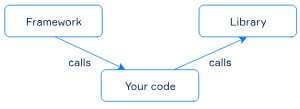

# Framework

A framework is a universal, reusable piece of software that facilitates the development of typical applications or their parts. It consists of structured code templates and provides generic functionality which can be easily extended for the needs of a specific application. To relinquish control on low-level tasks and focus on the high-level problems, you should use the API provided by the framework. It can significantly reduce total development time.

## Framework vs library

Applications that use frameworks are built on top of them and extend their code to get specific functionality. In a sense, a framework serves as the skeleton of an application or its parts and sets "the rules of the game". A library, on the other hand, only provides some specific operations without having such a global influence. However, libraries can be provided as parts of frameworks.

The most common principle that comes with frameworks is Inversion of Control (IoC).

In a framework, unlike in libraries or standard user applications, the overall program's flow of control is dictated not by the caller but by the framework. It means the framework calls your code, and not vice versa:

