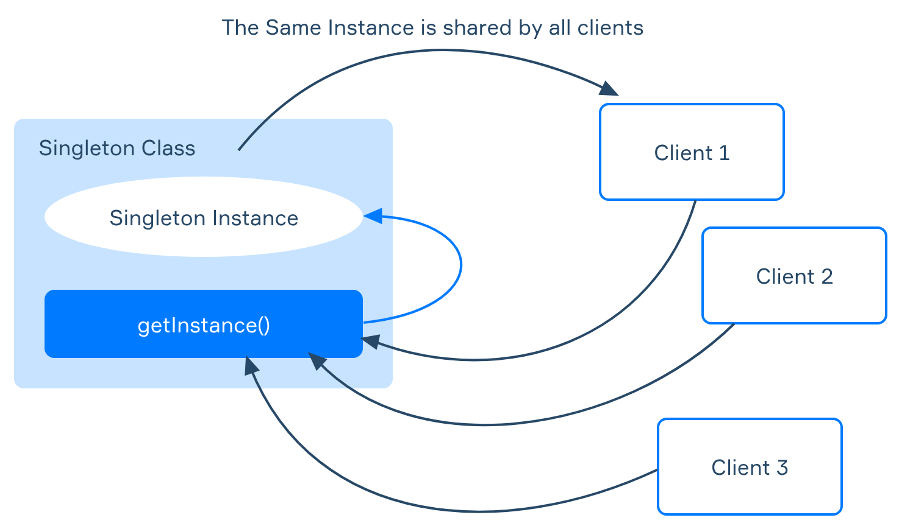

# Singleton Pattern

Singleton is a creational design pattern that allows you to keep only one instance of an object and provide global access to it. 

it solves two problems:

- **Keeping only one instance of an object** is useful when you want to control access to some shared resources. When you create one object of a class, if you use a singleton pattern, you will always have that same object. In case you'll try to create another one, the code will return the first initiated object each time.

- **Providing a global access point** to allow all clients to use the initiated instances. When you address this problem, you also should squeeze all the code regarding the first problem in one class, to avoid it being scattered all over your code.

## Structure

- **The Singleton** class declares the static method `getInstance` that returns the same instance of its own class.
The Singleton’s constructor should be hidden from the client code. Calling the `getInstance` method should be the only way of getting the Singleton object.

## Prospects

- You can be sure that a class has only a single instance.
- You gain a global access point to that instance.
- The singleton object is initialized only when it’s requested for the first time.

## Consequences

- Violates the Single Responsibility Principle. The pattern solves two problems at the time.
- The Singleton pattern can mask bad design, for instance, when the components of the program know too much about each other.
- The pattern requires special treatment in a multithreaded environment so that multiple threads won’t create a singleton object several times.
- Singletons are hard to unit test due to private constructors and static methods, making mocking difficult. Solutions are creative mocking, skipping tests, or avoiding Singleton altogether.

## Reference

- https://refactoring.guru/design-patterns/singleton