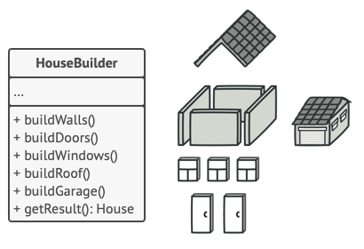
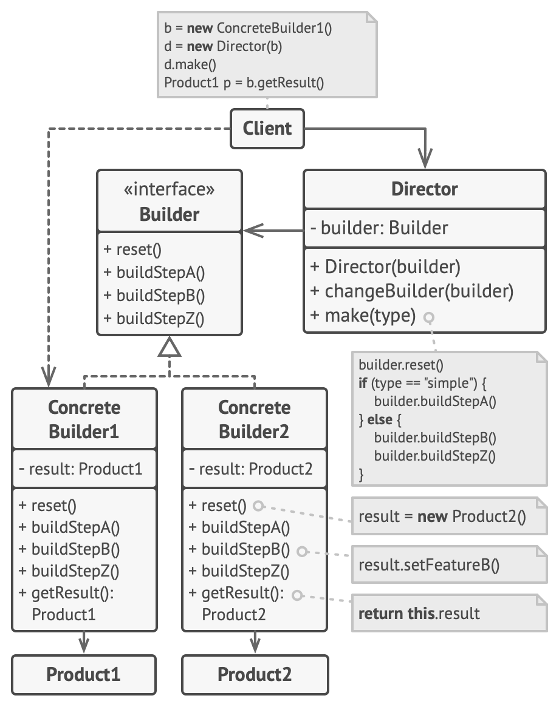
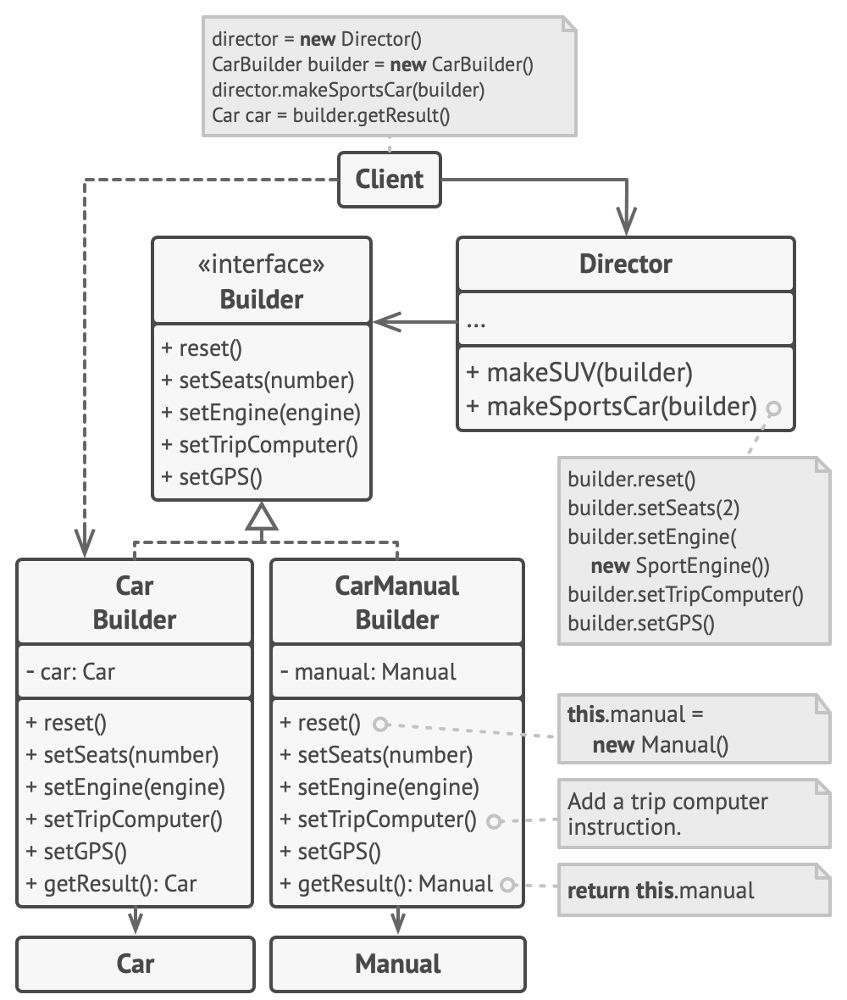

# Builder Pattern

## Problem

Imagine a complex object that requires laborious, step-by-step initialization of many fields and nested objects.
Such initialization code is usually buried inside a monstrous constructor with lots of parameters. 

## Solution

**The Builder pattern** suggests that you extract the object construction code out of its own class and move it to separate objects called **builders**.

The pattern organizes object construction into a set of steps (`buildWalls`, `buildDoor`, etc.).
To create an object, you execute a series of these steps on a builder object.

The important part is that you don’t need to call all of the steps.

## Structure

- **The Builder interface**:
declares product construction steps that are common to all types of builders.

- **Concrete Builders**
provide different implementations of the construction steps.

- **The Director** (Optional):
defines the order in which to call construction steps, so you can create and reuse specific configurations of products.

- **The Client**:
assigns a `Builder` object to the `Director`, usually through the constructor. The director then uses this builder for all construction tasks. Alternatively, the client can pass a different builder to the production method, allowing flexibility to switch builders for each product.

## Director

The director class defines the order in which to execute the building steps,
while the builder provides the implementation for those steps.

Having a director class in your program isn’t strictly necessary.

You can always call the building steps in a specific order directly from the client code.
However, the director class might be a good place to put various construction routines so you can reuse them across your program.

## Pseudoocode

## Prospects
- **Single Responsibility Principle**. You can isolate complex construction code from the business logic of the product.
- You can construct objects step-by-step, defer construction steps or run steps recursively.
- You can reuse the same construction code when building various representations of products.

## Consequences

- The overall complexity of the code increases since the pattern requires creating multiple new classes.

## reference:

[builder-design-pattern](https://refactoring.guru/design-patterns/builder)

