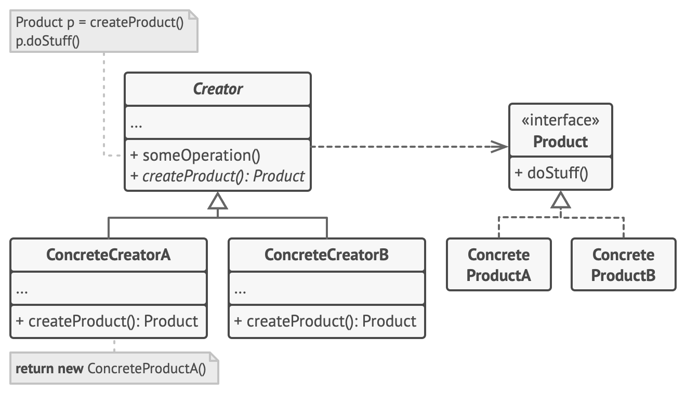
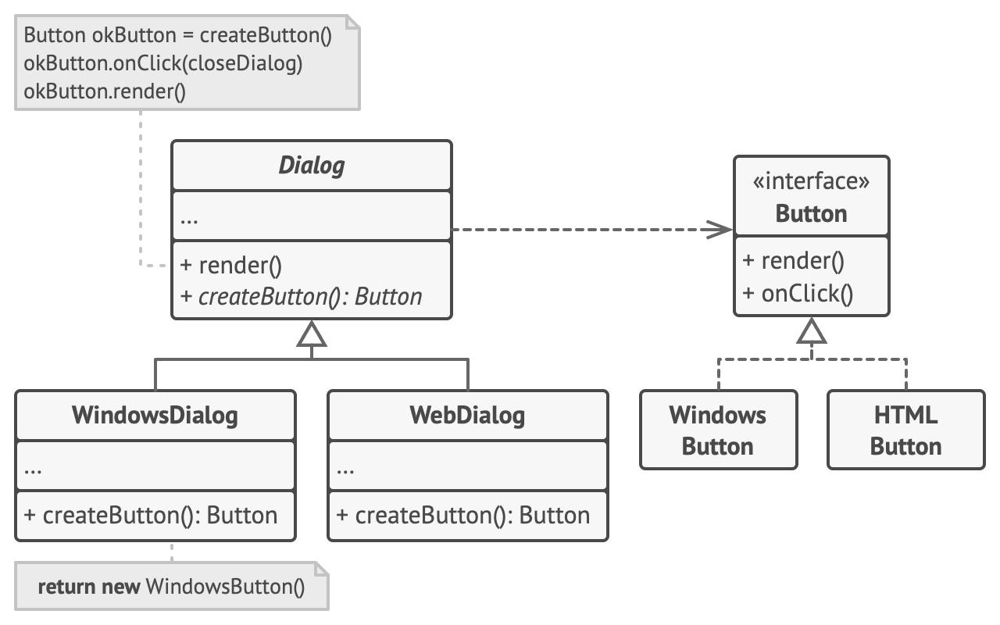

# Factory Method

## Problem

In a logistics management app, the code is tightly coupled with the Truck class.
When adding Sea transportation (Ships), the codebase needs extensive modification.
Future additions of new transportation types will also require similar changes, leading to messy code with multiple conditionals and poor maintainability.

## Solution

The Factory Method Pattern replaces **direct object creation** with a **factory method**.
This allows subclasses to override the factory method and produce different products without modifying existing code.

## Structure

- **The Product**:
declares the interface, which is common to all objects that can be produced by the creator and its subclasses.

- **Concrete Products**:
are different implementations of the product interface.

- **The Creator**:
class declares the factory method that returns new product objects. It’s important that the return type of this method matches the product interface.

- **Concrete Creators**:
override the base factory method so it returns a different type of product.
Note that the factory method doesn’t have to create new instances all the time. It can also return existing objects from a cache, an object pool, or another source.

## Pseudocode

## Prospects

- **Single Responsibility Principle**. You can move the product creation code into one place in the program, making the code easier to support.
- **Open/Closed Principle**. You can introduce new types of products into the program without breaking existing client code.
- You avoid tight coupling between the creator and the concrete products.

## Consquences

- The code may become more complicated since you need to introduce a lot of new subclasses to implement the pattern.

## References

- https://refactoring.guru/design-patterns/factory-method

