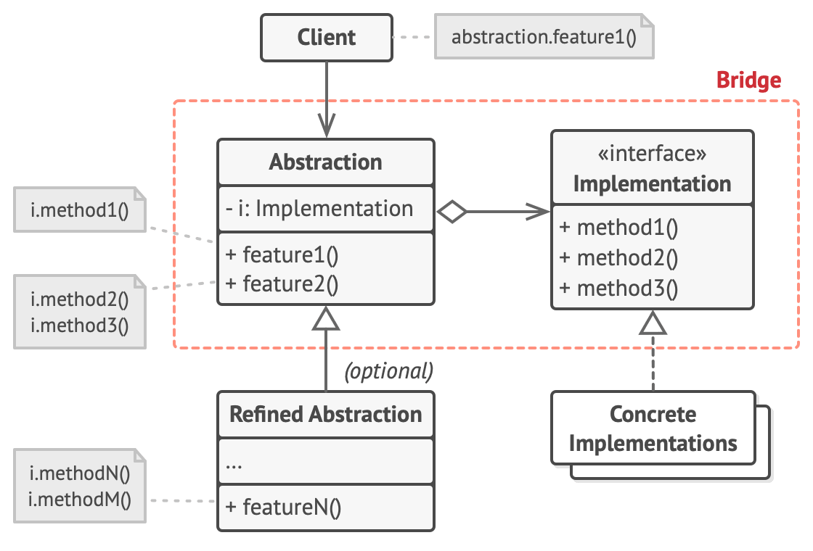
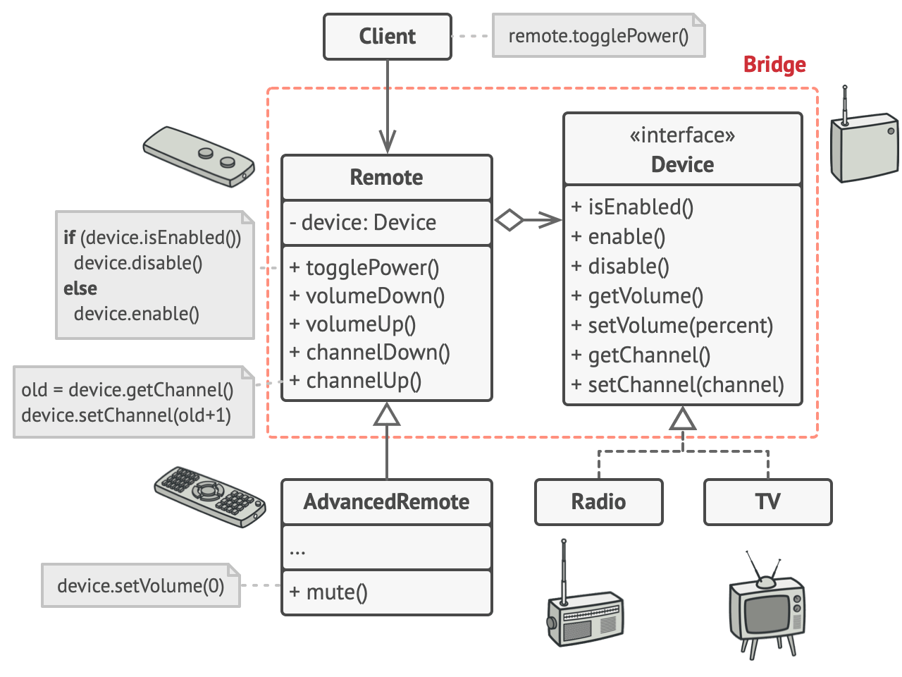

# Bridge

## Problem

For example, When trying to extend a `Shape` hierarchy (e.g., `Circle` and `Square`) with colors (e.g., `Red` and `Blue`), the number of subclasses grows exponentially.

For example, adding `RedCircle` and `BlueSquare` is manageable, but introducing new shapes or colors leads to class explosion, making the code complex and hard to maintain.

## Solution

Instead of creating subclasses for each `Shape`-`Color` combination, the `Color` code is extracted into a separate hierarchy (e.g., Red and Blue). The `Shape` class holds a reference to a `Color` object, acting as a bridge between the two hierarchies.

This way, adding new shapes or colors becomes independent, avoiding exponential growth in the class hierarchy.

## Structure

- **The Abstraction**:
provides high-level control logic. It relies on the implementation object to do the actual low-level work.

- **The Implementation**:
declares the interface that’s common for all concrete implementations.
An abstraction can only communicate with an implementation object via methods that are declared here.

- **Concrete Implementations**: contain platform-specific code.

- **Refined Abstractions**(Optional): provide variants of control logic. Like their parent, they work with different implementations via the general implementation interface.

- Usually, the **Client** is only interested in working with the abstraction. However, it’s the client’s job to link the abstraction object with one of the implementation objects.

## Pseudocode

## Prospects

- **Single Responsibility Principle.**
You can focus on high-level logic in the abstraction and on platform details in the implementation.
-  **Open/Closed Principle**.
You can introduce new abstractions and implementations independently from each other.
- You can create platform-independent classes and apps.
- The client code works with high-level abstractions.
It isn’t exposed to the platform details.

## Conssequences

- You might make the code more complicated by applying the pattern to a highly cohesive class.

## The defference from `Bridge` and `Factory Method`
- Factory Method pattern is a creational pattern. It is responsible for creating instances of other objects.
- Bridge is a structural pattern. It solves a problem regarding the structure of your code.
Bridge is responsible for decoupling an abstraction from an implementation. 

## Reference
- https://refactoring.guru/design-patterns/bridge

