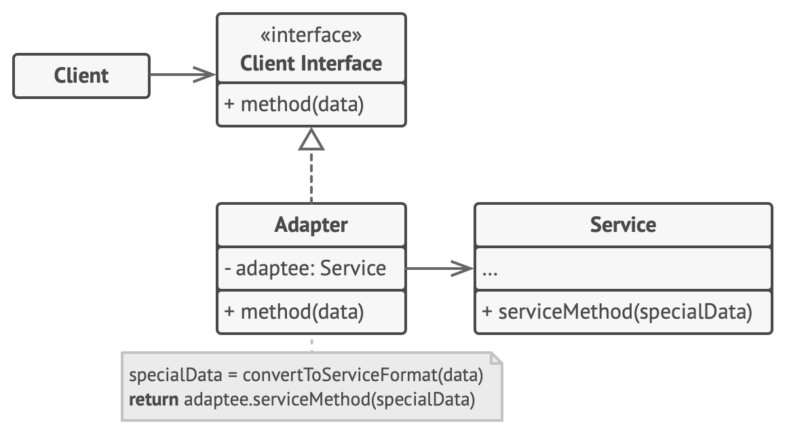
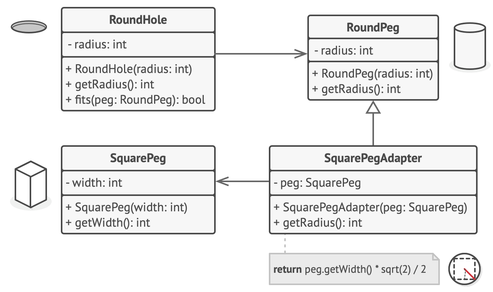

# Adapter pattern

## Problem

In a stock market app, data is downloaded in XML format, but a 3rd-party analytics library only supports JSON format.

Directly modifying the library to accept XML is risky and might break existing code or be impossible without access to the source code. This incompatibility issue makes it difficult to integrate the new library into the app.

## Solution

You can create an adapter. This is a special object that converts the interface of one object so that another object can understand it.

## Structure

- **The Client**:
is a class that contains the existing business logic of the program.

- **The Client Interface**: describes a protocol that other classes must follow to be able to collaborate with the client code.

- **The Service** is some useful class (usually 3rd-party or legacy).
The client can’t use this class directly because it has an incompatible interface.

## Pseudocode

## Prospects

- **Single Responsibility Principle**. You can separate the interface or data conversion code from the primary business logic of the program.
- **Open/Closed Principle**. You can introduce new types of adapters into the program without breaking the existing client code, as long as they work with the adapters through the client interface

## Consequences

- The overall complexity of the code increases because you need to introduce a set of new interfaces and classes.

## References
- https://refactoring.guru/design-patterns/adapter
