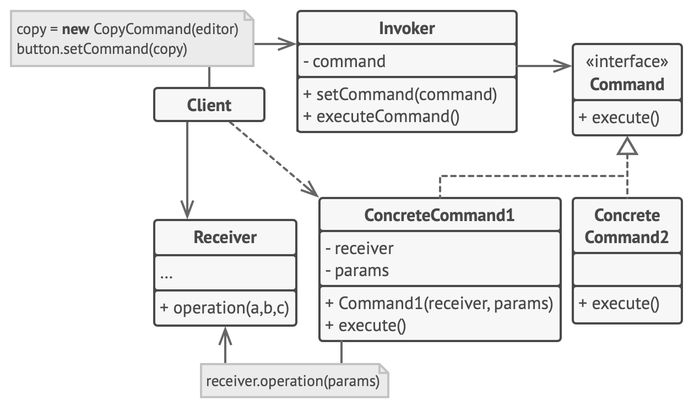
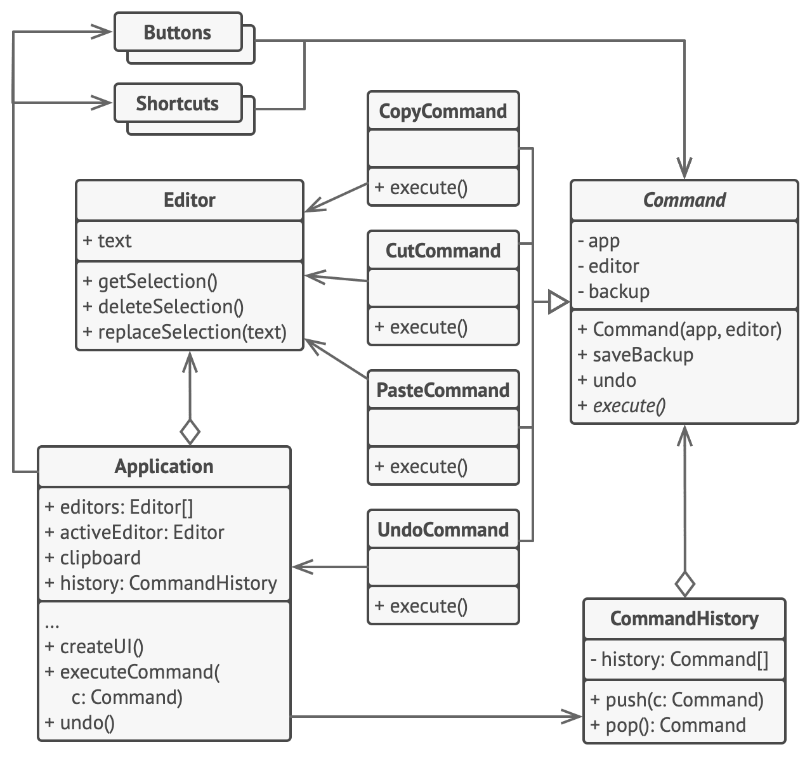

# Command

## Problem

When handling buttons with different functions, a common approach is to create multiple subclasses for each button. However, this leads to tight coupling between the GUI and business logic, making the code fragile and hard to maintain.

The Command Design Pattern offers a better solution by encapsulating requests as objects, allowing for the decoupling of the sender and receiver. This enhances code flexibility and scalability.

>[!NOTE]
> A "volatile" variable is a directive to the compiler, indicating that a variable's value can be changed unexpectedly by external events

## Key Components

- **Command Interface**:
interface usually declares **just a single method** for executing the command.

- **Concrete Command**:
Implements the method from the interface.
Concrete Commands act as intermediaries, passing requests to business logic objects.
They can store parameters as fields and be made immutable by setting these fields through the constructor.

- **The Sender (Invoker)**:
triggers a Command object instead of directly interacting with the receiver.
The command is pre-created by the Client and passed to the sender via the constructor, ensuring flexibility and decoupling.

- **Receiver**:
The Receiver class contains the business logic.
Almost any object may act as a receiver.
Most commands only handle the details of how a request is passed to the receiver, while the receiver itself does the actual work.

- **Client**:
The Client creates and configures concrete command objects.
The client must pass all of the request parameters, including a receiver instance, into the command’s constructor.
After that, the resulting command may be associated with one or multiple senders.

## Pseudocode

## Prospects:

- **Single Responsibility Principle**. You can decouple classes that invoke operations from classes that perform these operations.
-  **Open/Closed Principle**. You can introduce new commands into the app without breaking existing client code.
- You can assemble a set of simple commands into a complex one.

## Consequences:

- The code may become more complicated since you’re introducing a whole new layer between senders and receivers.

## reference

- https://refactoring.guru/design-patterns/command

