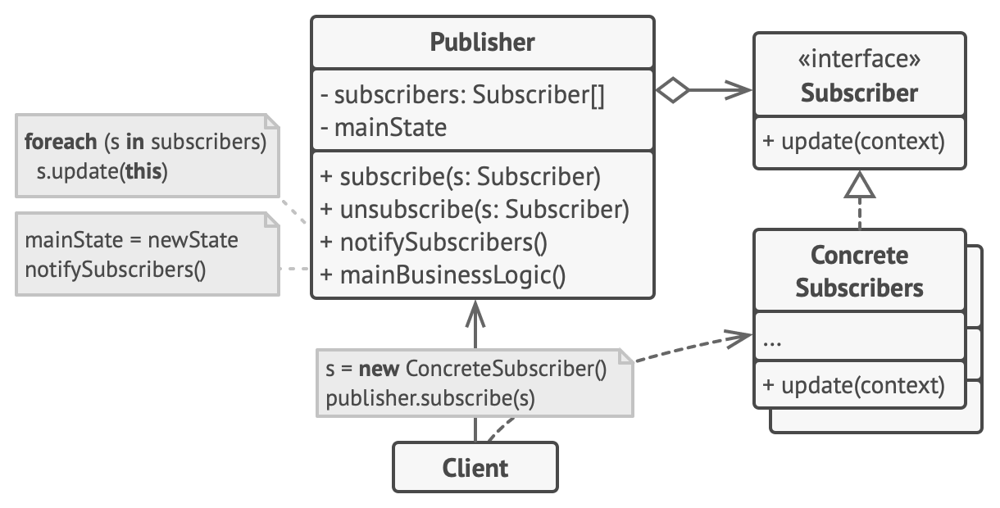
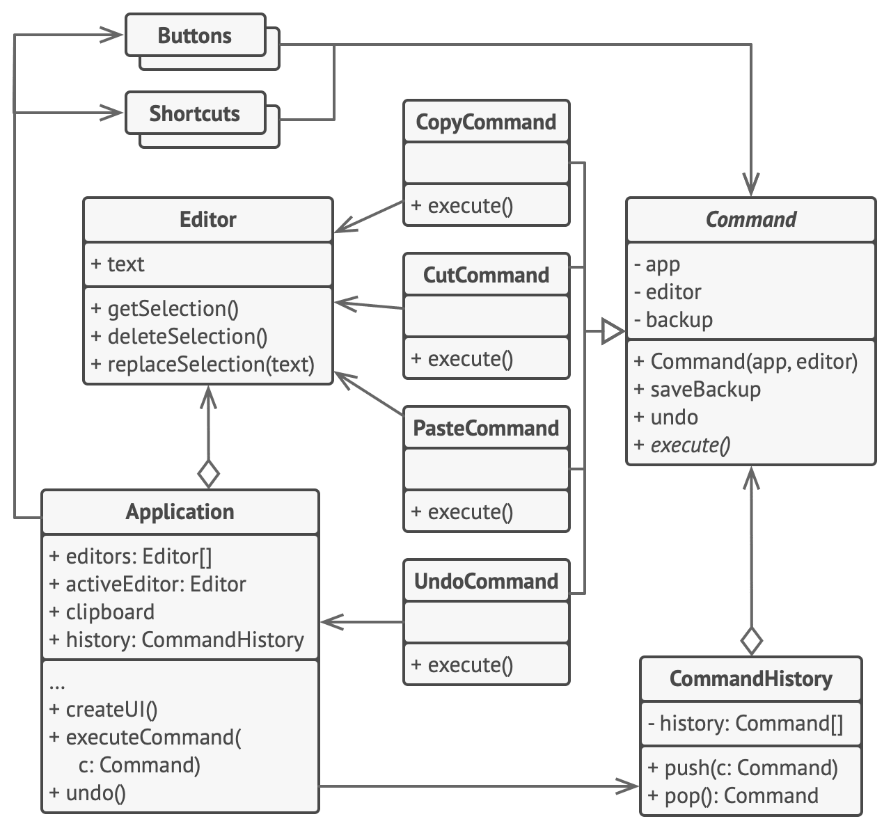

# Observer Design Pattern

## Problem

There are two objects: a Customer and a Store.
The customer is eager to buy a new product (like the latest iPhone), which will soon be available in the store.

If the customer visits the store daily to check for availability, it would be a waste of time.
On the other hand, if the store sends frequent emails to all customers when new products arrive, it could be considered spam and annoy those who aren't interested.

This creates a conflict: either the customer wastes time, or the store wastes resources.

## Solution

The object with an interesting state is called the **publisher**, while the objects that want to track its changes are called **subscribers**.

## Structure

- **The Publisher**:
issues events of interest to other objects. These events occur when the publisher changes its state or executes some behaviors. Publishers contain a subscription infrastructure that lets new subscribers join and current subscribers leave the list.

- **The Subscriber interface**:
declares the notification interface.
In most cases, it consists of a single update method.

- **Concrete Subscribers**:
the implementation of the Interface that perform some actions in response to notifications issued by the publisher.
All of these classes must implement the same interface so the publisher isn’t coupled to concrete classes.

- **The Client**:
creates publisher and subscriber objects separately and then registers subscribers for publisher updates.

## Pseudocode

## Prospects

- **Open/Closed Principle**.
You can introduce new subscriber classes without having to change the publisher’s code (and vice versa if there’s a publisher interface).

- You can establish relations between objects at runtime.

## Consequences

- Subscribers are notified in random order.

## reference

- https://refactoring.guru/design-patterns/observer