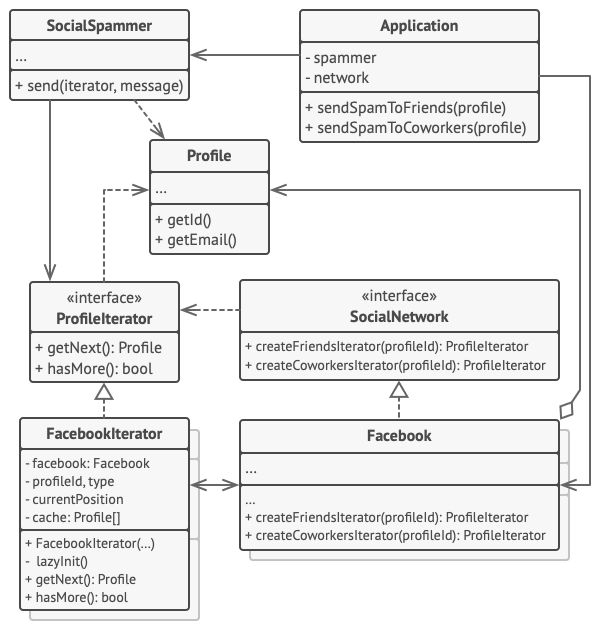

# Iterator

## Problem

Collections like lists, trees, and graphs store elements differently, **but all need a way to traverse their elements sequentially**.

However, directly adding multiple traversal algorithms (e.g., depth-first, breadth-first) to the collection class violates its primary responsibility of data storage.
It also couples client code to the specific collection’s structure, making the code inflexible and harder to maintain.

## Solution

The main idea of the Iterator pattern is to extract the traversal behavior of a collection into a separate object called an iterator.

## Structure

- **The Iterator interface**: 
declares the operations required for traversing a collection: fetching the next element, retrieving the current position, restarting iteration, etc.

- **Concrete Iterators**:
implement specific algorithms for traversing a collection. The iterator object should track the traversal progress on its own. This allows several iterators to traverse the same collection independently of each other.

- **The Collection interface**:
declares one or multiple methods for getting iterators compatible with the collection

- **Concrete Collections**:
return new instances of a particular concrete iterator class each time the client requests one. 

- **The Client** works with both collections and iterators via their interfaces. This way the client isn’t coupled to concrete classes, allowing you to use various collections and iterators with the same client code.
Typically, clients don’t create iterators on their own, but instead get them from collections.

## Pseudocode

## Prospects

- **Single Responsibility Principle**. You can clean up the client code and the collections by extracting bulky traversal algorithms into separate classes.

-  **Open/Closed Principle**. You can implement new types of collections and iterators and pass them to existing code without breaking anything.

- You can iterate over the same collection in parallel because each iterator object contains its own iteration state.
- For the same reason, you can delay an iteration and continue it when needed.

## Consequences

-  Applying the pattern can be an overkill if your app only works with simple collections.
-   Using an iterator may be less efficient than going through elements of some specialized collections directly.

## Reference

- https://refactoring.guru/design-patterns/iterator

