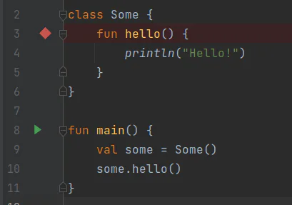
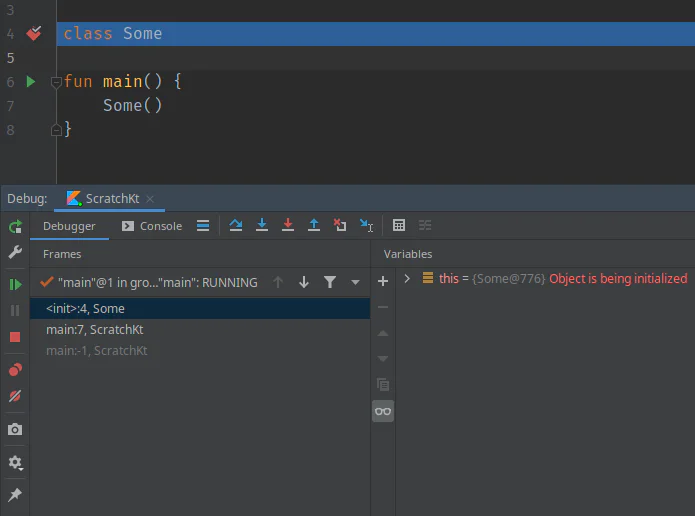
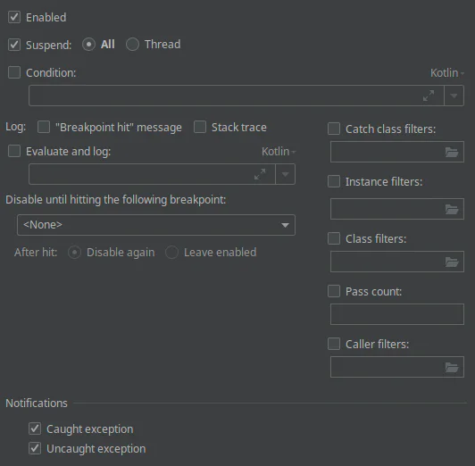

# Advanced debugger features

Line breakpoints are useful, but there are several other places where it can be helpful to stop execution:

- When the primary constructor is invoked.

- When a particular method is invoked. Including one that's been overridden or one with incorrect or missing source code.

- When an exception of a specific type is thrown.

- The next line of the current method, when program execution has already been stopped.

- The first line of the method that's going to be invoked and added to the call stack next.

- The next line of the caller method after the currently executing method is popped from the call stack.

## Constructor and method breakpoints
To set a **method breakpoint**, click in the gutter against the method declaration and you will see a diamond breakpoint indicator:

The execution will stop at the first line of the method

A **primary constructor** might not contain any statements and may not even have any property declarations or parentheses.

To set a constructor breakpoint, click in the gutter against the class declaration. You will see a diamond instead of a circle, and the execution will stop right inside the constructor, which is called `<init>` in the bytecode:

## Exception breakpoints

When an application crash occurs, you can see its stack trace, but that's not always enough. Walking through stack frames and observing application state just before the crash could be very helpful.

Pressing Run → View Breakpoints... enables you to see all the current breakpoints and to set **exception breakpoints**

Kotlin uses the same exception machinery as Java, so click the Java Exception Breakpoints option. Having done this, you can choose any of the exception types available in the current project and configure whichever details you want. For example, you can opt to stop on caught exceptions, uncaught exceptions, or both.

Done! Now, execution will stop when an exception that meets the specified conditions is thrown.