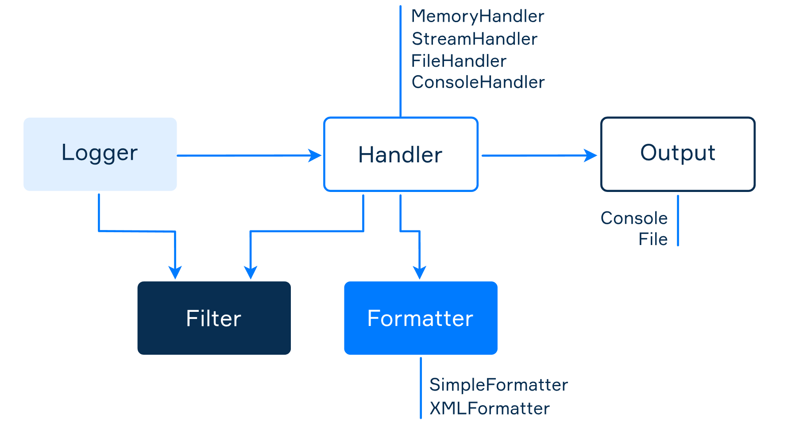

# Log

Logging refers to the act of recording during the execution of an application. Logs are records that give us information about the events in a software application. This record could be a message that is enough to understand the event that happened, it may include a timestamp, a description, and a severity level. These events could be user-generated or system-generated. We use either a log file or, sometimes, the standard output to make these records.

## We need logging for several reasons. 
- troubleshooting

- auditing

- profiling

- statistics

## Log levels

- **Debug** logs are used to diagnose applications. Debugging messages inform us about what the program is doing at a certain step and what it gets as a result of these actions. 

- **Info** is used to log important information about an application. It is used to log service start, service stop, configurations, assumptions. 

- **Warn** logs are considered to be the first level of application failure. They are usually applied to log repeated attempts to access a resource, missing secondary data, or switching from a primary server to a back-up server. 

- **Error** log level is used for more critical problems. These kinds of issues usually affect the result of the operation but do not terminate the program. Errors are considered to be the second level of application failures. 

- **Fatal** is the third level of application failures. It is used to indicate a much more serious error that causes the termination of the program. Such a message may say that the program totally failed and depending on the time and conditions of this failure the developers can find out how to fix the problem.

## Log Format
```bash
[date time][log level][message]
```

## Standard logging for JVM



### Logger class

There are seven log levels in Java's logging package. The list below shows them from the highest to the lowest severity.
|Log Level| Value |
|---------|-------|
| SEVERE  | 1000  |
| WARNING | 900   |
| INFO    | 800   |
| CONFIG  | 700   |
| FINE    | 500   |
| FINER   | 400   |
| FINEST  | 300   |

### Handlers and formatters

**handlers** (`Handler` in the `java.util.logging package`) are responsible for sending actual logs to the outside world. It is extended by five concrete classes. Two most important classes among them are `ConsoleHandler` and `FileHandler`. `ConsoleHandler` writes log messages to `System.err`, while `FileHandler` writes log messages to a file.

handler uses a **formatter** to format the log message. There are two types of formatters in the logging package. Those are `SimpleFormatter` and `XMLFormatter`. Of course, both of them extend the `Formatter` abstract class in the logging package.

Example:

```kotlin
import java.util.logging.FileHandler
import java.util.logging.Handler
import java.util.logging.Logger
import java.util.logging.XMLFormatter

object Main {
    @JvmStatic
    fun main(args: Array<String>) {
        val logger = Logger.getLogger(Main::class.java.name)
        val fileHandler: Handler = FileHandler("default.log")
        logger.addHandler(fileHandler)
        fileHandler.formatter = XMLFormatter()
        logger.info("Info log message")
    }
}
```


output file:

```log
<?xml version="1.0" encoding="UTF-8" standalone="no"?>
<!DOCTYPE log SYSTEM "logger.dtd">
<log>
<record>
  <date>2023-01-09T07:29:56.688157Z</date>
  <millis>1673249396688</millis>
  <nanos>157000</nanos>
  <sequence>0</sequence>
  <logger>Main</logger>
  <level>INFO</level>
  <class>Main</class>
  <method>main</method>
  <thread>1</thread>
  <message>Info log message</message>
</record>
</log>
```

## Filters

When we are developing a software application, we write as many log messages as possible. But we don’t want all the log messages to be executed every time the application runs: it will waste resources and may result in unnecessarily long log files. That’s why we use filters. 

For that, first, you have to create a **custom filter** class by implementing the `Filter` interface in the logging package.

```kotlin
class FilterExample : Filter {
    override fun isLoggable(record: LogRecord): Boolean {
        return if (record.level !== Level.INFO) {
            false
        } else true
    }
}
```

### Logback

a popular logging library named Logback. It is a successor to the Log4j logging library and is based on similar concepts.

Logback is fast in both synchronous and asynchronous logging and offers many useful features, which makes it a good choice for a project of any scale.

The most important difference between using a `Logback` logger and simply printing a message to `System.out` is that each logger has a context. The logger context allows enabling or disabling certain log messages and is responsible for creating logger instances and arranging their hierarchy. Let's take a closer look at all these features.

### Adding Logback to a project

```kotlin
dependencies {
    implementation ("ch.qos.logback:logback-classic:1.2.11")
}
```

This library will transitively pull two other dependencies, `slf4j-api` and `logback-core`.

**SLF4J** (Simple Logging Facade for Java) is a facade or abstraction for various logging libraries, including Logback. It provides a simple logging API, and Logback implements it natively. You can invoke the SLF4J logger with Logback as its underlying implementation without any overhead.

The `logback-core` library lays the foundation for Logback and provides a few ready-made classes for use. They are:

- ConsoleAppender, which adds log events to System.out or System.err;

- FileAppender, which adds log events to the file;

- RollingFileAppender, which adds log events to the file and can change its logging target to another file when a certain condition is met.

The logback-classic library provides classes that make it possible to send data to external systems. They are:

- SMTPAppender, which collects data in packets and sends the contents of the packet to a user-defined email after the occurrence of an event specified by the user;

- DBAppender, which adds data to database tables.

### Fine-tuning the logger configuration and logger levels

To configure loggers in Logback, you can use an xml file or a Groovy file.

you will need to go to logback.xml file and then specify the parameters name and level. In the name parameter, specify the path to the package or class in your project, and in the level parameter, specify the logging level that you need. 

```kotlin
import org.slf4j.LoggerFactory

class Example {
    private val LOG = LoggerFactory.getLogger(Example::class.java)

    fun log() {
        LOG.warn("WARN level message")
        LOG.info("INFO level message")
    }
}

class LoggerLevelClass {
    private val LOG = LoggerFactory.getLogger(LoggerLevelClass::class.java)

    fun log() {
        LOG.debug("DEBUG level message")
        LOG.info("INFO level message")
    }
}

fun main() {
    Example().log()
    LoggerLevelClass().log()
}
```

```xml
<configuration>
<appender name="console" class="ch.qos.logback.core.ConsoleAppender">
    <encoder>
        <pattern>%d{HH:mm:ss.SSS} [%thread] %-5level %logger{36} - %msg%n</pattern>
    </encoder>
</appender>

<logger name="com.example" level="warn"/>
<logger name="com.example.LoggerLevelClass" level="info"/>

<root level="info">
    <appender-ref ref="console" />
</root>
</configuration>
```

Each logger will output only the messages whose log request level is higher than or equal to the level of the logger.

```bash
16:19:28.528 [main] INFO Example - INFO Level message
16:19:28.533 [main] INFO Example - INFO Level message
16:19:28.524 [main] INFO LoggerLevelClass - INFO Level message
Process finished with exit code 0
```


