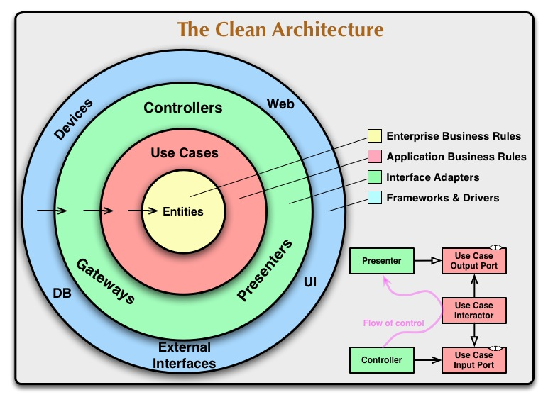

# Clean Architecture

The Clean Architecture **is a software architecture** proposed by Robert C. Martin (better known as Uncle Bob).

## The Dependency Rule

The concentric circles represent different areas of software. In general, the further in you go, the higher level the software becomes. The outer circles are mechanisms. The inner circles are policies.

This rule says that **source code dependencies** can only **point inwards**.
Nothing in an inner circle can know anything at all about something in an outer circle.

In particular, the name of something declared in an outer circle must not be mentioned by the code in the an inner circle.
That includes, functions, classes. variables, or any other named software entity.

## Entities

Entities encapsulate Enterprise wide business rules.
An entity can be an object with methods, or it can be a set of data structures and functions.
The entities could be used by many different applications in the enterprise.

In the most case entities are the business objects of the application.
They encapsulate the most general and high-level rules.
They are the least likely to change when something external changes.

## Use Cases

This layer contains application specific business rules.
It encapsulates and implements all of the use cases of the system.
These use cases orchestrate the flow of data to and from the entities, and direct those entities to use their business rules to achieve the goals of the use case.

We do not expect changes in this layer to affect the entities.
We also do not expect this layer to be affected by changes to externalities such as the database, the UI, or any of the common frameworks.
This layer is isolated from such concerns.

## Interface Adapters

This layer is a set of adapters that convert data from the format most convenient for the **use cases** and **entities**, to the format most convenient for some external agency such as the Database or the Web.

For example, that will wholly contain the Architecture of a GUI.
The `Presenters`, `Views`, and `Controllers` all belong in here.
The models are likely just data structures that are passed from the controllers to the use cases, and then back from the use cases to the presenters and views.

Similarly, data is converted, in this layer, from the form most convenient for entities and use cases, into the form most convenient for whatever persistence framework is being used.i.e. The Database.
No code inward of this circle should know anything at all about the database.
If the database is a SQL database, then all the SQL should be restricted to this layer, and in particular to the parts of this layer that have to do with the database.

Also in this layer is any other adapter necessary to convert data from some external form, such as an external service, to the internal form used by the use cases and entities.

## Frameworks and Drivers

The outermost layer is generally composed of frameworks and tools such as the Database, the Web Framework, etc.

Generally you don’t write much code in this layer other than the code that communicates to the next circle inwards.

This layer is where all the details go. The Web is a detail. The database is a detail. We keep these things on the outside where they can do little harm.

## Advantages of Clean Architecture

- **Independence from Frameworks**: Avoids being locked into a specific framework, making it easier to adopt new technologies.
- **Testability**: Business logic can be tested independently of UI, database, or external services.
- **Separation of Concerns**: Clear division between business rules, use cases, and external dependencies improves maintainability.
- **Scalability**: Flexible architecture allows teams to expand the system without affecting core functionalities.
- **Easy UI and Database Replacement**: UI or database can be swapped out without modifying the core logic.

## Disadvantages of Clean Architecture

- **Increased Complexity**: Requires multiple layers, leading to more code and abstraction.
- **Steeper Learning Curve**: Developers unfamiliar with dependency inversion and architecture layers may struggle initially.
- **More Boilerplate Code**: Implementing boundaries between layers requires additional interfaces and data conversion logic.
- **Potential Performance Overhead**: Extra layers and dependency inversion can introduce slight performance trade-offs.
- **Not Always Necessary**: Overengineering for small projects can slow development without significant benefits.

## Reference
- https://blog.cleancoder.com/uncle-bob/2012/08/13/the-clean-architecture.html

