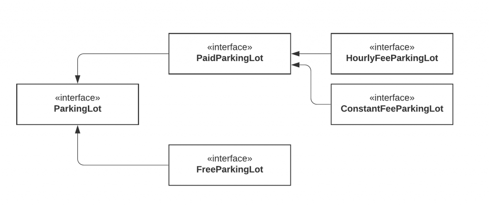

# Interface Segregation Principle

When starting a new application, the first idea that comes to mind is to define functions, classes, and interfaces we would use throughout the project. Working further with the code, we may miss the point when our interfaces start taking on more than they can handle, making it hard to work with them. This is where the Interface Segregation Principle comes into play.

The Interface Segregation Principle (ISP) is based on two key points: 

- objects should not be forced to implement parts of the interfaces they don't use;
- many specific interfaces are better than one general-purpose interface.

In other words, to make our interfaces accurate, we should make them specific, so we won't have to implement needless methods in the future.

## Example

We modeled a very simplified parking lot.

```java
public interface ParkingLot {

    void parkCar();    // Decrease empty spot count by 1
    void unparkCar(); // Increase empty spots by 1
    void getCapacity();    // Returns car capacity
    double calculateFee(Car car); // Returns the price based on number of hours
    void doPayment(Car car);
}

class Car {

}
```

It is the type of parking lot where you pay an hourly fee.
Now consider that we want to implement a parking lot that is free.

```java
public class FreeParking implements ParkingLot {

    @Override
    public void parkCar() {

    }

    @Override
    public void unparkCar() {

    }

    @Override
    public void getCapacity() {

    }

    @Override
    public double calculateFee(Car car) {
        return 0;
    }

    @Override
    public void doPayment(Car car) {
        throw new Exception("Parking lot is free");
    }
}
```
Our parking lot interface was composed of 2 things: Parking related logic (park car, unpark car, get capacity) and payment related logic.

But it is too specific. Because of that, our `FreeParking` class was forced to implement payment-related methods that are irrelevant. Let's separate or segregate the interfaces.



We've now separated the parking lot. With this new model, we can even go further and split the PaidParkingLot to support different types of payment.


## Reference 
- https://hyperskill.org/learn/step/10089
- https://www.freecodecamp.org/news/solid-principles-explained-in-plain-english/