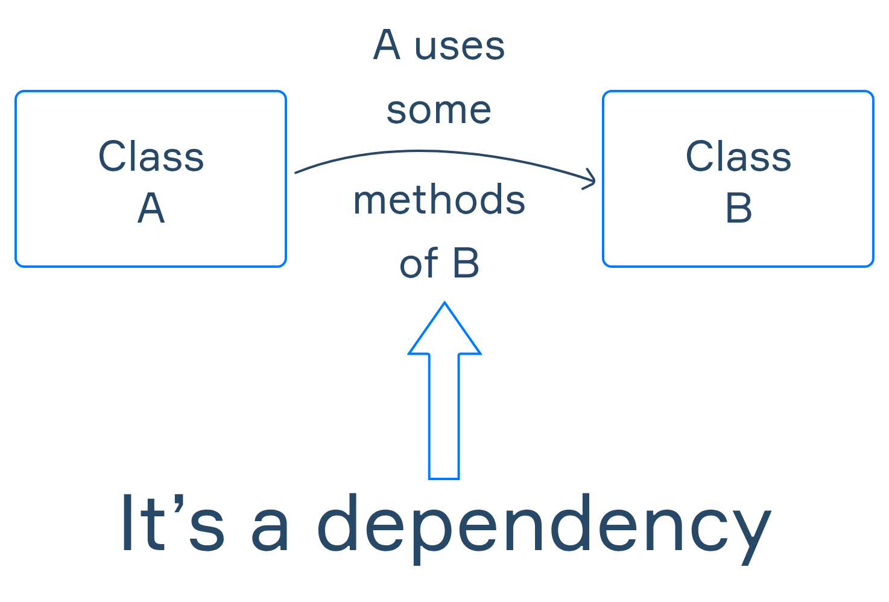

# Dependency Inversion

The Dependency Inversion principle states that our classes should depend upon interfaces or abstract classes instead of concrete classes and functions.

## Inversion of control

Inversion of Control (IoC) is a software design principle in which the control flow of a program is reversed compared to the traditional approach.
Instead of manually calling libraries or components, IoC allows a framework or container to manage and invoke application components when needed.
This helps separate business logic from infrastructure, improving scalability and maintainability.

A common way to implement IoC is through Dependency Injection (DI), Service locator where an object's dependencies are provided externally rather than being created inside the object itself. This reduces tight coupling between components and increases system flexibility.

## Dependency Injection

> [!NOTE]
> Dependency is a relation between two classes in which one class uses the functionality of the other class, i.e. one class is dependent on the other.


> [!TIP]
> Dependency Injection is a method for implementing Inversion of Control.

It is the process of transferring the task of object creation to other parts of code.
This means making a dependency that you can use. This allows the creation of [loose coupling in our code.](/General/ComputerScience/0_Fundamentals/0_Essentials/2_SoftwareConstruction/4_DesignPrinciple/1_SOLIDPrinciple/0_CouplingAndCohesion.md)

### Types of injection

There are three main types of DI.

- **Method(Interface) Injection**: dependencies are passed through methods that the class can access via interface or another class.

```java
// Define the Email interface
interface Email {
    void sendMessage();
}

// Implement GmailService that adheres to the Email interface
class GmailService implements Email {
    @Override
    public void sendMessage() {
        System.out.println("Sending email via GmailService...");
    }
}

// EmailService class depends on Email interface instead of a specific implementation
class EmailService {
    public void sendMessage(Email service) {
        service.sendMessage();
    }
}

// Main class to test Dependency Injection
public class Main {
    public static void main(String[] args) {
        EmailService gmail = new EmailService();
        gmail.sendMessage(new GmailService()); // Injecting GmailService dependency
    }
}

```

- **Property(Setter) Injection**: dependencies are passed through a separate setter method. Implementation of this injector varies depending on the language.

```java
// Define the Email interface
interface Email {
    void sendMessage();
}

// Implement GmailService that adheres to the Email interface
class GmailService implements Email {
    @Override
    public void sendMessage() {
        System.out.println("Sending email via GmailService...");
    }
}

// EmailService class now uses Dependency Injection through setter method
class EmailService {
    private Email service;

    // Getter method to retrieve the current Email service
    public Email getService() {
        return service;
    }

    // Setter method to inject an Email service implementation
    public void setService(Email service) {
        this.service = service;
    }
}

// Main class to test Dependency Injection
public class Main {
    public static void main(String[] args) {
        EmailService email = new EmailService();  // Create EmailService instance

        email.setService(new GmailService()); // Inject GmailService dependency

        Email gmail = email.getService(); // Retrieve the injected service
        gmail.sendMessage(); // Call the sendMessage() method
    }
}
```

- **Constructor Injection**: dependencies are provided through the class constructor.

```java
// Define the Email interface
interface Email {
    void sendMessage();
}

// Implement GmailService that adheres to the Email interface
class GmailService implements Email {
    @Override
    public void sendMessage() {
        System.out.println("Sending email via GmailService...");
    }
}

// EmailService now uses Constructor-Based Dependency Injection
class EmailService {
    private Email email;

    // Constructor to inject dependency
    public EmailService(Email email) {
        this.email = email;
    }

    // Method to send a message using the injected email service
    public void sendMessage() {
        email.sendMessage();
    }
}

// Main class to test Dependency Injection
public class Main {
    public static void main(String[] args) {
        EmailService gmail = new EmailService(new GmailService()); // Inject GmailService via constructor
        gmail.sendMessage(); // Calls GmailService's sendMessage() method
    }
}
```


## Reference
- https://hyperskill.org/learn/step/20580


