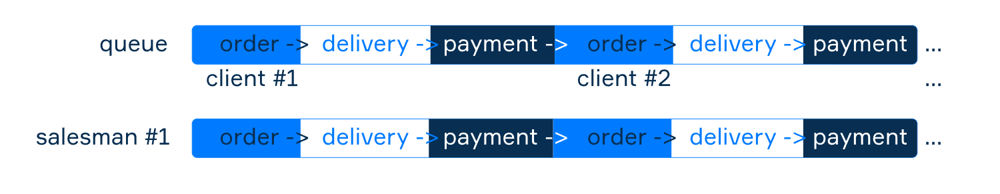
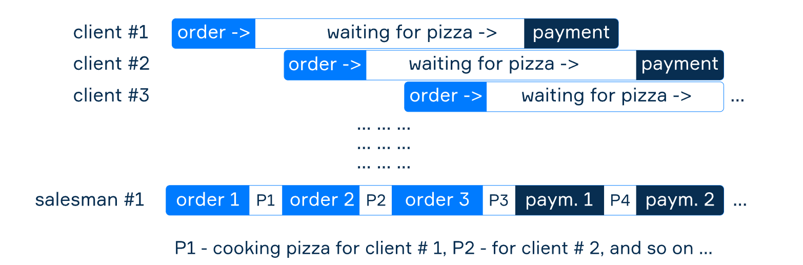
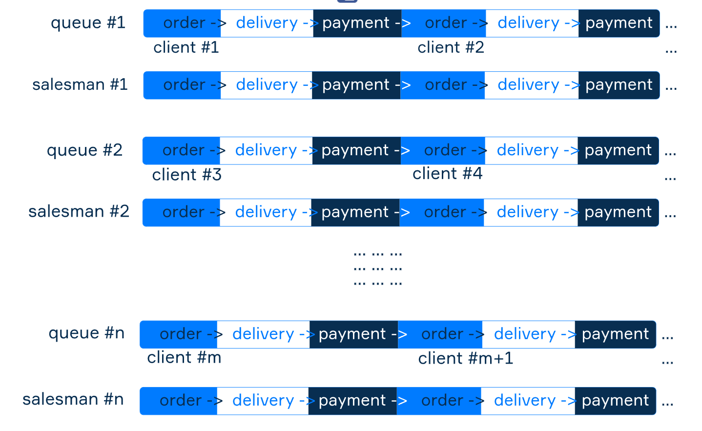

# Multithreading and multiprocessing

When we are considering some complex process, let's call it **workflow**, various parts of it may run differently.

Sometimes actions go one by one, sometimes they go in random order overlapping each other, and sometimes things go simultaneously and in parallel.

The workflow can evolve differently. There are three sorts of workflow executions sequence: **synchronous, asynchronous, and parallel.**

## Synchronous workflow

For example

There are many models to manage customer flows. The simplest approach is one shop with one seller.

They serve each client separately one by one which means starting to serve the next client only after finishing with the current. We name this type of action a **synchronous** one.

## Asynchronous workflow

Let's imagine our old shop becomes fancier, After the first client has ordered their pizza, they need to wait for it to be cooked. At this point, the seller leaves the first customer alone for a while, and now the second one can make their order, then the third, and so on.

When the first client's pizza is ready, the seller returns to them to complete the sale. That's how this story will repeat again and again.

Our old friend seller can serve several customers simultaneously in overlapping periods. We call such **behavior asynchronous**.

## Parallel processing

As the pizza shop sales are growing, now one worker is not enough for the whole business. So, we should hire several. If each seller has a separate compact oven for preparing exactly one pizza at a time, then we can divide the queue of buyers among the sellers.

Now each of them works independently, and this is a case of **parallel processing**. Each task in parallel processing is running in a continuous period as a whole unit process.

## Reference
- https://hyperskill.org/learn/step/9332