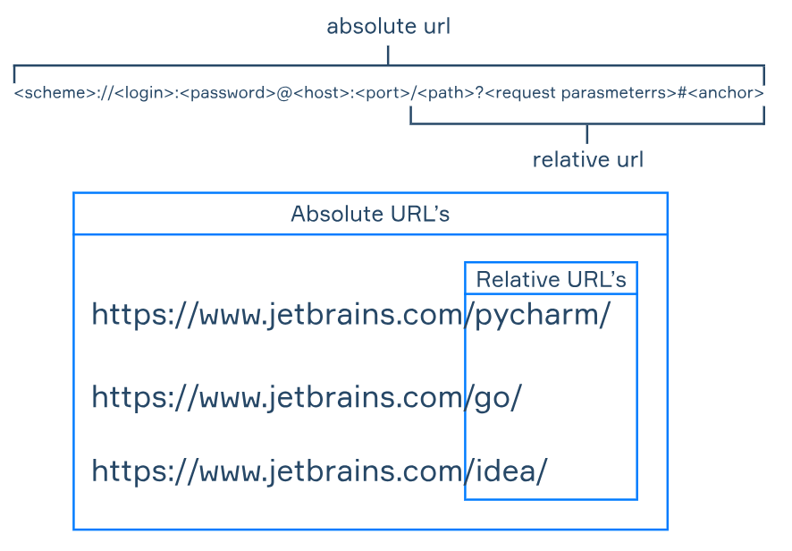

# HTTP URL

## Basic URL Structure

URL address has a certain structure based on the following template:

`<scheme>://<login>:<password>@<host>:<port>/<path>?<request parameters>#<anchor>`

Now let's look at this template in more detail:

- `<scheme>` is a way of exchanging data with a resource. You are probably most familiar with http and https URL schemes, but there are others;

- `<login>` and `<password>` are prefixes that transmit authentication data for some protocols, if necessary;

- `<host>` is the domain name or IP address where the site is located. Domain is the name of the site, IP is its address in a network;

- `<port>` is required for connection within the specified host. The official default port for HTTP connections is 80, and the alternative is 8080, but it is possible to use any other ports too. The default setting for HTTPS is 443;

- `<path>` indicates the exact address of a particular file or page within a domain;

- `<request parameters>` are parameters transmitted to the server. Depending on request parameters, the site may slightly change its display. For example, it is possible to sort the items of a list in a different order;

- `<anchor>` allows you to connect to a specific part of a web page or document.

## Absolute and relative URLs

You should remember that it would work only on the same site, while you cannot refer to another site by a relative path.

We know that by absolute URLs we can easily find the resource through the Internet, but why do we need relative paths? Here are the main reasons for that:

- They are short, and coding is more accessible with them.

- We can easily move the site to another host because relative paths do not depend on a particular domain.

- They are a little bit faster to retrieve by a browser.

