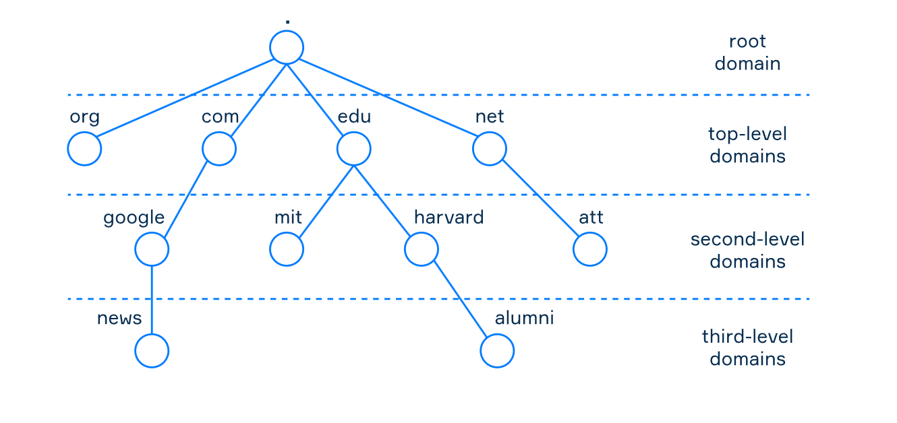

# Domains

When a computer connects to the Internet, it is assigned a unique number called **IP Address**. 
Each web resource also has one
For example, let's look at the address `74.125.131.113`. If you write it in the address bar, the browser will open the site of the search engine Google.

Unless you have a phenomenal memory, it is way too difficult to remember long numeric values to visit several sites, which is why domain names were invented.
It's much easier to write `google.com` instead of a long set of numbers.

**The domain name** acts as a unique name on the Internet and is a more straightforward and more human-friendly way of recording IP addresses.

All information about domain names is stored in a distributed database of **DNS (Domain Name System)**, which is a network of computers scattered around the world.

## Domain name structure

Domains are arranged hierarchically: they consist of levels.
The hierarchical structure allows the browser to quickly find and open the site.
By default, each domain consists of two levels, but there can be more levels (three, four, etc).

### Root domain

The **root** domain, or the top (zero) level domain, is marked with a **dot**. In common use, the dot is not displayed as part of the domain name.

`https://news.google.com.`

You can skip the root domain because it does not interfere with access to the site.

### Top-level domain

The **top-level domains** are divided into **national domain names** and **public domains**.

- The first group defines the region of the site and its geographical location: `.us` for the United States and `.eu` for the European Union.

- The second group does not reflect the geographical characteristics of the resource, but rather its affiliation to a particular field. For example, an information site will have an `.info` endpoint, a commercial site will have `.com`, and a non-profit site will have `.org`.

- There are some more specific domains. The domain `.net` (from the network) was originally intended for network technology organizations. For example, Internet service providers. The domain `.edu` is used by the US-affiliated institutions of higher education.

> [!NOTE]
> Today the domains .com, .org and .net are used with almost no restrictions. You can find any type of organization registered under these domain names. But the .edu domain remains very restricted in use.

### Second-level domain

The **second-level domain** is a unique website address that people remember and use for surfing the Internet like `google`, `facebook`, `uber`, and others.

### Third-level domain

Third-level names are available to register resources with second-level domain name companies.
The owner of a second-level domain has the ability to create multiple resources at once on the site with a common domain name. For example, if the site is called `google.com`, the news blog will be `news.google.com` .

> [!NOTE]
> Not all organizations use third-level domains since it's not the only way to organize the resources.

We will not consider deeper domain levels (4th, 5th, etc), but they can also exist on the Internet.

### Localhost

You may be wondering if you can refer to your own computer in the network by name. The common alias for this purpose is the **localhost**.

**Localhost** is the hostname that refers to the computer you're working on. Localhost is also a reserved top-level domain for DNS, but its only purpose is to access the current machine.

Addresses from `127.0.0.0` to `127.255.255.255` are reserved for localhosts. In a network that consists of a single PC, meaning on your machine, localhost is located at the address `127.0.0.1`. 

When you enter this address or a localhost into your browser's address bar, you will be automatically rerouted to your machine. The most common usage of this process is to run and test web services in a local environment. This allows developers to simulate an internet connection, maintaining security and speed.