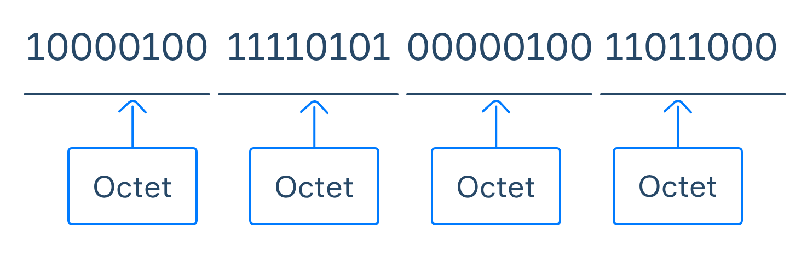

# IP

You can connect to the Internet from any device: computer, laptop, tablet, smartphone, etc. 
This is possible because their software executes network protocols, i.e. sets of rules that dictate how devices exchange data across networks. One of these important protocols is IP.

## IP and IP addresses

**IP (Internet Protocol)** defines the addressing of information as it is transmitted over the network and ensures the organization of the transport of this information to specific destinations.
It specifies the way, time, and place of its forwarding.

In order to correctly determine to which address deliver the information on the Internet, there is an IP address.
When a computer connects to the Internet, it is assigned a unique number called an **IP address.**

It's not just computers that have IP addresses.
Every site on the Internet has its own IP address.
It is equivalent to the IP address of the server hosting the site.
Knowing the IP addresses of the sites you are interested in, you can visit them by typing IP addresses into the address bar.

There are two versions of the IP protocol: **IPv4** and **IPv6**. An IP address on the Internet can be represented in one of the two formats depending on which of these two versions of the IP protocol is used.

## IPv4

We will start with IPv4, as this is the most common version of the protocol on the Internet at the moment.
Any address following this format consists of four numbers from `0` to `255` separated by dots. 

Example:

`132.245.4.216`

This is a human-readable version of an IP address.
In computers, such an address is represented with 
**4** sequences of **8** bits that equal to **32** bits in total.

One sequence of **8** bits of information is usually called an **octet**.
Here is the same example of an Internet address written in the binary format:

IP addresses at IPv4 are short and relatively easy to remember, but there is one inconvenience with them.

The number of IP addresses is very limited, and many of them are reserved for technical needs.

As the IPv4 uses a 32-bit value for its Internet addresses, it means that the protocol can provide support for 
`2^32` IP addresses in total that is equal to around **4.29**
billion various addresses.

Despite being quite large, even this value isn't enough to provide addresses for all the possible users in the near future.

## IPv6

For all its simplicity and convenience, there is a major problem that prevents the continued use of IPv4 — the depletion of the address range. IPv6 was developed to solve this problem.

This version of the IP protocol uses 
**128** bits to represent an address that allows for `2^128` different addresses.
In this version, an address consists of eight groups of four hexadecimal digits separated by colons.

Here is an example of an IPv6 address:

`0de2:041a:7d43:65ab:9a63:a63e:aa78:34c2`

To shorten an IPv6 address we can omit leading zeros. 

For example, the address `0000:0000:0000:0000:0000:0000:0000:0001` can be simplified to `0:0:0:0:0:0:0:1`. 

After this procedure you can shorten the address again.
To do this, select the longest row of consecutive hexadecimal zeros and replace it with two colons (`::`). Thus, `0:0:0:0:0:0:0:1` converts to `::1`.

Despite the fact that this new format allows storing an immense number of addresses, it has one significant drawback: **this version isn't backward compatible with IPv4**.

It is still possible to start using IPv6 though, so if you decide to use this protocol within a network, you need to upgrade your infrastructure and all your devices to support this IPv6 version.

## Loopback addresses

There are special IP addresses that point to the local computer, that is, the computer you are using right now.
They are called **loopback addresse**s. They are useful when you want to connect to a server on your computer.

The most commonly used IP addresses to connect to a server on your local computer are `127.0.0.1` for IPv4 and `::1` for IPv6.

