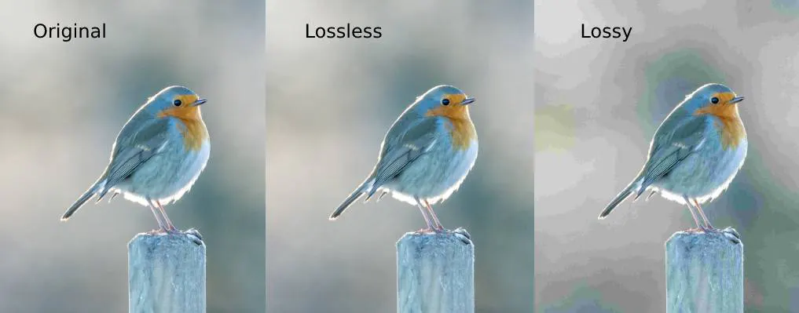

# Graphic file formats

**Graphic file format** is a way of organizing image information into a file. It determines how the information in the file will be stored: for example, raster or vector, two-dimensional or three-dimensional.

Three-dimensional graphics are widely used in engineering programming, modeling, computer games, and cinematography. 

- Raster graphics are useful for creating high-quality photorealistic images, detailed digital drawings, and photos.
- Vector graphics are used to create icons, logos, not detailed illustrations, and are often used in web design.

## Common formats

- **JPEG**, a raster file format, doesn't support transparency. It is most commonly used to process and store photos.
- **WebP**, a raster file format. It was developed by Google to reduce image file size to make web pages load faster.
It was created to replace JPEG as the main photo format on the Internet.
Its peculiarity is an advanced compression algorithm that allows you to reduce the size of the picture without any apparent loss of quality. WebP supports transparency.
- **PNG**, a raster file format.
It allows to compress files with little or no loss of quality and supports transparency. It is mainly used to store graphic elements with transparency.
- **GIF**, a raster file format. It provides compression without loss of quality, supports animation and transparency.
- **TIFF**, a raster file format. It is most commonly used in the typography and printing industry. An image in TIFF will not lose its quality after each saving of the file. But, unfortunately, this is the reason why TIFF  files weigh a lot more than JPEG.
- **SVG**, a vector file format. It supports transparency and allows you to save both still and animated images. It allows to scale files without changing their quality. Usually it is used to create logos, icons, etc.

## Lossy and lossless

Almost all web graphics are compressed to efficiently transfer images over the Internet.
**Image compression** is an idea used to reduce the size of images, especially when you want to improve your website's loading speed and performance.
There are two basic types of image compression:

- **Lossless image compression** reduces the size of the file containing an image without losing its quality at all. It just gets rid of the data that isn't needed or that can be dropped and restored. A good example of a lossless compressed file is PNG.
- **Lossy image compression** restores the large file to its original form with loss of some data which can be considered as not-noticable. An example of a format that works with this approach is JPEG.

