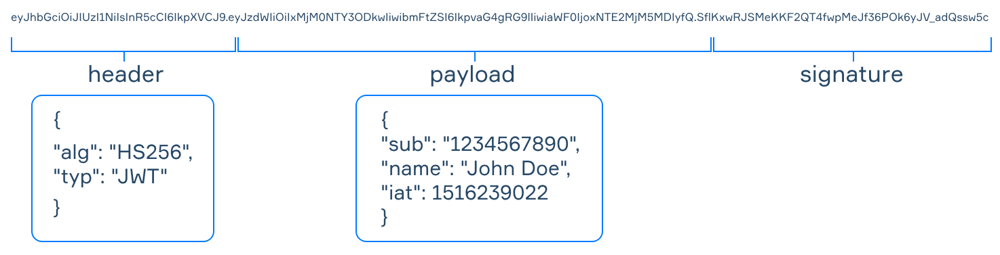

# Understanding JSON Web Tokens

In today's digital world, it is essential to secure and manage user authentication to ensure the seamless operation of web applications and services.
**One efficient way to achieve this is by using JSON Web Tokens (JWT).**


## Definition
 
JSON Web Token (JWT) is an open standard that defines a compact and self-contained method for securely exchanging information between parties in the form of a JSON object.
The information can be verified and trusted because it is digitally signed using a secret key (using the HMAC algorithm) or a public/private key pair (using RSA or ECDSA).

JWT tokens are particularly useful in various scenarios for web applications and services.
Some common use cases include:

1. **Authentication**: JWT tokens are widely used for user authentication.
After a user logs in with their credentials, a JWT token is generated and sent back to the user.
The user's client (browser or app) then sends this token with each subsequent request to access protected resources, allowing the server to authenticate the user without requiring the user to send their credentials again.

2. **Authorization**: JWT tokens can also be used for authorizing access to specific resources or actions within an application.
By including specific claims in the token, such as roles or permissions, the server can verify the user's access rights based on the information present in the JWT token.

3. **Single Sign-On (SSO)**: JWT tokens enable single sign-on across multiple systems or applications. Once a user is authenticated in one system, a JWT token is generated, which can then be used to authenticate the user across other systems without requiring the user to log in again. This creates a seamless experience for users navigating between different applications or services.

4. **Stateless API Authentication**: JWT tokens can be used for authenticating RESTful APIs or microservices.
Since JWT tokens are self-contained and do not require server-side sessions, they allow for a stateless and scalable authentication mechanism.
API clients can send JWT tokens with each request, enabling the server to authenticate the client and process the request accordingly.

5. **Delegating Access to Third-Party Applications**: JWT tokens can be used to grant limited access to a user's resources or data to third-party applications without exposing the user's credentials. For example, OAuth 2.0, a popular authorization framework, uses JWT tokens (called access tokens) to provide temporary and scoped access to resources on behalf of the user.

6. **Cross-Domain Authentication**: JWT tokens can be used to authenticate users across different domains or services. Since tokens are self-contained, they can be easily passed between different systems without the need for cross-origin authentication mechanisms, making it possible to authenticate users across various services and domains.

## Structure of JWT

A JSON Web Token (JWT) is composed of three distinct parts, which are Base64Url encoded strings concatenated with periods `.` as separators.
The structure of a JWT can be represented as follows: 
`Header.Payload.Signature`
Here is a JWT structure diagram:



Let's delve deeper into the structure of JWT tokens and discuss each part in more detail.

- The **header** contains metadata about the token, including the type of token and the algorithm used for signing. It is a JSON object with two main properties:

  - "alg": This property specifies the cryptographic algorithm used to sign the token.

  - "typ": This property denotes the type of token, which is typically "JWT" for JSON Web Tokens.


- The **payload** is the core of the JWT and contains claims that convey information about the subject (usually a user), along with any additional data required by the application. Claims are key-value pairs and can be divided into three categories:
    - Registered claims: These are predefined claims specified by the JWT standard ([RFC7519](https://www.rfc-editor.org/rfc/rfc7519#section-4.1))
    - Public claims: These are custom claims agreed upon by the parties involved in the token exchange. Public claims should be registered with the **IANA JSON Web Token Registry** to avoid collisions.
    - Private claims: These are custom claims used within an organization or between parties that have a mutual understanding of their meaning. They are not registered with any registry and require careful selection to prevent naming conflicts.

- The **signature** is the final part of the JWT and is crucial for ensuring the integrity and authenticity of the token. To create the signature, you concatenate the encoded header and payload, and then sign them with a secret key (for symmetric algorithms) or a private key (for asymmetric algorithms), using the specified algorithm.

For example, using the HMAC SHA256 algorithm:

```
HMACSHA256(
  base64UrlEncode(header) + "." +
  base64UrlEncode(payload),
  secret
)
```

## Standard claim fields and commonly used claims

Standard claims, also known as registered claims, are predefined by the JWT standard (RFC 7519) and serve as a set of useful properties.
While they are not mandatory, they are recommended to provide a consistent and interoperable structure for tokens.
The following are the standard claim fields:

- **iss** (Issuer): The "iss" claim identifies the principal (e.g., an application or service) that issued the JWT. It is typically a string or a URI, and it helps to track and distinguish the origin of the JWT in case there are multiple issuers.
- sub (Subject): The "sub" claim identifies the principal that is the subject of the JWT. It is usually a unique identifier for the user or system that the token represents. This claim allows systems to associate the token with a specific user or entity.
- aud (Audience): The "aud" claim identifies the intended recipients or audience of the JWT. It can be a single value or an array of values, usually representing an identifier or URI for the authorized systems. It helps ensure that a token is only accepted by the systems it was intended for, providing an additional layer of security.
- exp (Expiration Time): The "exp" claim specifies a numeric date (UNIX timestamp) after which the JWT must not be accepted for processing. This claim allows systems to reject expired tokens automatically, reducing the risk of unauthorized access and ensuring tokens are not used indefinitely.
- nbf (Not Before): The "nbf" claim specifies a numeric date (UNIX timestamp) before which the JWT must not be accepted for processing. This claim allows systems to define a future time when the token will become valid, potentially limiting the token's use to a specific time window.
- iat (Issued At): The "iat" claim identifies the numeric date (UNIX timestamp) at which the JWT was issued. This claim can be useful for tracking token lifetimes, implementing token replay prevention, or calculating the token's age in the receiving system.
- jti (JWT ID): The "jti" claim provides a unique identifier for the JWT. This claim can be used to prevent token replay attacks by allowing systems to track used tokens and ensure they are not used more than once.

## JWE and JWS

**JSON Web Encryption** (JWE) and **JSON Web Signature** (JWS) are two complementary standards that extend the core JSON Web Token (JWT) specification. 
They provide a framework for securing JWT tokens through encryption and digital signatures, respectively.

- **JWS** is a standard that enables the creation and validation of digital signatures for JWT tokens. In the previous section, we discussed in detail the structure of this standard. By digitally signing a JWT, you can ensure the integrity and authenticity of the token, verifying that it has not been tampered with and that it originates from a trusted source.

- **JWE** is a standard that enables the encryption of JWT tokens to protect their contents. By encrypting a JWT, you can ensure that only authorized parties are able to view the token's payload. JWE is particularly useful when you need to transmit sensitive information within a JWT token, such as personally identifiable information (PII) or other confidential data.


