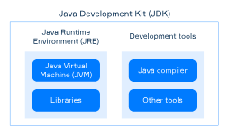

# JVM Defination

The **Java Virtual Machine**, or JVM, is a virtual simulation of a physical computer.  It executes the Java (or Java-compatible) bytecode, which comes after the source code compilation. In some sense, JVM acts as a mediator between the code and the real machine. In some sense, JVM acts as a mediator between the code and the real machine. It runs on a unified set of bytecode instructions, which are then interpreted and converted into machine-level commands.

JVMs are available for many hardware and software platforms, so you can run the bytecode almost everywhere.  A program compiled to bytecode is almost always platform-independent. Basically, when you have a JVM language code, you need to compile it only once, get the bytecode, and you'll be able to run it on any platform that has JVM.

## Java Development Kit (JDK)

Java Development Kit, or JDK, is a package to develop programs for the Java Platform. It includes JRE to run the programs and tools for developers: Java compiler, debugger, archiver, documentation generator, etc.

At the compilation stage, compilers translate source code into `.class` files that contain bytecode and can be executed by JVM.

> [!WARNING]
> Note that if you're using JVM languages other than Java, you will need to download compilers separately, as they are not bundled with JDK.

## Java Runtime Environment (JRE)

Java Runtime Environment, or JRE, is an execution environment. It includes the necessary components for running compiled JVM programs: the JVM itself and the Java Class Library (JCL).

JCL is essentially a set of standard libraries providing the most common functionality: fundamental classes, input/output, math package, collections, security, user interface toolkits, and many others. You can utilize these libraries in your programs.

> [!NOTE]
> Before Java 11, if you wanted only to run a Java program, JRE was enough for you. However, since Java 11 was released, for most JVM implementations JRE is no longer downloadable as a separate component. If you want to run programs in JVM 11 or newer, you have to install JDK.

The relationship between JVM, JRE, and JDK
The following image illustrates the relationship between JVM, JRE, and JDK:

## Reference
- https://hyperskill.org/learn/step/3499
