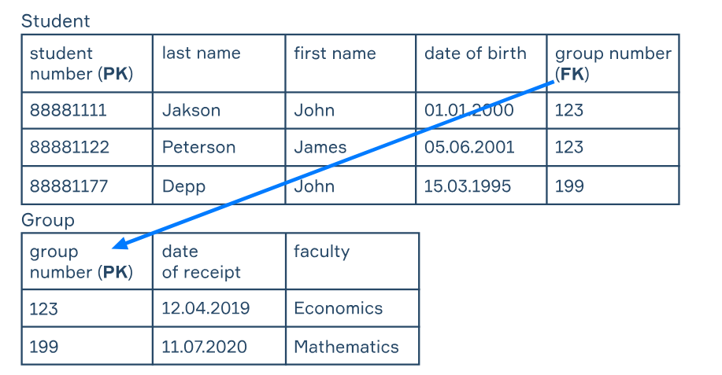

# Relational Data Model

The Relational Data Model (RDM) is an abstract mathematical model on the basis of which modern databases are designed. Here's the list of several relational DBMS: Postgres, MySQL, Oracle, etc.

## Important terms

 The RDM is based on the concept of relation. A **relation** is essentially a two-dimensional table that represents some entity or relationship.

An **entity** is an abstraction of some object (like a class in OOP), for example, a student, a car, or a building. **A relationship** defines how entities are interconnected.

A relation consists of **attributes** and **tuples**. 

- An **attribute** is a column in a table, some property of which has a relation. For example, in relation to a student, there are the following attributes: last name, first name, date of birth, and student number. 
- A **tuple** is a row in a table, a collection of specific attribute values.

## Restrictions

The following restrictions are imposed on the relations in the relational data model:

- There cannot be two relations with the same name in a database.

- All attributes within the same relation should have different names.

- There should only be one value in each cell.

The order of the rows and columns in the relations is not important.

## Integrity

**Integrity** is the conformity of a data model with certain rules. There are two kinds of integrity: **entity integrity** and **referential integrity**.

### Entity integrity

The integrity of the entity means that there cannot be two identical tuples (rows) in the table.
As in the real world, we cannot have two absolutely identical objects, for example, there are no identical students, they are all distinct.
To maintain the integrity of an entity, the concept of a **primary key** (PK) is introduced.

### Referential integrity

**Referential integrity** occurs when we have two connected relations. The relationship of the relations is provided using a **foreign key (FK)**. A foreign key is an attribute of a relation (subordinate/dependent) that points to the primary key of another relation (main/master). Referential integrity means that there cannot be a foreign key in the main table that points to a nonexistent tuple in the subordinate table.

## Pros and cons

- One of the main reasons why RDM is so popular is that there is a query language SQL, with which you can easily interact with data.
- Another reason is that it is based on a mathematical apparatus based on set theory.
- For large data volumes, DBMS implementations based on other (usually simpler and less general) data models can be more scalable and performant than relational DBMS.
- One other disadvantage of the relational data model is that it's different from the object data model and requires a translational layer that increases code complexity.