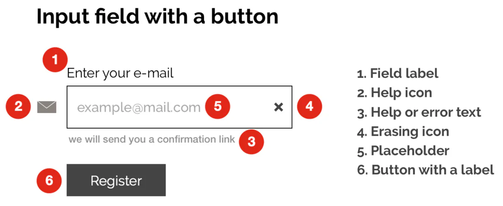
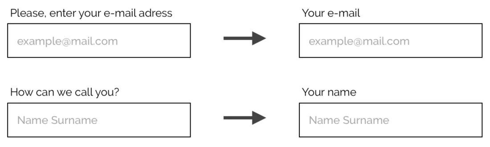

# Input fields and field labels

Most sophisticated version

## How to make a better label

1. **Make the label as short as possible**: the fewer words, the faster the user will understand what is required. Avoid complex phrases like "How are you addressed?" instead of "Your name".

2. Labels should always be visible to users, so that they don't have to search for them.

3. Avoid cases when the label is too short or moved along the rows.

