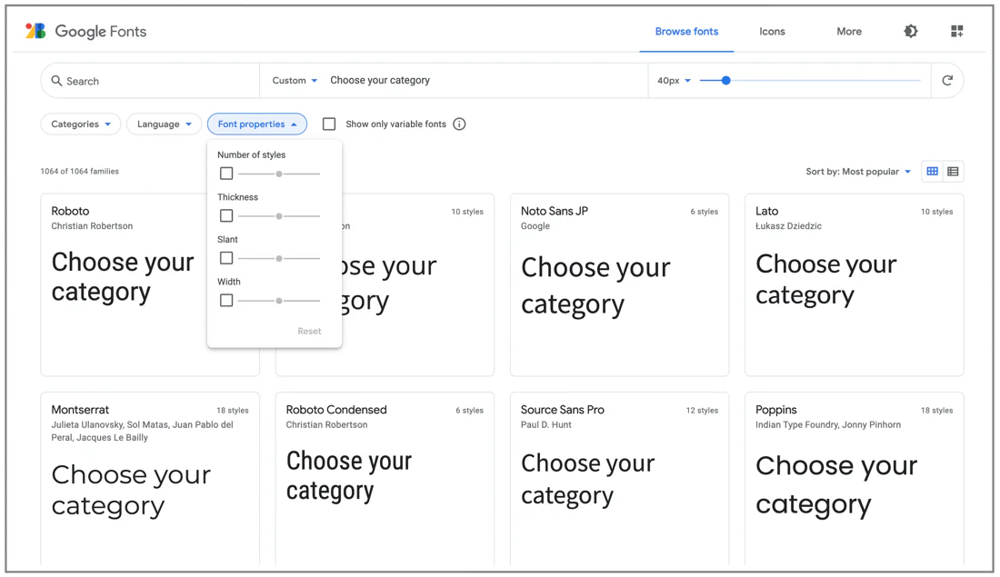
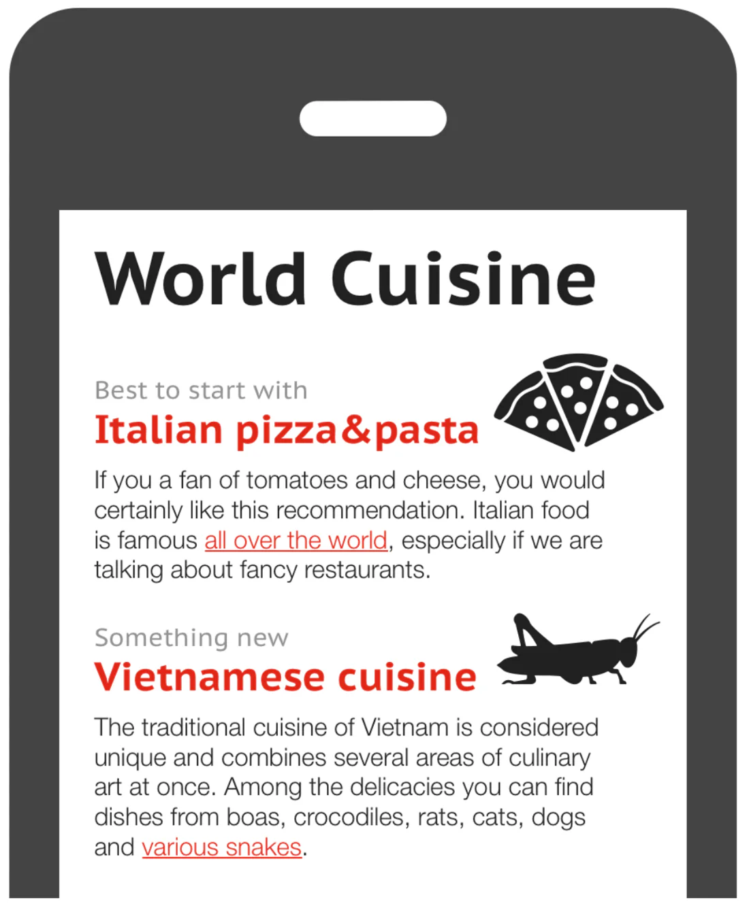

# Fonts

## Font types

The most common font types are **Sans-serif** and **Serif**.

The main difference is in the style of each character (letters, numbers, or punctuation marks).
Sans-serif is smoother, neat, maybe even "modern".
Serif is rather conservative, classic — it's characterized by serifs, small lines attached to characters

## Font choice

Choosing fonts (and selecting colors) for a project can end up taking a really long time.
So it makes sense to simplify the process by using a special service that allows you to compare text snippets rendered in different font styles.

you can use [Google Fonts](https://fonts.google.com/)

The service is very convenient because it enables you to choose the visual appearance of your text for the project and download all the styles of a font as an **archive**.
It even allows you to select your preferred option and see which **font pairs** are suitable for use together.

> [!NOTE]
> It's worth knowing that Google Fonts also has a Developer API, which makes it possible to connect the platform to your project. This could be used for things like allowing users to choose custom fonts inside your service.

## Font pairs

Using a second (**auxiliary**) font in a project is a fairly common practice

To avoid getting stuck when choosing matching fonts or accidentally opting for combinations that make users strain when reading, you can visit the [fontpair website](https://www.fontpair.co/)
It contains great pairings along with helpful illustrative examples.

## Typographic hierarchy

The **UI kits** you learned about in the Interface Elements topic are sometimes also called **style guides**. These allow designers and developers to specify the styles of all interface elements in advance so that the product is designed uniformly.

UI kits usually define text styles in addition to all the interface elements.

For example, they may specify the size and style of the headers, the format of the main text, the appearance of the auxiliary text, and so on.

A good typographic hierarchy helps users to scan the interface without reading all the content.
Thanks to the uniform **heading** style, the user knows that they are moving from one article to another.
Formatting **tags** and headings in the auxiliary text style will help ensure they don't get muddled up with the main content. **Display text** is usually the biggest, followed by headings, then **body text**, and **overline text** (like tags, dates, and so on).

## Text highlighting

If you want your interface to be efficient, you need to allow users to interact with some of its text elements.
These could be links to other screens, category filters, or buttons with hints.

If you also highlight the headings in color, users will probably want to click on them, meaning they can be used as transitions to more detailed content pages.

