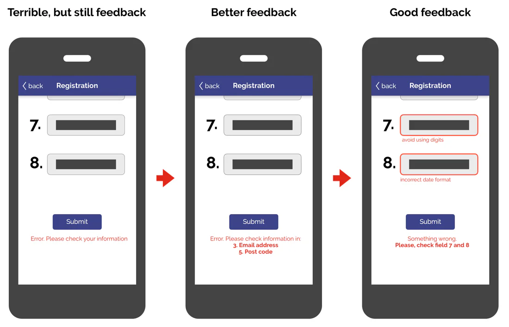
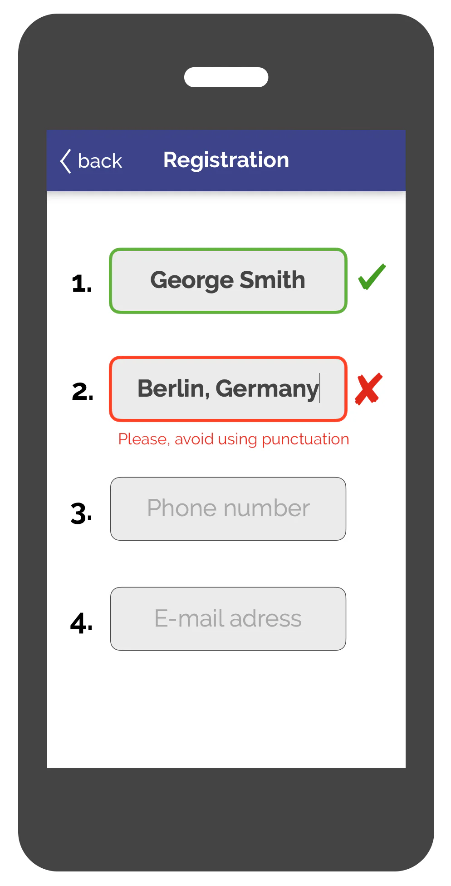
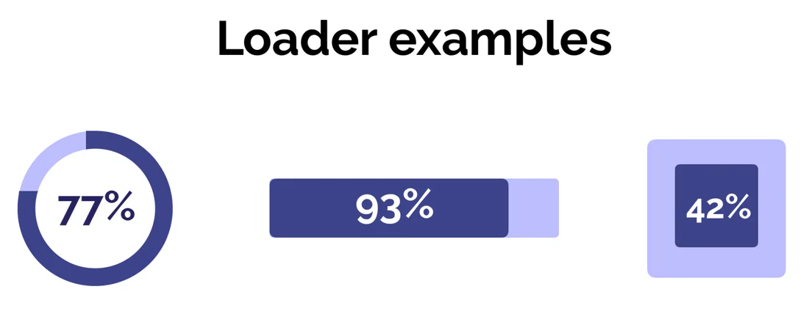

# Feedback

## Minimal visual feedback

Users need regular reassurance that the system is still functioning.
They also want to be made aware if something goes wrong.
Even simple elements like hyperlinks and buttons can provide users with encouraging feedback that the application is working.

## Highlighting user errors

Text fields for entering data. They are used for things like registration, completing questionnaires, searching, and making payments.

Unfortunately, users often make mistakes when attempting to submit information they have added to fields, and they need to be given feedback about these errors.

The best way to indicate errors is by highlighting the affected fields, showing the user how they can fix the problem, and transferring them directly to the relevant part of the screen.

## Instant feedback

Do you want your services to be even more user-friendly? Then consider implementing **instant field validation**.

You can do this by highlighting correctly completed fields as well as those with errors.
This will provide a reassuring, positive boost and make it easy to spot issues straight away.
Psychological satisfaction from solving small tasks!

Instead of using a separate task that verifies whether everything is correct at once, you can make feedback instant instead.

## Loaders

Servers need time when switching between different windows and processing data.
- So if there are any significant pauses, it should be apparent to the user that the application hasn't frozen and things are progressing as they should.
- This can be achieved by adding special elements called **loaders** — animated icons or progress bars that demonstrate the application is in data processing mode.
- It's also possible to implement them in the form of a simple "please wait" message.

Users will quickly become concerned without this feedback. They'll start to wonder whether the application has stopped working or if they did something wrong.

## Notifications

System notifications can be used to make people aware that processes are complete or that steps need to be taken.

