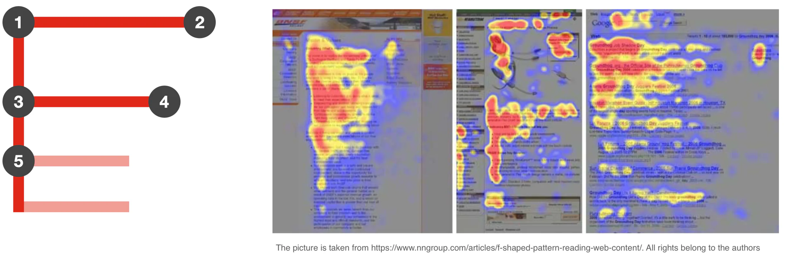
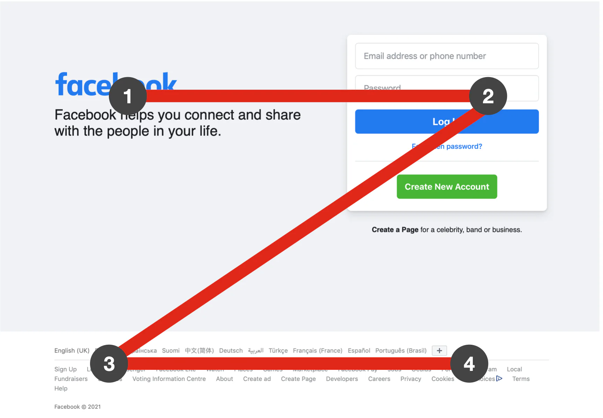
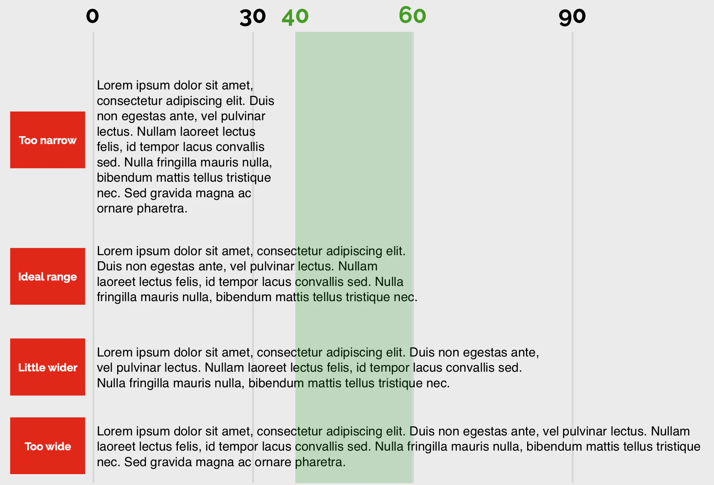
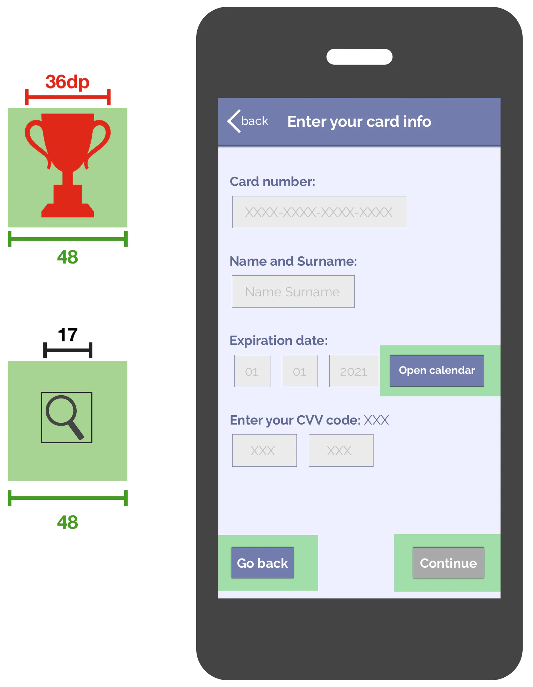

# Design tips and rule

## Patterns of perception

Where do you look when you open a new website for the first time? Or if you're reading an article?

How can you make sure that people aren't confused when opening the page?

That they don't get cognitive exhaustion and immediately close your service?

Users perceive on-screen information in predictable ways, and understanding these patterns holds the key.

People scan information when they read books or articles — they don't usually read every single word.
Instead, the eyes pass along the entire line, and the brain catches the main meaning of the sentence by analyzing the words that were seen.
The same thing happens when you view pages on the internet or the screen of a mobile application

Early human-computer interaction researchers Jakob Nielsen and Don Norman studied how users scan a page by tracking the movement of their eyes over an interface.
In 2000, they identified a pattern of eye movement.
It showed that when most users open a page, they first scan the content in a particular sequence and then proceed directly to reading the content that interests them.
This sequence is called the **F-shaped pattern.**

Knowing about this pattern can help you place important information where it will be seen immediately.

Depending on where screen elements are located, users may resort to an alternative route instead — the **Z-shaped pattern.**

**When there's a lot of text content on the page, the F-shape is used. But when the content is diluted with a large photo or diagram, the Z-shaped pattern comes into play.**

# Text length and cognitive load

As you already know, users don't like cognitive load. 
There are also a variety of visual ways to simplify the perception of information.

## Let's focus on the text.

The width distribution of the text plays a vital role in the speed of reading and perception of information in general.

> [!NOTE]
> If you make the paragraphs too narrow, the user will have to run their eyes back and forth very frequently, causing slight nausea.
> But if the lines are really wide, the user will need to make a long movement every time to return to the beginning of the following line.
> To tackle these issues, Robert Bringhurst came up with a method for calculating the optimal width of text on the screen.

To calculate the correct text length, you need to multiply the font size by 30. For example, if your font size is 14, this will give you 420 pixels, which is the ideal text width.

## Accessible text

For this technology to work, alternative text (alt text) that isn't usually visible is required.

- Use a small but informative phrase to describe a picture or diagram.
- The shorter the text, the faster the screen reader system will read it, so it's best to keep description lengths below 130 characters.
- Include keywords in the text that give the correct context to images, but don't just list them separated by commas.

## Pointer targets

When developing an interface, elements sometimes need to be reduced in size to fit in a particular position.
But if the element is too small, it can be difficult for users to click on it using a mouse or touch screen.
To solve this problem, you need to set the relevant parameters of the clickable fields, known as **pointer targets.**

In mobile development, a good rule is to create a pointer target space with a size of at least 48x48 dp. This will enable users to perform the action even if they click slightly to the side.

Ensure clickable elements have a minimum pointer target size of 48x48 dp for better usability. If space allows, increase the interactive area to improve accessibility and ease of use. 

# references

- [Design tips and rules](https://hyperskill.org/learn/step/15205)

