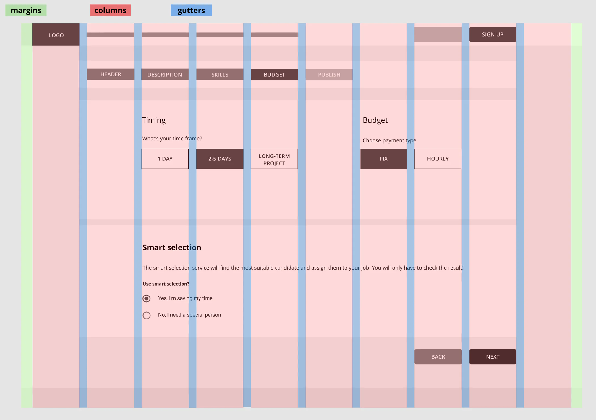

# Layout grids

## System of rules

Everything has rules that help create stability and order. For example, traffic rules or rules for using brackets, quotes, and commas in programming languages. When learning something new, it's important to understand the system of rules behind it to avoid chaos and confusion.

Similarly, when designing an interface for a service or application, a layout grid system is used to set rules for where to place elements on the user's screen. This is important because people tend to be lazy and prefer not to think too much when performing actions. When faced with something unexpected, they may panic and become confused.

Layout grids make it easy for interface developers to arrange elements in a way that is user-friendly. This includes information, buttons, and input fields.

## What are layout grids?

In simple terms, a grid is a skeleton, a layout that consists of vertical and horizontal lines, or even a table that serves as a foundation for deciding where to place content elements.

Grids make it easy to place interface elements on the screen in a consistent and user-friendly way. They also provide constraints that can help stimulate creativity.

Grids use **columns** to mark up the screen and **margins** to measure the distance from the edge of the screen.

Typically, nothing is placed right at the edge because it's inconvenient for users to interact with the interface in this area

Designers usually set the markup values for these properties in advance during their work. An example of this can be seen in the picture below:

## Layout grid views

