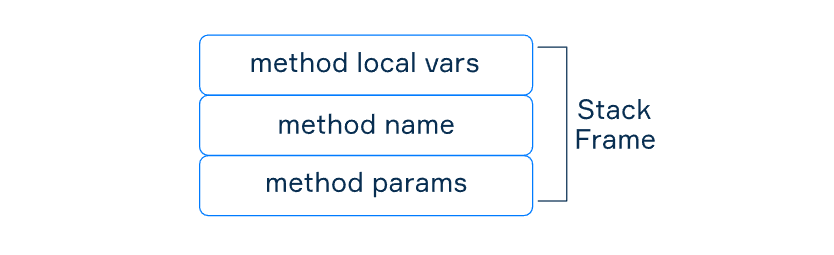
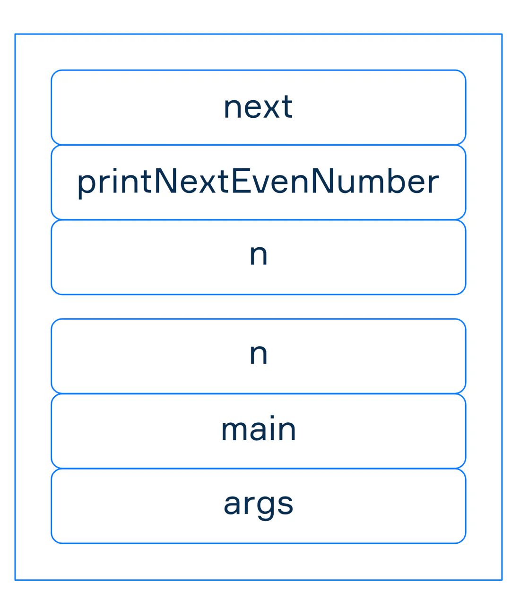

# Call Stack

When you write a program, it probably contains several functions invoking each other, either programmer-defined or standard ones, and all of them need to be executed.

How does the machine understand the order of the execution?
How does it switch between different functions?
How does it know when the program execution is over?

## Call stack structure

JVM uses a call stack (or execution stack) to understand which function should be invoked next and to access information regarding it.

The call stack is composed of **stack frames**
 
> [!NOTE] 
> Stack Frame is a data structure that represents a single method within the call stack. that store information about functions that have not yet terminated. The information includes the return address of a function, parameters, local variables, intermediate computations, and some other data.




As a regular stack, the call stack follows the rule Last In First Out (LIFO). It means stack frames are pushed at the top and move everything down.
- A new stack frame is added when the execution enters the new function.
- And the stack frame is removed from the call stack if the execution of a function is done.

Example:

```kotlin
fun printNextEvenNumber(n: Int) {
    val next = if (n % 2 == 0) n + 2 else n + 1
    println(next)
}

fun main(args: Array<String>) {
    val n = 99
    printNextEvenNumber(n)
}
```

The program declares two functions: `printNextEvenNumber` and `main`.

As usual, the first function to be invoked is `main`. Each time a function is invoked, a new stack frame is created.

The stack frame for `main` is structured the following way:

1. The function parameters (`args`) are pushed on the frame.
2. The function address (shown in the scheme as the function name — main) is added to the stack frame to keep a reference to where to return from the following function calls.
3. The local variables (n) are added to the frame.

Actually, the stack stores just a reference to the args array since all reference types are stored in heap memory.

The next function to be invoked is `printNextEvenNumber`.

As always, a new stack frame is created. The function parameters (n), address (`printNextEvenNumber` for simplicity), and local variables (next) are added to the new stack frame.

We have two complete stack frames for `main` and `printNextEvenNumber` functions within the execution stack:



> [!NOTE]
> Note, both frames have variables named n, but these variables are not the same since they belong to different functions.

Now the program executes the function at the top of the call stack (`printNextEvenNumber`).
After the execution, the current frame `printNextEvenNumber` is removed from the call stack and the previous frame main continues the execution.

When the stack is empty, the execution stops. 


## Stack overflow

The number of possible function invocations depends on the amount of memory allocated to the stack. When your stack contains too many stack frames, it can be overflowed.
It leads to the `StackOverflowError` that will stop the execution. The stack size can be set with the command line option -Xss for executing a particular program:

```kotlin
kotlin YourProgramName -Xss256k
```

But we recommend you to be careful with it and read some articles on the Internet before modifying the default stack size.
Also, sometimes the StackOverflowError points to an incorrect recursion call in your program. In this case, increasing the size of the stack will not help you.
