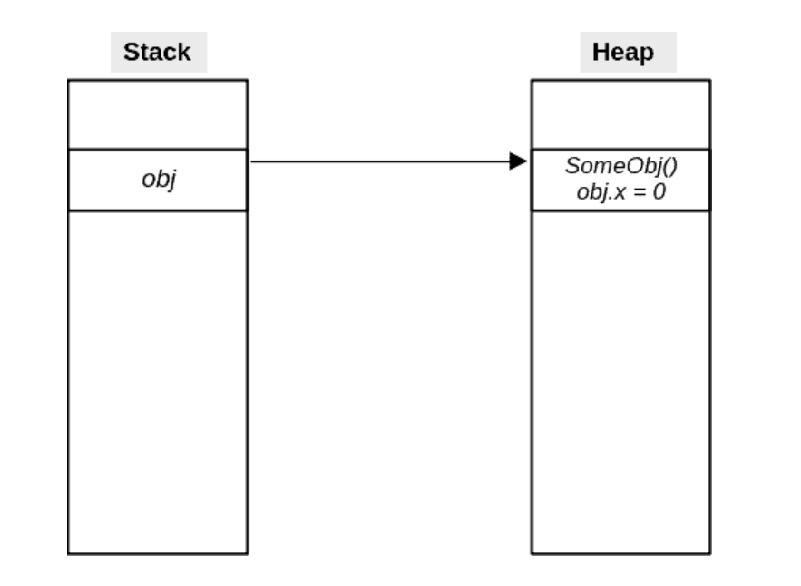
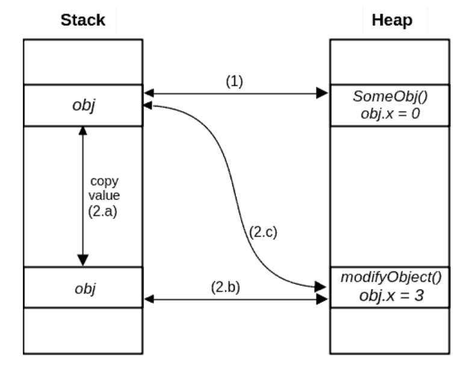

# Transimit Argument

Understanding Kotlin’s behavior when it comes to pass-by-value and pass-by-reference is crucial to working effectively with the language.

## 1. Pass-By-Value

In Kotlin functions, as with Java methods, arguments are pass-by-value by default. 

**primitive parameters in Kotlin cannot be reassigned**. When we attempt to do so, the code will not compile. You will receive "val cannot be reassigned." compile error.

## 2. Pass-By-Reference

Pass-by-reference is the behavior where a function receives the memory address of an argument, allowing access and modification.

Java and Kotlin always use pass-by-value.

However, when passing objects or **non-primitive types**, the function copies the reference, simulating pass-by-reference.
Changes inside the method affect the external object due to the shared reference.


Let’s illustrate this behavior with a simple example:

```kotlin
data class SomeObj(var x: Int = 0)

private fun modifyObject(someObj: SomeObj) {
    someObj.x = 3
}
```

let’s write a unit test:


```kotlin
@Test
fun `Test using pass-by-reference`() {
    val obj = SomeObj()
    
    assertEquals(0, obj.x) // before modify

    modifyObject(obj)

    assertEquals(3, obj.x) // after modify
}
```
we assert that `x` in `obj` is still `0` before calling the `modifyObject()` function.

Kotlin and Java both use the same memory model, where the stack stores the reference variable, and the heap stores the objects.
Our newly created object contains a reference to `obj`:



Finally, we call the `modifyObject()` function and assert that `x` has changed to `3`.

In our memory model, we now have two objects on the heap: the one inside the function and the one outside. 
When the one inside the function is created, a new reference variable is copied onto the stack. Two reference variables now exist on the stack with identical values, 
The old reference is lost if no variable points to it anymore (it may be garbage collected - GC):



> [!WARNING]
> When calling a function in Kotlin, the reference of an object is copied and passed as an argument.
> This is not the same as traditional pass-by-reference, where the function would receive the original reference itself.


