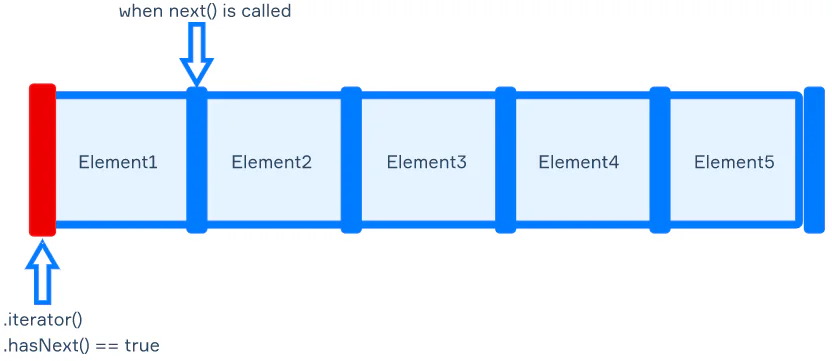

# Interators

## Iterator and immutable collections
An iterator provides access to collection elements sequentially, regardless of their type. It can be seen as a movable pointer to an element of the collection.
`iterator()` returns a special object that can iterate over the collection.

When the variable of an iterator is created, it points to the position **before** the first element of the collection. If you want to move to the next element, call the `next()` function. 
it returns `true` if the iteration still has some elements.

> [!WARNING]
> Notice that when the iterator passes through the last element of a collection, it can no longer retrieve elements.

If you try to invoke `next()` from the iterator after passing the last element in a collection (or for an empty collection), `NoSuchElementException` will be thrown.
In this situation, you should create a new iterator for the collection.



Instead of using the `for` loop, **iterators** support the `forEach()` function. 

```kotlin
var map = mapOf("John" to "chocolate", "Mary" to "sweets", "Sara" to "marmalade")
var iterator = map.iterator()

iterator.forEach { (key, value) ->
    println("$key likes $value")
}


/*
  John likes chocolate
  Mary likes sweets
  Sara likes marmalade
*/
```

## Iterator and mutable collections

Another special iterator variation is `MutableIterator`.
It differs from the previous one in that it works with mutable collections, i.e., with those that can be changed after their creation.

`MutableIterator` extends `Iterator` and provides the `remove()` function, **which removes the last collection element returned by the iterator.**

Ex:

```kotlin
fun main() {
    val numbers = mutableListOf(1, 2, 3, 4, 5)
    val iterator = numbers.iterator() // This is a MutableIterator for a mutable list

    while (iterator.hasNext()) {
        val number = iterator.next()
        if (number % 2 == 0) {
            iterator.remove() // Removes the last returned element if it's even
        }
    }

    println(numbers) // Output: [1, 3, 5]
}
```

## List iterator


Lists have a special type of iterator called `ListIterator`. It allows you to iterate through the list in both directions: forward and backward, while iterators for `Set` or `Map` can iterate only forward. Also, `ListIterator` is able to get the positions of the next and previous elements.

In addition to the common `Iterator` methods, `ListIterator` has the following methods of its own:

- fun `nextIndex()`: Int returns the index of the element that would be returned by calling the `next()` function;

- fun `previous()`: T returns the previous element of the list and moves the iterator's pointer backward;

- fun `hasPrevious()`: `Boolean` returns "true" if there are elements in the iteration before the current element;

- fun `previousIndex()`: Int returns the index of the element that would be returned by calling the `previous()` function.

Let's see an example:
```kotlin
val strings = listOf("i", "like", "donuts")
val listIterator = strings.listIterator()

println("Iterating forwards:")
while (listIterator.hasNext()) listIterator.next()

println("Iterating backwards:")
while (listIterator.hasPrevious()) {
    print("index: ${listIterator.previousIndex()}")
    println(", value: ${listIterator.previous()}")
}
```

As you can see, `ListIterator` can still be used after it reaches the last element.

Mutable lists have their own version of `Iterator` called `MutableListIterator`. `MutableListIterator` is unique for being able not only to remove elements but also replace them and add new ones while traversing the collection.


```kotlin
val words = mutableListOf("i", "know", "Claire")
val mutableListIterator = words.listIterator()

mutableListIterator.next()
mutableListIterator.next()
mutableListIterator.set("don't know")// i , don't know, Claire
mutableListIterator.add("John")
println(words)// i, don't know, John, Claire
```