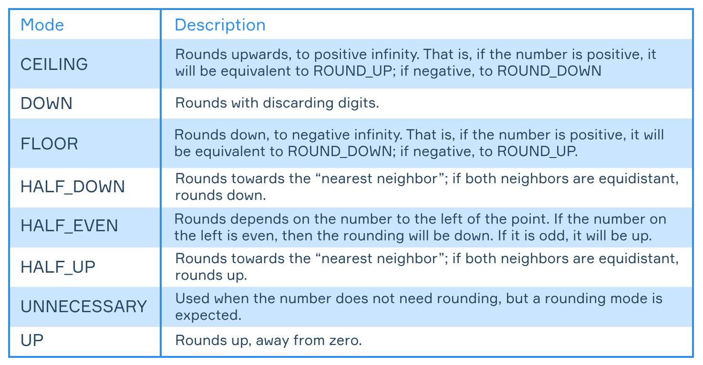
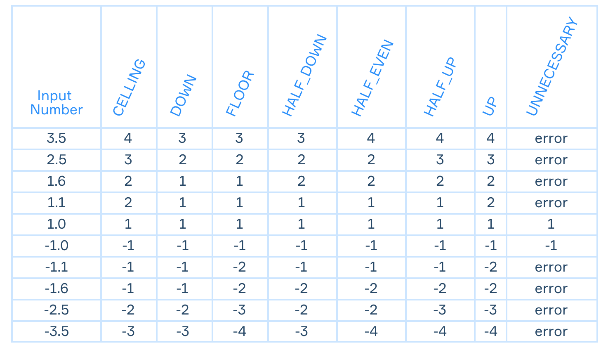

# BigDecimal

Sometimes programmers have to work with extremely large numbers. `BigInteger` for integer numbers and `BigDecimal` for **floating-point** numbers.

you can have as many digits after the point as you want, which is important for accurate calculations. There are programs where the accuracy of computation is critical, for example, aircraft or medical software, or storing and processing sums of money, to name a few.

## Creating objects of BigDecimal

you have several different options to create a `BigDecimal`

-  The first way is creating it from the String object and specifying the desired number in double-quotes.
```kotlin
val firstBigDecimal = BigDecimal("10000000000000.5897654329")
```
- The second option is creating it from `Double`:

```kotlin
val bigDecimal = BigDecimal(10000000000000.5897654329)
```

- You can convert numbers of other types to `BigDecimal` as follows:

```kotlin
val number = 100000.50000
val bigDecimal = number.toBigDecimal()
```

> [!IMPORTANT]
> It is extremely important to keep in mind that `BigDecimal` is an immutable class. 
> Immutability implies that you cannot change an existing instance of `BigDecimal`, even if it was declared with the var keyword. If you try to modify an existing object, it is created again.

You might remember that in the case of `Double` and `Float`, there are a few potential problems with the floating point representation. 
For instance, the result of adding `0.2` and `0.1` won't be `0.3`, which affects the accuracy of further calculations:

```kotlin
println(0.1 + 0.2) // 0.30000000000000004
```

`BigDecimal` has no such problem: the results of all the operations will be absolutely correct.

```kotlin
val first = BigDecimal("0.2")
val second = BigDecimal("0.1")

val addition = first + second   // 0.3
```

Binary and unary operations are available for `BigDecimal`. In the code snippet below, you can see some examples of binary operations with `BigDecimal`:

```kotlin
val first = BigDecimal("0.2")
val second = BigDecimal("0.1")

val addition = first + second   // 0.3
val subtraction = first - second   // 0.1
val multiplication = first * second // 0.02
val division = first / second   // 2.0
val remainder = first % second // 0.0

// decrement
val decrement = --first //  -0.8
// increment
val increment = ++first //  0.2
// unary minus, turning to opposite sign
val reverse = -first  //  -0.2
// absolute value
val module = first.abs()  //  0.2
// raise to the power, works only with Int
val power = first.pow(3) 
```

## Rounding control


`setScale()` allows us to adjust the precision of large fractional numbers:

```kotlin
bigDecimal.setScale(newScale, RoundingMode)
```

The table below lists all the possible `BigDecimal` rounding modes along with their brief descriptions:



The table below illustrates the difference in behavior depending on rounding modes. You'll be able to easily compare them:



> [!NOTE]
> Note that UNNECESSARY will add insignificant zeros to the number if you specified too many digits in setScale(). But if you specify too few digits, an error will occur.

## Rounding in arithmetic operations

Let's talk about determining the accuracy of the result of division. The scale of the result is the same as the scale of the dividend, and by default, `RoundingMode.HALF_EVEN` is used. However, you can specify the scale manually if necessary:

```kotlin
val dividend = BigDecimal("0.9865745")
val divisor = BigDecimal("3.543")

var quotient = dividend / divisor    // 0.2784574
quotient = dividend.setScale(4, RoundingMode.CEILING)/ divisor   // 0.2785
```

Let’s look at another example. Say we need to divide an integer BigDecimal by something, and as a result, we want to get a fractional number. In such situations, it's important to clearly indicate the scale of the dividend:

```kotlin
val intDividend = BigDecimal("10")
val divisor = BigDecimal("3")

var quotient = intDividend / divisor    // 3
quotient = intDividend.setScale(4, RoundingMode.CEILING)/ divisor   // 3.3333
```

Addition, subtraction, and multiplication have no such specificities. Although precision is also a thing there and it is used in arithmetic operations, it's quite intuitive:

```kotlin
val first = BigDecimal("7.7777")
val second = BigDecimal("3.3")

val addition = first + second   // 11.0777; The result scale is 4 (max of the scales)
val subtraction = first - second   // 4.4777; The result scale is 4 (max of the scales)
val multiplication = first * second // 25.66641; The result scale is 5 (sum of the scales)
```

So, for these operations, we can describe the accuracy of the result as follows:

- **Addition**: the maximum scale of the addends;

- **Subtraction**: the maximum scale of the minuend and subtrahend;

- **Multiplication**: the sum of the multiplier and multiplicand scales;

- **Division**: the scale of the dividend.