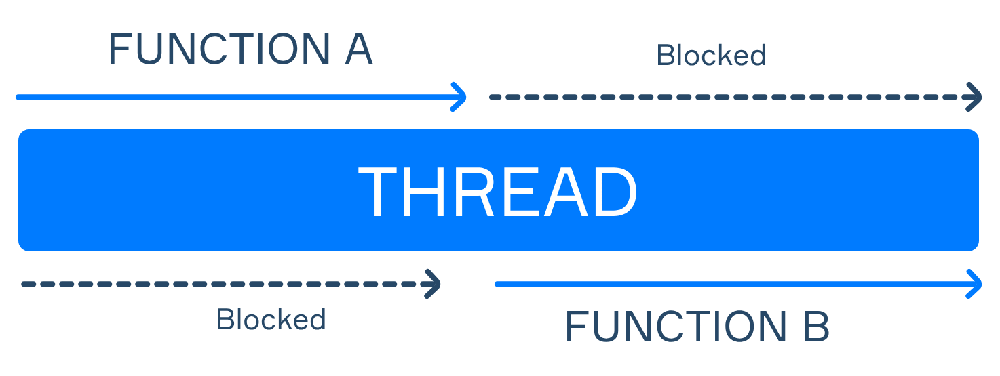
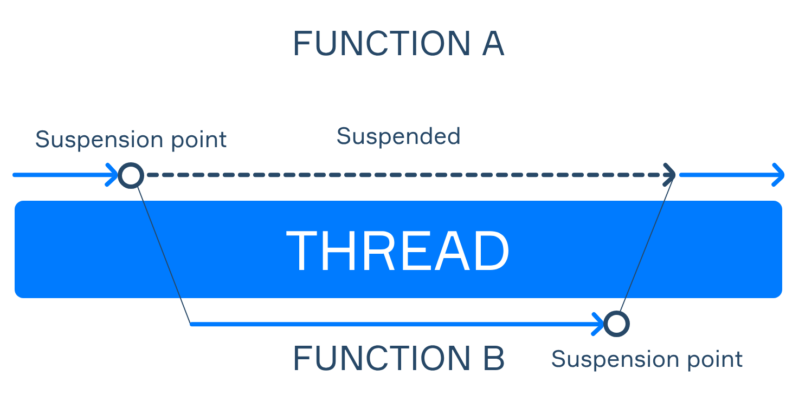

# Suspending function


A coroutine is a part of a program that can be suspended and resumed later.

Kotlin doesn't pause a coroutine at an arbitrary point, though; it can only do that when a special **suspending function** is called.

It keeps track of suspending functions and can run another one that was waiting for execution and then resume the original function when possible, even without switching threads at OS level.

**This mechanism potentially allows us to run many more coroutines than the limit of the available threads.**


## Suspend function

Let's see how it works. When you call two simple functions, they run sequentially:
a thread can execute only one function at a time:



But what happens if a function becomes suspended?
In this case, you can pause the execution of one function and run another one. The program will not forget about your paused function and will resume it later.
This is especially useful when you need to wait for some external resource.



## Use case example

Imagine we need to run a lot of "heavy" operations like calculating the checksum for hundreds of 
files we received from the internet to make sure they aren't broken (that's what package managers or torrent clients do all the time).


```kotlin
fun loadFile(): ByteArray {
    return ... // long operation, actual code skipped for brevity
}

fun calculateChecksum(fileData: ByteArray): String {
    return ... // another long operation, actual code skipped for brevity
}

fun main() {
    for (i in 1..10_000) {
        val fileData = loadFile()
        val checksum = calculateChecksum(fileData)
        println(checksum)
    }
}
```

To complete all calculations faster, we can process each file on a separate thread.

```kotlin
fun main() {
    for (i in 1..10_000) { // depends on the machine, rarely more than that
        Thread {
            val fileData = loadFileBlocking()
            val checksum = calculateChecksum(fileData)
            println(checksum)
        }.start()
    }
}
```

However, it won't improve the performance if we have more files than the CPU cores because each core can only process one thread at a time.
Moreover, if we have too many threads, we will run out of memory soon because each thread requires extra RAM just to start.

To fix the issue, more complex thread pools and callbacks are required.
With coroutines, in contrast, we can run hundreds of thousands of parallel operations and keep our code simple.
Kotlin will take care of suspending (pausing) those functions that are not active at the moment.

```kotlin
import kotlinx.coroutines.*

suspend fun loadFile(): ByteArray { // now it's a suspending function
    return ... // long operation
}

suspend fun calculateChecksum(fileData: ByteArray): String { // another suspending
    return ... // long operation
}

// 'runBlocking' and 'async' build coroutines, we'll learn about it in the next topic
//  so far you need to know that everything inside one of these builders is a coroutine
fun main() = runBlocking {
    for (i in 1..10_000) { // now we can have even more operations running concurrently
        async {            // async schedules background execution of a given coroutine
            val fileData = loadFile()
            val checksum = calculateChecksum(fileData)
            println(checksum)
        }
    }
}
```

## Suspension points

a function marked with the `suspend` keyword. Such a call is a "parking point" for a coroutine.

JetBrains IDEs will mark these calls with a special symbol on the left.


## Suspend keyword

Any Methods, top-level functions, extension functions, and even lambdas can be suspending. just using keyword `suspend` before the `fun`


## Suspending function invocation

Kotlin only allows calling suspending functions either from other suspending functions or from special coroutine builders like `runBlocking` and `async`

Coroutines are lightweight but not free—creating too many can slow down execution and make debugging harder.
Developers must carefully decide where suspending functions provide the most benefit.


