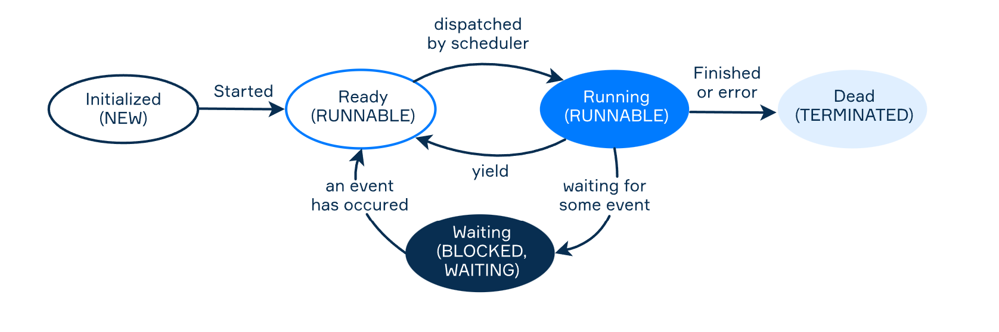

# States of a thread

Throughout its lifecycle, a thread's state changes.
This is caused by both the actions of the programmer and some internal events in the operating system.

We will consider the possible states of a thread presented both in Kotlin terms and on the operating system (OS) level.

## Thread.State enum

In Kotlin, the state of a thread is defined by the `Thread.State` enum with six possible values:

- `NEW`: an instance of the class `Thread` has been created, but it has not yet started;

- `RUNNABLE`: the thread is running in the JVM, but it may be waiting for some resources from the OS (e.g., from the processor);

- `BLOCKED`: the thread is blocked and waiting for a monitor lock (we will consider it later);

- `WAITING`: the thread is waiting for another thread to perform a task indefinitely long (e.g., join without timeout);

- `TIMED_WAITING`: the thread is waiting for another thread for a specified time (e.g., sleep, join with timeout);

- `TERMINATED`: the thread is terminated when the run function completes execution or an uncaught exception occurs. **Once the thread terminates, it never gets back to its runnable state.**

To obtain the current state of a thread, we use the parameter `state`.


Let's look at how these states change depending on the programmer's actions.

```kotlin
val worker: Thread = thread(start = false, block = {
    for (i in 1..10000)
        print("$i ")
    println("End of the work")
}) // new worker to make a difficult task
println(worker.state) // NEW

worker.start() // start the worker
println(worker.state) // RUNNABLE

worker.join()  // waiting for completing the worker
println(worker.state) // TERMINATED
```
When a thread is created, its state is `NEW`. When a thread is started, its state is `RUNNABLE` (the function run may not be called yet).
Finally, when a thread is completed, the state is `TERMINATED`. Besides, the main thread also goes through the state `WAITING` (indefinitely long) after invoking the `worker.join()` function.

## The (almost) real lifecycle of a thread

The above states have been discussed in Kotlin terms.
The real lifecycle of a thread is slightly different.

For example, the `RUNNABLE` state is actually more complex than it might seem: **in this state, a thread might actually be running or it might be ready to run.**

Below, you may see the simplified lifecycle of a thread in the OS terminology. 

The diagram includes five states and the events that cause the thread to jump from one state to another. Please do not confuse these states with the corresponding states in Kotlin (those are in UPPERCASE).



## The simplified lifecycle of a thread in the operating system

After initialization, the thread is ready to run (**Ready**).

It is the responsibility of the thread scheduler to give some instants of time for the thread to run (**Running**) and then move it again to **Ready**.

> [!NOTE]
> In Kotlin, a thread scheduler is a component of the operating system that manages the execution of individual threads within a program.

This is used to share the processor time between multiple threads concurrently: otherwise, one thread could consume all the available processor time.

The **Waiting** state means that a thread is temporarily inactive (for example, it may be waiting for another thread or for I/O to complete).

A thread in this state cannot continue its execution any further until it is moved to the **Ready** state.

Actually, the waiting state is a set of different states, which we will consider in the following topics.

Of course, the real lifecycle of threads is even more complex than we've outlined,
but for now, it is enough to have at least a general understanding of how threads work.