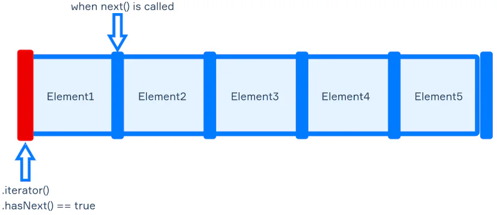

# Loop


Kotlin provides several special statements to repeat blocks of code multiple times. These statements are known as loops

## Loops: repeat statement

To use the simplest loop, write `repeat(n)` and a sequence of statements in curly braces `{...}`. `n` is an integer that determines how many times these statements are going to be repeated.


```kotlin
repeat(n) {
    // statements
}
```

> [!NOTE]
> If n is zero or a negative number, Kotlin will ignore the loop. If n is one, the statements will be executed only once.

## While loop

```kotlin
    while (i < 5) {
        println(i)
        i++
    }
```
## Do...while loop

A `do...while` loop is executed first, after that the program tests a condition.

```kotlin
do {
    // body: do something
} while (condition)
```

## For loop

This is the syntax the for loop has:
```kotlin
for (element in source) {
    // body of loop
}
```
Iterating through a range

```kotlin
for (i in 1..4) {
    println(i)    
}
```

Iterating in the backward order

```kotlin
for (i in 4 downTo 1) {
    println(i)
}
```

> [!NOTE]
> Note that it is required to use in 4 downTo 1, not in 4..1, to iterate the range in reverse order.

Excluding the upper limit

```kotlin
for (i in 1 until 4) {
    println(i)
}
```

Specifying a step

```kotlin
for (i in 1..7 step 2) {
    println(i)
}
//output
//1
//3
//5
//7

```
You can also use it for backward iteration.

```kotlin
for (i in 7 downTo 1 step 2) {
    println(i)
}
```

Iterating through a MutableList

```kotlin
for (element in mutList) {
    // body of loop
}
```
Iterating by indexes

```kotlin
for (index in daysOfWeek.indices){
   // body of loop
}

```
## Interators

### Iterator and immutable collections
An iterator provides access to collection elements sequentially, regardless of their type. It can be seen as a movable pointer to an element of the collection.
`iterator()` returns a special object that can iterate over the collection.

When the variable of an iterator is created, it points to the position **before** the first element of the collection. If you want to move to the next element, call the `next()` function. 
it returns `true` if the iteration still has some elements.

> [!WARNING]
> Notice that when the iterator passes through the last element of a collection, it can no longer retrieve elements.

If you try to invoke `next()` from the iterator after passing the last element in a collection (or for an empty collection), `NoSuchElementException` will be thrown.
In this situation, you should create a new iterator for the collection.



Instead of using the `for` loop, **iterators** support the `forEach()` function. 

```kotlin
var map = mapOf("John" to "chocolate", "Mary" to "sweets", "Sara" to "marmalade")
var iterator = map.iterator()

iterator.forEach { (key, value) ->
    println("$key likes $value")
}


/*
  John likes chocolate
  Mary likes sweets
  Sara likes marmalade
*/
```

### Iterator and mutable collections

Another special iterator variation is `MutableIterator`.
It differs from the previous one in that it works with mutable collections, i.e., with those that can be changed after their creation.

`MutableIterator` extends `Iterator` and provides the `remove()` function, **which removes the last collection element returned by the iterator.**

Ex:

```kotlin
fun main() {
    val numbers = mutableListOf(1, 2, 3, 4, 5)
    val iterator = numbers.iterator() // This is a MutableIterator for a mutable list

    while (iterator.hasNext()) {
        val number = iterator.next()
        if (number % 2 == 0) {
            iterator.remove() // Removes the last returned element if it's even
        }
    }

    println(numbers) // Output: [1, 3, 5]
}
```

### List iterator


Lists have a special type of iterator called `ListIterator`. It allows you to iterate through the list in both directions: forward and backward, while iterators for `Set` or `Map` can iterate only forward. Also, `ListIterator` is able to get the positions of the next and previous elements.

In addition to the common `Iterator` methods, `ListIterator` has the following methods of its own:

- fun `nextIndex()`: Int returns the index of the element that would be returned by calling the `next()` function;

- fun `previous()`: T returns the previous element of the list and moves the iterator's pointer backward;

- fun `hasPrevious()`: `Boolean` returns "true" if there are elements in the iteration before the current element;

- fun `previousIndex()`: Int returns the index of the element that would be returned by calling the `previous()` function.

Let's see an example:
```kotlin
val strings = listOf("i", "like", "donuts")
val listIterator = strings.listIterator()

println("Iterating forwards:")
while (listIterator.hasNext()) listIterator.next()

println("Iterating backwards:")
while (listIterator.hasPrevious()) {
    print("index: ${listIterator.previousIndex()}")
    println(", value: ${listIterator.previous()}")
}
```

As you can see, `ListIterator` can still be used after it reaches the last element.

Mutable lists have their own version of `Iterator` called `MutableListIterator`. `MutableListIterator` is unique for being able not only to remove elements but also replace them and add new ones while traversing the collection.


```kotlin
val words = mutableListOf("i", "know", "Claire")
val mutableListIterator = words.listIterator()

mutableListIterator.next()
mutableListIterator.next()
mutableListIterator.set("don't know")// i , don't know, Claire
mutableListIterator.add("John")
println(words)// i, don't know, John, Claire
```

## Labels

Technically, it's just an identifier with the @ sign at the end, for example: `loop@`, `kotlin@`. You can use almost any word with it, apart from the reserved words in Kotlin. What do you need labels for? Well, you can add your label to a loop:


```kotlin
loop@ for (i in 1..3) { 
    for (j in 1..3) {
        println("i = $i, j = $j")   
        if (j == 3) break@loop  
    }  
}  
```

Both the inner and outer for loops are terminated at the third iteration. The output is this:

```bash
i = 1, j = 1
i = 1, j = 2
i = 1, j = 3
```


